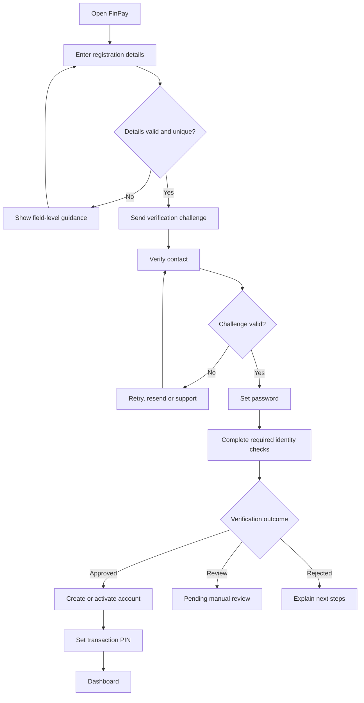
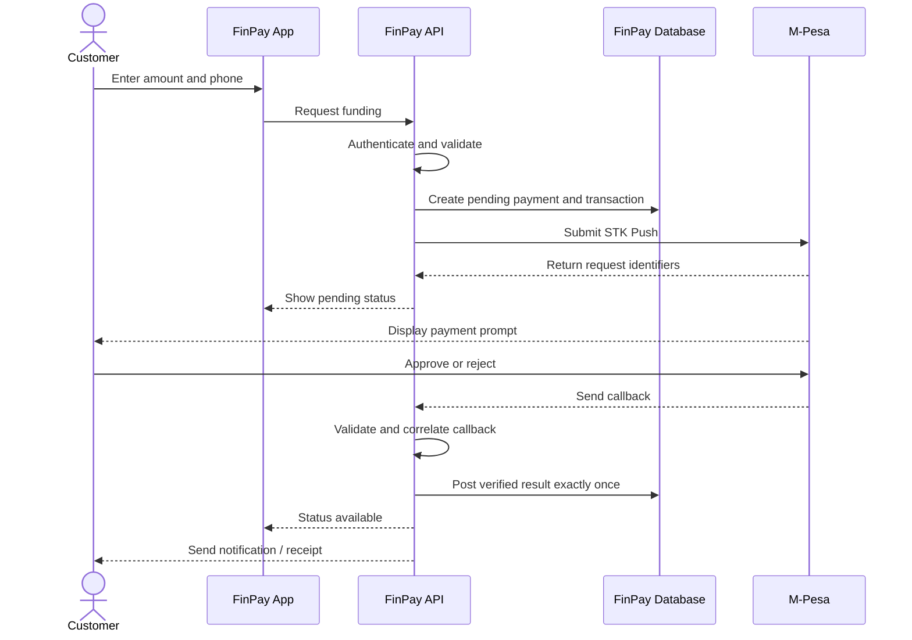

# FinPay Product Specification and UX Blueprint

## 1. Product experience

FinPay should feel secure, clear and dependable. Customers should understand where their money is, what action they are taking, what fees apply, and whether a transaction is pending, successful or unsuccessful.

## 2. Customer roles and needs

| Persona | Needs |
|---|---|
| Everyday customer | Simple onboarding, quick account access, clear balance and history |
| Active transactor | Fast transfers, clear confirmation, receipts and status updates |
| New customer | Guided registration, understandable verification and recovery |
| Support user | Searchable references, accurate timelines and controlled case access |
| Operations user | Payment queues, reconciliation exceptions and audit trails |

## 3. Information architecture

### Customer web/mobile navigation

- Home / Dashboard
- My Account
- Add Money
- Send Money
- Withdraw
- Transactions
- Notifications
- Profile
- Security
- Help and Support
- Settings
- Sign out

### Staff console

- Operations dashboard
- Customers
- Accounts
- Payment requests
- Transfers and payouts
- Reconciliation
- Disputes and cases
- Audit events
- Reports
- User and role administration

Staff functions must be separated from customer-facing functions and protected by dedicated roles and stronger authentication.

## 4. Key screens

1. Welcome / landing screen.
2. Registration.
3. Contact verification.
4. Password creation.
5. Identity verification status.
6. Transaction PIN setup.
7. Login and recovery.
8. Dashboard with available balance and quick actions.
9. Account details.
10. Add money / M-Pesa prompt.
11. Transfer recipient and amount.
12. Transaction confirmation and PIN entry.
13. Withdrawal destination and confirmation.
14. Transaction list and filters.
15. Transaction detail / receipt.
16. Notifications.
17. Profile and security settings.
18. Help and support.
19. Staff operations dashboard.
20. Payment investigation and reconciliation detail.

## 5. UX rules

- Use plain language and avoid unexplained financial jargon.
- Show currency and amount consistently.
- Display fees, limits and net amount before final confirmation.
- Use a review screen for consequential actions.
- Never display a success message before the authoritative backend outcome.
- Distinguish `Initiated`, `Pending`, `Completed`, `Failed`, `Expired`, `Reversed` and `Under review`.
- Provide a transaction reference and next-step guidance for pending or failed actions.
- Avoid exposing full account identifiers or sensitive personal data unnecessarily.
- Use accessible colour contrast, keyboard navigation, semantic labels and scalable text.
- Provide loading, empty, error, offline and retry states.
- Confirm destructive or security-sensitive changes.
- Do not use colour alone to communicate transaction status.

## 6. Visual design direction

The intended visual identity uses a professional fintech style with navy as the primary foundation, gold as a restrained accent and neutral backgrounds for readability. The suggested proportion is approximately 60% navy/dark foundation, 30% neutral surfaces and 10% gold accent. These proportions are a design direction, not a rigid rule for every screen.

Typography should be legible and consistent. Cards should be used to group related information, not to obscure hierarchy. Motion should be subtle and must not delay financial feedback.

## 7. Customer journey — onboarding

## 8. Customer journey — payment funding

## 9. Error and recovery experience

| Situation | Customer message principle |
|---|---|
| Network unavailable | Explain that status may be unknown; advise checking history before retrying |
| Payment pending | Explain that provider confirmation is outstanding |
| Payment rejected | State that no successful funding was recorded, where verified |
| Duplicate submission | Show the original request/reference rather than creating another transaction |
| Insufficient funds | Show required amount and available balance without revealing unnecessary data |
| PIN locked | Explain lock duration or recovery route without exposing security internals |
| Account restricted | Give a support route; do not disclose sensitive risk signals |

## 10. Design deliverables

The design phase should produce user flows, low-fidelity wireframes, high-fidelity mockups, reusable components, responsive breakpoints, accessibility review, clickable prototype and design handoff specifications.
