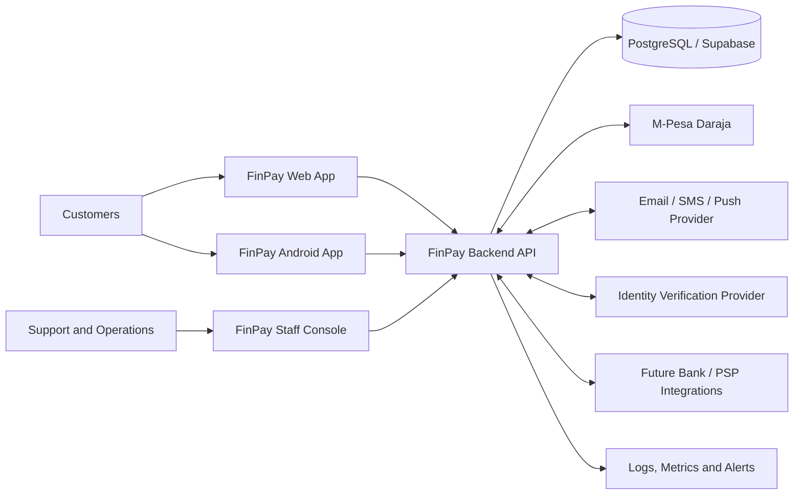
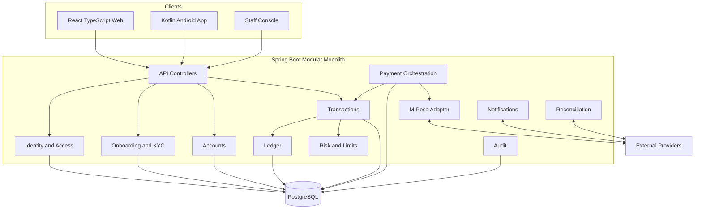
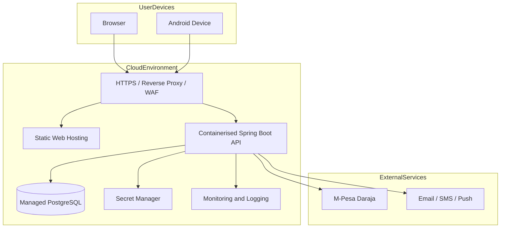

# FinPay Target System Architecture

## 1. Architecture overview

FinPay is intended to begin as a modular monolith: one deployable backend application organised into clear business modules. This avoids premature distributed-system complexity while preserving boundaries that can later be extracted if scale, team structure or operational requirements justify it.

The backend is the authoritative owner of account state, payment instructions, transaction status, financial posting and authorisation decisions. Web and mobile clients consume documented APIs and must not directly mutate financial records.

## 2. Context diagram

## 3. Logical backend modules

| Module | Responsibility |
|---|---|
| Identity and Access | Registration, authentication, sessions, roles, recovery and verification |
| Customer | Customer profile, contact details and preferences |
| Onboarding / KYC | Verification workflow, evidence references, review status and eligibility |
| Account | Account lifecycle, ownership, currency and available balance projection |
| Ledger | Immutable debit/credit postings, balances and financial auditability |
| Transaction | Transfer, deposit, withdrawal, status and reference orchestration |
| Payment Orchestration | Provider-neutral payment initiation, status correlation and retries |
| M-Pesa Adapter | Daraja OAuth, STK Push, callback handling and provider-specific mapping |
| Notification | Email, SMS and push notification dispatch |
| Risk and Limits | Transaction limits, velocity controls, risk flags and step-up requirements |
| Reconciliation | Compare internal records with provider settlement and transaction reports |
| Support and Operations | Case handling, exception queues, approved adjustments and reporting |
| Audit | Security, privileged-action and financial-event audit trail |

## 4. Component diagram

## 5. Deployment view

## 6. Architecture principles

- Modular monolith first; split services only when justified.
- Stateless API instances where possible.
- Database transactions for atomic financial state changes.
- Explicit module ownership and controlled access to repositories.
- Provider adapters isolate external API formats from domain logic.
- Idempotency keys and unique provider identifiers prevent duplicate financial effects.
- Asynchronous processing for callbacks, notifications and reconciliation where appropriate.
- Secrets supplied through managed configuration, never committed to source control.
- Database migrations are versioned and reviewed.
- Observability must correlate customer requests, internal transactions and provider references.

## 7. Financial consistency model

A production-grade target should use a double-entry ledger. The account balance shown to the customer is a derived or reconciled projection of posted ledger entries, not an independently editable value. Each financial operation should create a balanced set of entries within one database transaction, with unique posting identifiers and idempotency protection.

Pending provider activity must not be treated as settled money. External payment state and internal ledger state must be correlated but remain separately identifiable.

## 8. Scalability and resilience

Scale stateless API instances horizontally behind a load balancer. Use database connection pooling, indexed queries, bounded workloads and background workers for asynchronous tasks. Introduce queues only where they provide a clear reliability or throughput benefit. Define tested database backup, point-in-time recovery, restore, health checks and graceful shutdown procedures.

Capacity objectives, including any target for concurrent users or transaction throughput, must be validated through realistic load tests and infrastructure sizing.

## 9. Architecture decision records

Create an ADR for decisions that materially affect the system, including modular monolith selection, database hosting, ledger model, authentication strategy, payment provider abstraction, idempotency, deployment topology, event/queue strategy and any later move to microservices.
