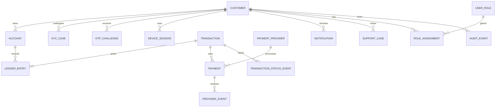

# FinPay Data Model and Data Dictionary

## 1. Data design principles

The data model must preserve ownership, integrity, traceability and privacy. Monetary values must use fixed-precision decimal types, never floating-point types. All financial records must have stable identifiers and references. Sensitive values such as password hashes, PIN hashes, access tokens and provider secrets must never be exposed through ordinary API responses.

## 2. Conceptual entity relationship diagram

## 3. Core entities

| Entity | Purpose | Key fields (conceptual) |
|---|---|---|
| Customer | Customer identity and profile | customer_id, public_id, names, email, phone, status, created_at |
| Account | Financial account owned by a customer | account_id, account_number, customer_id, currency, status |
| LedgerAccount | Accounting control account | ledger_account_id, code, type, currency, status |
| LedgerEntry | Immutable debit/credit posting | entry_id, transaction_id, ledger_account_id, direction, amount, currency, posted_at |
| Transaction | Business-level financial instruction | transaction_id, reference, type, status, amount, currency, created_at, completed_at |
| Payment | External payment-provider instruction | payment_id, transaction_id, provider_id, provider_reference, status, amount |
| ProviderEvent | Raw/normalised provider outcome metadata | event_id, payment_id, event_type, provider_event_id, received_at |
| OTPChallenge | Verification challenge lifecycle | challenge_id, customer_id, channel, purpose, code_hash, expires_at, attempts, status |
| KycCase | Identity verification lifecycle | kyc_case_id, customer_id, provider_reference, status, reviewed_at |
| DeviceSession | Device/session trust and revocation | session_id, customer_id, device_id, issued_at, expires_at, revoked_at |
| Notification | Delivery and notification history | notification_id, customer_id, channel, template, status, sent_at |
| AuditEvent | Security and privileged-action trail | audit_id, actor_id, action, target, outcome, timestamp, correlation_id |
| SupportCase | Customer issue tracking | case_id, customer_id, transaction_id, category, status, assigned_to |

This is a target conceptual model. Final physical schema, normalisation, indexes, constraints and migration scripts must be designed and reviewed before implementation.

## 4. Ledger design

A double-entry ledger records every posted financial movement as balanced debit and credit entries. For each transaction and currency:

**Total debits = total credits.**

A transfer between two customer accounts should debit the sender's liability/account ledger and credit the recipient's liability/account ledger according to the chosen accounting model. Deposits and withdrawals require appropriate external clearing, settlement or cash-control accounts. Exact account mapping must be reviewed by a qualified finance/accounting stakeholder.

Ledger entries should be append-only. Corrections should use linked reversal or adjustment transactions, not deletion or mutation of posted entries.

## 5. Data constraints

- Unique customer public identifier.
- Unique normalised email and phone where business rules require uniqueness.
- Unique account number.
- Explicit account ownership foreign key.
- Unique transaction reference.
- Unique provider event identifier within provider scope.
- Unique idempotency key within its defined client/operation scope.
- Positive transaction amounts and valid currency codes.
- Foreign keys for all business relationships.
- Appropriate indexes for customer history, account lookup, provider correlation and reconciliation.
- Restrict updates/deletes to financial records after posting.
- Use UTC timestamps internally and render local time consistently to customers.

## 6. Data classification

| Classification | Examples | Controls |
|---|---|---|
| Public | Marketing content, public help pages | Integrity and publishing controls |
| Internal | Operational metrics, non-sensitive configuration | Role-restricted access |
| Confidential | Customer profile, account and transaction data | Encryption, least privilege, audit |
| Restricted | Password/PIN hashes, tokens, identity evidence, provider secrets | Strong access restriction, secure storage, masking and strict retention |

## 7. Retention and deletion

Retention periods must be established through legal, regulatory, contractual and operational review. Financial records may be subject to mandatory retention requirements. Customer privacy requests must be handled without unlawfully deleting records that must be retained. Define archival, anonymisation, backup expiry and legal-hold procedures.

## 8. Data dictionary conventions

For each physical column, document: name, type, nullability, default, primary/foreign/unique constraints, allowed values, meaning, sensitivity, source of truth and retention rule. Keep the dictionary aligned with migrations.
