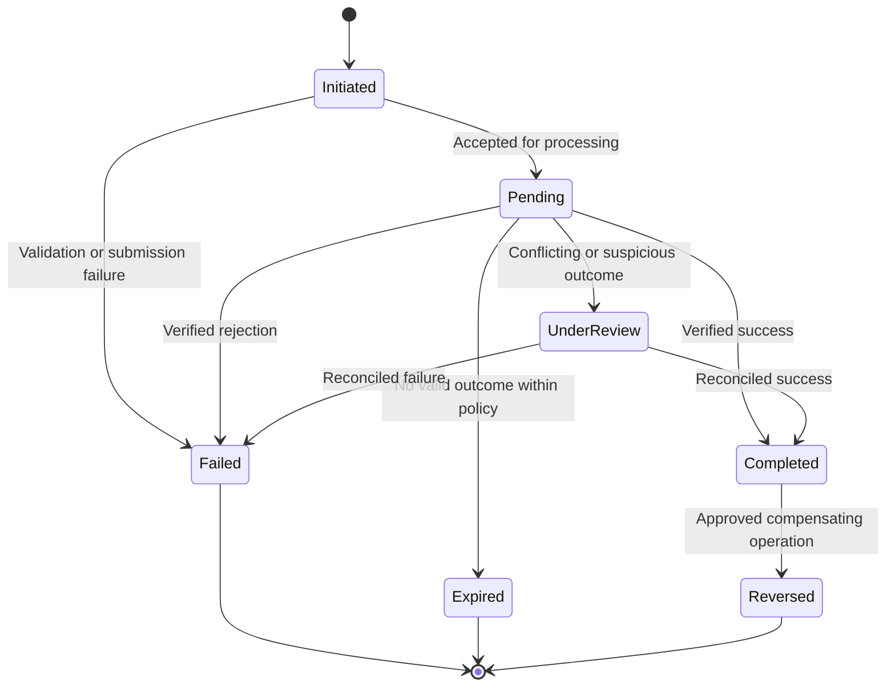

# FinPay Payment System and Financial Processing

## 1. Purpose

This document defines the intended financial processing model for account funding, internal transfers, withdrawals/payouts, provider callbacks, reconciliation, refunds and future payment-network integrations.

## 2. Payment domain concepts

- **Transaction:** the business instruction initiated by a customer or authorised system.
- **Payment:** the external provider interaction used to move money.
- **Ledger posting:** the authoritative internal accounting record of a completed financial movement.
- **Settlement:** the movement of funds between financial institutions or provider settlement accounts.
- **Reconciliation:** comparison of FinPay records against provider/bank records to identify matches and exceptions.
- **Reversal:** a compensating financial operation linked to an earlier posting.

These concepts must not be treated as interchangeable.

## 3. Transaction lifecycle

A provider's acknowledgement that a request was received is not proof that funds moved. Completion requires a verified provider result and successful internal posting.

## 4. Account funding with M-Pesa

Target workflow:
1. Authenticate customer and verify account ownership and eligibility.
2. Validate amount, currency, configured limits and phone number.
3. Display fees and total payable amount before confirmation.
4. Require transaction PIN or other approved step-up authorisation.
5. Create a unique internal transaction and payment record in `PENDING`.
6. Request provider authorisation and initiate STK Push.
7. Store provider merchant and checkout request identifiers.
8. Receive callback through a dedicated public integration endpoint.
9. Validate callback structure, authenticity where supported, provider correlation, amount, currency, account and status.
10. Process callback idempotently and protect against concurrent duplicate delivery.
11. Post the ledger credit only after verified success.
12. Persist provider receipt/reference and status event.
13. Notify customer and make a receipt available.
14. Reconcile provider records and settlement reports.

## 5. Internal transfers

A transfer must be atomic. The system must validate source ownership, recipient eligibility, account status, currency, available balance, limits, risk checks and transaction authorisation. It must then post balanced ledger entries in a single database transaction. If any posting fails, the entire operation must roll back.

Concurrent transfer requests must not permit overspending. Use appropriate database locking or optimistic concurrency/version checks, unique idempotency keys and retry-safe transaction boundaries.

## 6. Withdrawals and payouts

A payout should be represented as a pending instruction until the external provider confirms the outcome. The platform must handle accepted, pending, rejected, timed-out, returned and reversed outcomes. A timeout is not automatically a failure: query or reconcile the provider before allowing a duplicate payout.

## 7. Fees, limits and FX

Fees and limits should be configurable, versioned and disclosed before confirmation. Record the fee calculation and applicable policy version with the transaction. For foreign exchange, retain the quoted rate, quote identifier, quote expiry, source currency, target currency, source amount, target amount, fees and final execution rate. Do not promise live FX until a provider and pricing source are contracted and tested.

## 8. Idempotency and duplicate prevention

- Require an idempotency key for retryable financial initiation endpoints.
- Persist the key, customer, operation, request fingerprint and resulting resource.
- Reject reuse of a key with a different request payload.
- Enforce unique provider callback/event identifiers.
- Lock or atomically transition payment records before posting.
- Make callback processing safe under retries and concurrent delivery.
- Keep a durable provider-event record for investigation.

## 9. Reconciliation

Reconciliation should compare:
- FinPay payment and transaction records.
- Provider request/callback records.
- Provider transaction statements and settlement reports.
- Bank/settlement account statements where applicable.

Exceptions include missing provider records, missing internal records, amount mismatch, duplicate reference, delayed settlement, unexpected reversal and unmatched fee. Every exception should have an owner, status, evidence and resolution record.

## 10. Refunds and reversals

Refunds and reversals must be separate linked operations with reason codes, authorisation, provider reference and audit trail. A completed transaction must not be silently changed to failed. Use compensating ledger entries and maintain the original transaction history.

## 11. ISO 8583 and future payment rails

ISO 8583 is a message standard used in card/payment transaction environments. Any FinPay ISO 8583 capability should be designed as a separate integration adapter with explicit message profiles, field mappings, network management, security, timeouts, reversals, duplicate detection, reconciliation and certification requirements. ISO 8583 support is a future integration direction unless a specific network, host specification and certification environment are available.

## 12. Financial controls

- Maker-checker approval for privileged financial adjustments.
- Segregation of duties between initiation and approval.
- Daily reconciliation and exception ageing.
- Transaction and velocity limits.
- Risk-based step-up authentication.
- Immutable audit records.
- Controlled operational access and break-glass procedures.
- Monitoring for unusual transaction patterns.
