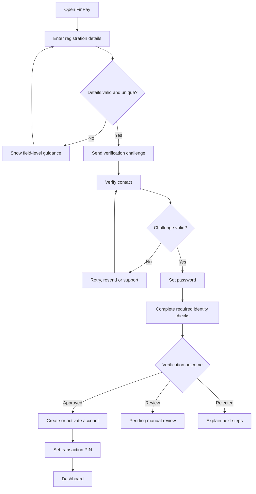
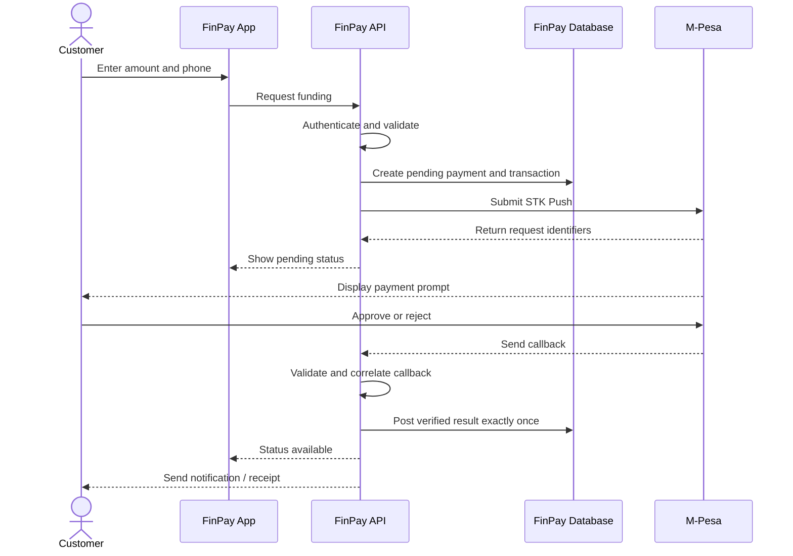
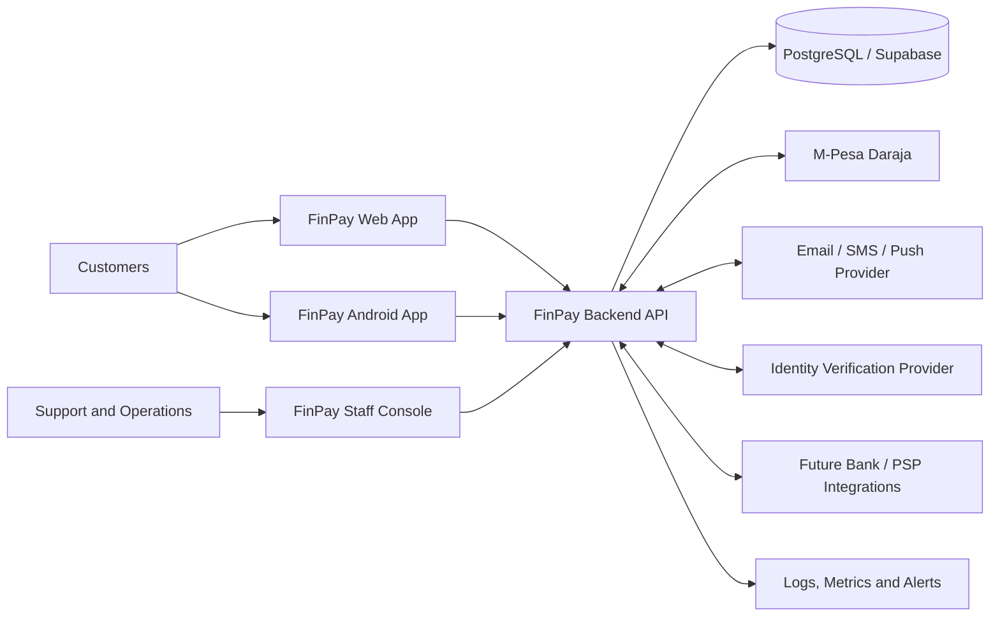
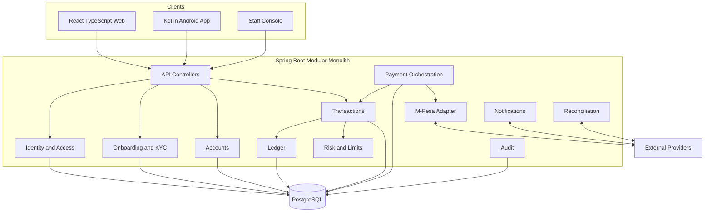
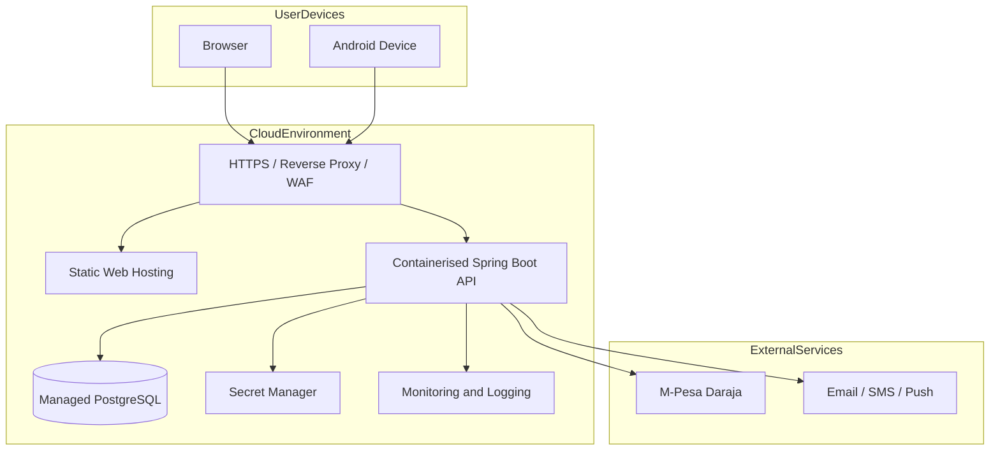
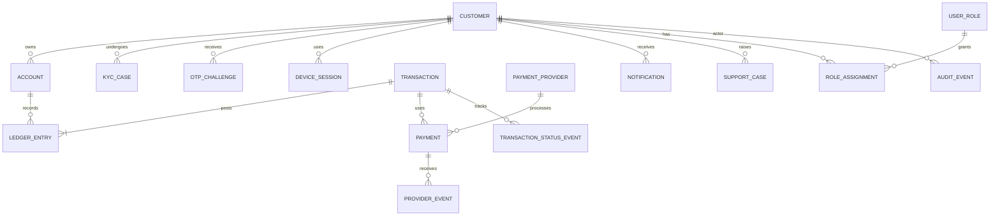
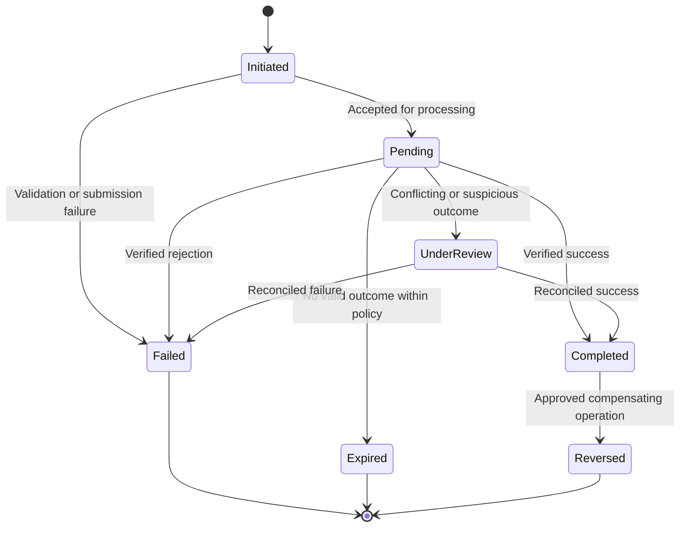

# FinPay: Complete Project Documentation

_Generated 2026-11-06_


---

<!-- source: README.md -->

## FinPay — Complete Project Documentation

**Project:** FinPay
**Document pack:** Target-state product and system specification
**Version:** 1.0
**Audience:** Tracom Academy assessors, product stakeholders, business analysts, developers, QA, operations and future maintainers.

### 1. Documentation purpose

This pack defines the intended FinPay product: what it is meant to solve, who it serves, how it should behave, and how it should be designed, built, tested, secured and operated. It is a forward-looking specification and development baseline, not a declaration that every capability is already implemented.

The documents use these labels:

- **Target requirement:** a capability FinPay is intended to provide.
- **Design decision:** the proposed approach that should guide implementation.
- **Acceptance criterion:** an observable condition used to determine whether a requirement is satisfied.
- **Implementation evidence:** code, test results, configuration or operational evidence that demonstrates delivery. Evidence must be recorded separately from the target requirement.

Existing QA execution reports in `docs/06-qa` and `docs/qa` are retained as historical project evidence. They should not be interpreted as proof that every target-state requirement in this pack has been delivered.

### 2. Product summary

FinPay is a proposed digital financial services platform designed to provide customers with a secure and convenient way to register, access a digital account, manage funds, initiate payments, transfer money, and review transaction activity. The intended initial market is Kenya, with a design that can be extended to additional markets, currencies and payment rails.

The platform is intended to combine a responsive web application, an Android mobile application, a secure backend API, a relational data store, and integrations with external payment providers. M-Pesa is a priority local payment channel. The architecture should allow future integration with banks, card processors, international payment service providers and ISO 8583-based payment networks where commercially and technically appropriate.

### 3. Documentation map

| Area | Document |
|---|---|
| Project overview, scope and objectives | `docs/00-project-foundation/project-charter.md` |
| Business analysis and requirements | `docs/01-business-analysis/business-requirements.md` |
| Product behaviour and user journeys | `docs/02-product-design/product-specification.md` |
| Architecture and technical decisions | `docs/03-system-architecture/system-architecture.md` |
| Data model and dictionary | `docs/04-data-design/data-model.md` |
| Payments and financial processing | `docs/05-payment-system/payment-system.md` |
| API standards and endpoint catalogue | `docs/06-api/api-specification.md` |
| Security, privacy and compliance design | `docs/07-security/security-and-compliance.md` |
| QA approach and acceptance coverage | `docs/08-quality-assurance/quality-assurance-plan.md` |
| Environments, delivery and operations | `docs/09-devops-operations/devops-and-operations.md` |
| Project delivery and risk controls | `docs/10-project-management/project-management-plan.md` |
| End-user and support procedures | `docs/11-user-guides/user-and-support-guide.md` |
| Academic and technical report structure | `docs/12-final-report/final-project-report.md` |
| Shared glossary | `docs/glossary.md` |

### 4. Proposed technology direction

- Backend: Java and Spring Boot REST API.
- Web: React, TypeScript, Vite and Tailwind CSS.
- Mobile: Kotlin and Android Jetpack Compose.
- Data: PostgreSQL, with Supabase-hosted PostgreSQL as the selected hosting direction.
- Authentication: secure password hashing, token-based API authentication and transaction-level authorisation.
- Integrations: M-Pesa Daraja API initially; provider adapters for future payment rails.
- Delivery: Git, automated builds and tests, Docker-based packaging, environment-based configuration and controlled deployment.

Technology versions and provider products must be confirmed against the actual build configuration at implementation time.

### 5. Guiding principles

1. The backend is authoritative for balances, transaction state, account ownership and payment outcomes.
2. Every financial movement must be traceable and auditable.
3. A client must never be trusted to calculate or directly set a financial balance.
4. Payment initiation is not the same as payment completion.
5. Failed, pending, reversed and completed transactions must be represented distinctly.
6. Sensitive information must be protected in transit, at rest and in logs.
7. Customer experience must be accessible, understandable and consistent across web and mobile.
8. The system must be designed for reliability, reconciliation, recovery and controlled growth.
9. Requirements, design, implementation and test evidence must remain traceable.
10. Security and regulatory obligations must be validated with qualified providers and relevant authorities before any live financial service launch.

### 6. Status and change control

This pack describes the intended target state. When implementation decisions change, update the relevant design document and record significant architectural changes as Architecture Decision Records (ADRs). Do not silently change financial rules, API contracts, security assumptions or data definitions.


---

<!-- source: docs/00-project-foundation/project-charter.md -->

## FinPay Project Charter

### 1. Project identity

**Name:** FinPay  
**Category:** Digital financial services / fintech platform  
**Initial market focus:** Kenya  
**Primary interfaces:** Responsive web application and Android mobile application  
**Primary users:** Individual customers, operations/support personnel and system administrators.

### 2. Executive summary

FinPay is intended to provide a unified digital platform through which customers can securely onboard, access a digital account, fund it through supported payment channels, transfer funds, make withdrawals or payouts where supported, and monitor their financial activity. The platform aims to make common digital financial interactions convenient, transparent and accessible while maintaining strong controls over identity, authentication, authorisation, transaction integrity and auditability.

The first product release is intended to establish the core customer and account lifecycle, local payment integration, transaction history, operational visibility and a foundation for future payment-channel expansion.

### 3. Problem statement

Customers often interact with financial services through fragmented channels and inconsistent user experiences. Funding, transfers, transaction tracking and customer support may be spread across separate applications or processes. Users need a clear view of their account activity and understandable transaction outcomes. FinPay is intended to address this by bringing core account and payment interactions into one consistent digital experience.

This statement describes the product opportunity; it is not a claim that all existing financial platforms share the same deficiencies.

### 4. Vision

To provide a secure, accessible and extensible digital financial platform that simplifies everyday money movement and gives customers clear visibility and control over their financial activity.

### 5. Objectives

- Provide a straightforward customer registration and onboarding experience.
- Establish secure customer authentication and account access.
- Provide a digital account view with balances and transaction history.
- Support deposits/funding through approved payment integrations, beginning with M-Pesa.
- Support customer-to-customer transfers subject to account, balance, risk and authorisation controls.
- Support withdrawals or payouts through approved channels when available.
- Give customers clear transaction statuses, references, receipts and notifications.
- Give authorised operations staff tools to investigate and resolve payment issues.
- Maintain a reliable financial record and reconciliation process.
- Establish a modular architecture that can accommodate additional currencies, payment providers and markets.

### 6. Scope

#### 6.1 Intended in-scope capabilities

- Customer registration and onboarding.
- Email and/or phone verification.
- Password setup, login, logout and session/token lifecycle.
- Transaction PIN setup, verification, retry limits and temporary lockout.
- Customer profile and account management.
- Account balance and transaction history.
- M-Pesa STK Push funding and asynchronous callback processing.
- Internal transfers between eligible FinPay accounts.
- Withdrawal/payout workflow through supported providers.
- Payment and transaction status management.
- Receipts, alerts and notifications.
- Customer support and administrative operations.
- Audit logging, monitoring, reconciliation and reporting.
- Web and Android customer experiences.
- Security, QA, DevOps and operational readiness.

#### 6.2 Future or conditional scope

- Multiple currencies and cross-border transfers.
- Bank transfers and card acquiring.
- Additional mobile-money providers.
- ISO 8583 message processing and bank/payment-switch connectivity.
- Merchant payments, bill payments and bulk disbursements.
- Advanced fraud scoring and machine-learning-assisted monitoring.
- Additional regional markets and localisation.

These items require separate business, regulatory, provider and technical assessment before commitment.

#### 6.3 Out of scope for an initial academic MVP unless separately approved

- Acting as a bank or deposit-taking institution.
- Issuing credit or lending.
- Custody of cryptocurrency or trading in digital assets.
- Guaranteed real-world settlement without a contracted and tested provider.
- Production financial services before licensing, compliance, security and provider approvals are satisfied.

### 7. Stakeholders and responsibilities

| Stakeholder | Interest / responsibility |
|---|---|
| Product owner | Product vision, scope, priorities and acceptance |
| Business analyst | Requirements, workflows, business rules and traceability |
| Project manager | Schedule, resources, risks, communication and change control |
| Solution architect | Architecture, integrations, non-functional design and technical decisions |
| Backend developer | API, domain logic, payment orchestration and data access |
| Web developer | Responsive customer and staff web interfaces |
| Android developer | Kotlin mobile application and device integration |
| QA engineer | Test design, execution, defect tracking and quality reporting |
| Security reviewer | Threat assessment, security controls and verification |
| Operations/support | Monitoring, reconciliation, customer issue handling and incident response |
| Customers | Use the platform and provide feedback through approved channels |
| External providers | Payment execution, identity/communications services and settlement reporting |

### 8. Success measures

Targets should be agreed before release and measured using evidence. Candidate measures include onboarding completion rate, successful payment completion rate, transfer success rate, transaction-status accuracy, support resolution time, application availability, API latency, reconciliation variance, security defect closure and customer satisfaction.

Do not assign numerical targets without a baseline, capacity plan and business approval.

### 9. Assumptions and dependencies

- FinPay will use a regulated and appropriately authorised provider for payment execution.
- Provider sandbox access, credentials, callback configuration and documentation will be available.
- Supabase-hosted PostgreSQL is the current database hosting direction.
- Email/SMS delivery requires an approved external provider.
- Legal, compliance and operational requirements will be reviewed before live launch.
- External provider uptime, limits, fees and settlement timelines affect service behaviour.

### 10. Constraints

The project is developed within an academic/capstone context and has finite time and resources. Live payment processing, regulatory permissions, provider onboarding, penetration testing and production operations may require external approvals and services beyond the project team's direct control.

### 11. High-level delivery phases

1. Product definition and business analysis.
2. UX research, journeys and interface design.
3. Architecture, database and API contracts.
4. Customer onboarding and account foundation.
5. Core account and transaction services.
6. M-Pesa and payment-provider integration.
7. Web and Android application completion.
8. Security hardening and QA.
9. Deployment, monitoring and operational validation.
10. UAT, documentation, presentation and controlled release decision.


---

<!-- source: docs/01-business-analysis/business-requirements.md -->

## FinPay Business Analysis and Requirements

### 1. Purpose

This document defines the intended business capabilities and functional/non-functional requirements for FinPay. Requirements are target-state requirements until implementation and acceptance evidence are recorded.

### 2. Business goals

- Simplify access to everyday digital financial services.
- Provide transparent and traceable money movement.
- Reduce uncertainty around payment status and transaction history.
- Provide consistent experiences across web and Android.
- Establish a foundation for additional payment providers and markets.

### 3. Actors

- **Customer:** registers, authenticates, views account information, funds an account, transfers funds, requests payouts and views transaction records.
- **Support agent:** investigates customer issues using restricted, audited access.
- **Operations officer:** monitors payment queues, reconciles provider activity and manages permitted operational exceptions.
- **Administrator:** manages roles, configuration and access under least-privilege controls.
- **Payment provider:** processes external payment requests and sends asynchronous status notifications.
- **Notification provider:** delivers approved email, SMS or push messages.

### 4. Functional requirements

| ID | Requirement |
|---|---|
| FR-001 | The system shall allow a customer to register with the required identity and contact details. |
| FR-002 | The system shall verify nominated contact channels before activating the relevant account capabilities. |
| FR-003 | The system shall securely store passwords using an approved adaptive password-hashing algorithm. |
| FR-004 | The system shall allow customers to authenticate and securely terminate sessions. |
| FR-005 | The system shall support transaction PIN setup and verification for sensitive financial actions. |
| FR-006 | The system shall enforce retry limits and temporary lockout for failed PIN attempts. |
| FR-007 | The system shall allow an eligible customer to view their account details and available balance. |
| FR-008 | The system shall allow customers to initiate account funding through supported payment providers. |
| FR-009 | The system shall maintain payment requests and asynchronous provider outcomes as distinct states. |
| FR-010 | The system shall credit an account only after a valid, verified funding outcome has been accepted. |
| FR-011 | The system shall allow eligible customers to transfer funds to another eligible FinPay account. |
| FR-012 | The system shall validate balance, currency, account status, limits and authorisation before a transfer. |
| FR-013 | The system shall prevent duplicate processing of the same financial instruction. |
| FR-014 | The system shall support withdrawal/payout requests through approved providers where enabled. |
| FR-015 | The system shall provide transaction history, references, statuses and receipts. |
| FR-016 | The system shall notify customers of important account and transaction events. |
| FR-017 | The system shall provide authorised operations users with payment investigation and reconciliation tools. |
| FR-018 | The system shall maintain immutable or tamper-evident audit records for sensitive actions. |
| FR-019 | The system shall enforce role-based access for customer, support, operations and administrator functions. |
| FR-020 | The system shall provide a responsive web experience and an Android mobile experience. |
| FR-021 | The system shall support customer support workflows for disputed, delayed or failed transactions. |
| FR-022 | The system shall support configurable transaction limits and risk controls. |

### 5. Non-functional requirements

| ID | Quality attribute | Requirement |
|---|---|---|
| NFR-001 | Security | Protect credentials, tokens, PINs and payment data using current security practices. |
| NFR-002 | Privacy | Collect and process only data needed for defined purposes; apply retention and access controls. |
| NFR-003 | Integrity | Financial state changes must be atomic, traceable and protected against duplicate or concurrent processing. |
| NFR-004 | Availability | Define availability objectives and recovery targets before production release. |
| NFR-005 | Performance | Establish measurable latency and throughput targets through workload modelling and testing. |
| NFR-006 | Scalability | Support horizontal scaling of stateless application components where appropriate. |
| NFR-007 | Usability | Use clear language, consistent navigation, accessible controls and understandable transaction statuses. |
| NFR-008 | Compatibility | Support agreed modern browsers and Android versions. |
| NFR-009 | Maintainability | Use modular boundaries, code review, automated tests and documented interfaces. |
| NFR-010 | Observability | Record structured logs, metrics, traces and actionable alerts without exposing secrets. |
| NFR-011 | Recoverability | Maintain tested backup, restore and disaster-recovery procedures. |
| NFR-012 | Auditability | Retain traceable records of financial and privileged operations in line with approved retention policy. |

Numerical service-level objectives must be approved and supported by measured capacity and operational evidence.

### 6. Core business rules

1. A customer may access only their own profile, account and transaction information unless an explicitly authorised staff role permits otherwise.
2. A customer must complete the required onboarding checks before account capabilities are activated.
3. A transaction PIN is required for defined high-risk financial actions.
4. A transaction amount must be greater than zero and comply with configured limits.
5. A transfer must not debit more than the available spendable balance.
6. Source and destination accounts must be eligible and compatible with the transaction currency.
7. A transaction reference must be unique.
8. An external payment request remains pending until a trusted provider outcome is processed.
9. Duplicate callbacks or repeated requests must not create duplicate financial effects.
10. Reversals and refunds must be represented as linked compensating financial entries; historical financial records must not be silently overwritten.
11. Staff actions must be authorised, attributable and audited.
12. Customer-facing statuses must not imply settlement when only initiation or acceptance has occurred.

### 7. Key use cases

#### UC-01 — Customer onboarding

**Primary actor:** Customer  
**Preconditions:** Customer has access to a valid contact channel.  
**Main flow:** Submit registration details → validate details → send verification challenge → verify contact → set password → complete required identity checks → create/activate account → set transaction PIN → show onboarding completion.  
**Alternative flows:** Duplicate contact, invalid challenge, expired challenge, retry limit reached, provider delivery failure, identity review required.  
**Postcondition:** Customer profile and account are in the appropriate lifecycle state.

#### UC-02 — Fund account using M-Pesa

**Primary actor:** Customer  
**Preconditions:** Customer is authenticated, account is eligible and provider integration is available.  
**Main flow:** Enter amount and phone → review fee/amount → confirm with transaction PIN or required step-up control → create pending payment instruction → request STK Push → customer approves on handset → provider sends callback → validate callback and correlate payment → post financial credit exactly once → notify customer and provide receipt.  
**Alternative flows:** Rejected prompt, timeout, cancelled request, callback delay, invalid callback, duplicate callback, amount mismatch or reconciliation exception.  
**Postcondition:** Payment and account ledger reflect the verified outcome.

#### UC-03 — Internal transfer

**Primary actor:** Customer  
**Preconditions:** Customer is authenticated and source account is eligible.  
**Main flow:** Select recipient → enter amount → show confirmation → verify transaction PIN → validate limits and available balance → atomically post debit and credit entries → issue reference and receipt → notify parties.  
**Alternative flows:** Invalid recipient, insufficient funds, account restriction, PIN lockout, duplicate request, concurrent debit conflict or posting failure.  
**Postcondition:** Both sides of the transfer are consistent or neither side is posted.

#### UC-04 — Withdrawal or payout

**Primary actor:** Customer  
**Preconditions:** A payout provider and customer eligibility are configured.  
**Main flow:** Select destination/channel → enter amount → review fees and net payout → authenticate action → validate balance and limits → create pending payout → submit to provider → process asynchronous outcome → post completion or failure/reversal → notify customer.  
**Alternative flows:** Provider unavailable, rejection, timeout, pending result, returned payout or reconciliation mismatch.

#### UC-05 — Transaction investigation

**Primary actor:** Support/operations user  
**Preconditions:** Staff user has appropriate role and case-related access.  
**Main flow:** Search by reference → verify customer and permissions → inspect lifecycle and provider events → compare ledger and provider records → record findings → initiate approved resolution workflow.  
**Postcondition:** Case activity is recorded and any financial adjustment follows maker-checker controls.

### 8. Acceptance principles

A requirement is accepted only when its acceptance criteria are met, the relevant tests have passed, defects are resolved or formally accepted, and evidence is linked. A written requirement alone does not prove delivery.


---

<!-- source: docs/01-business-analysis/requirements-traceability-matrix.md -->

## FinPay Requirements Traceability Matrix (RTM)

**Document version:** 1.1  
**Document status:** Target-state baseline  
**Project:** FinPay  
**Related documents:**
- `business-requirements.md`
- `../02-product-design/product-specification.md`
- `../03-system-architecture/system-architecture.md`
- `../04-data-design/data-model.md`
- `../05-payment-system/payment-system.md`
- `../06-api/api-specification.md`
- `../06-qa/test-cases.md`
- `../06-qa/api-test-cases.md`
- `../06-qa/integration-test-cases.md`
- `../06-qa/security-test-cases.md`
- `../06-qa/performance-test-cases.md`
- `../06-qa/uat.md`
- `../06-qa/coverage-gap-register.md`

### 1. Purpose

This matrix traces FinPay business and non-functional requirements
to design artefacts and verification scenarios.

It covers the intended FinPay product, not only the functionality
implemented in the current development baseline.

A requirement can be documented while its implementation or testing
is still pending. Design references and planned test cases do not
constitute implementation or acceptance evidence.

### 2. Status Definitions

| Status | Meaning |
|---|---|
| Planned | Requirement is approved or included in the target baseline but implementation or verification is not established |
| In Progress | Implementation or verification is underway |
| Implemented | Implementation evidence has been reviewed |
| Tested | Relevant tests have passed with recorded evidence |
| Accepted | Authorised business acceptance has been recorded |
| Deferred | Requirement is intentionally postponed with documented rationale |

Status changes require evidence and review. A PASS in a narrow
historical test does not automatically mark the entire requirement
as Tested or Accepted.

### 3. Functional Requirements Traceability

| ID | Requirement | Design reference | Verification references | Current status |
|---|---|---|---|---|
| FR-001 | Customer registration | `../02-product-design/product-specification.md`; `../04-data-design/data-model.md` | USER-001–004; API-TC-005; INT-005; UAT-001 | Planned |
| FR-002 | Contact verification using OTP | `../02-product-design/product-specification.md`; `../07-security/security-and-compliance.md` | SEC-OTP-001–003; UAT-015–016 | Planned |
| FR-003 | Secure password protection | `../07-security/security-and-compliance.md` | SEC-001; SEC-AUTH-006; AUTH-002; API-TC-002 | Planned |
| FR-004 | Customer authentication and logout | `../06-api/api-specification.md`; `../07-security/security-and-compliance.md` | AUTH-001–007; API-TC-001–004; API-TC-019–021; INT-004; INT-006; UAT-002–003; UAT-005 | Planned |
| FR-005 | Transaction PIN setup, verification and reset | `../07-security/security-and-compliance.md`; `../02-product-design/product-specification.md` | SEC-PIN-001; SEC-PIN-002; SEC-PIN-004; UAT-017–018; UAT-020 | Planned |
| FR-006 | PIN retry limits and lockout | `../07-security/security-and-compliance.md` | SEC-PIN-003; UAT-019 | Planned |
| FR-007 | Customer account and balance view | `../04-data-design/data-model.md`; `../02-product-design/product-specification.md` | ACC-001–004; API-TC-006; INT-003; INT-007; UAT-004 | Planned |
| FR-008 | Account funding through approved payment channels | `../05-payment-system/payment-system.md` | TXN-001–004; API-TC-008–010; INT-009; UAT-006; UAT-021–022 | Planned |
| FR-009 | Asynchronous payment lifecycle and status | `../05-payment-system/payment-system.md` | INT-009–012; SEC-PAY-001–004; UAT-021–025 | Planned |
| FR-010 | Verified funding credit and financial posting | `../05-payment-system/payment-system.md`; `../04-data-design/data-model.md` | SEC-PAY-001; SEC-PAY-003; INT-010–012; UAT-022–024; UAT-031 | Planned |
| FR-011 | Internal customer transfers | `../05-payment-system/payment-system.md`; `../04-data-design/data-model.md` | TXN-008–011; API-TC-014–016; INT-008; UAT-009–010; UAT-031 | Planned |
| FR-012 | Transfer eligibility, ownership and limits | `../01-business-analysis/business-requirements.md`; `../07-security/security-and-compliance.md` | ACC-003; TXN-010–011; SEC-ACCESS-001–004; SEC-PAY-004; UAT-010; UAT-012 | Planned |
| FR-013 | Duplicate transaction and callback prevention | `../05-payment-system/payment-system.md` | SEC-PAY-002; SEC-PAY-004; INT-011; UAT-024 | Planned |
| FR-014 | Withdrawals and external payouts | `../05-payment-system/payment-system.md` | TXN-005–007; API-TC-011–013; UAT-007–008; provider payout tests not yet defined | Planned |
| FR-015 | Transaction history and receipts | `../06-api/api-specification.md`; `../02-product-design/product-specification.md` | TXN-012–013; API-TC-017–018; UAT-014; UAT-026 | Planned |
| FR-016 | Customer notifications | `../11-user-guides/user-and-support-guide.md`; `../03-system-architecture/system-architecture.md` | INT-015; UAT-027; delivery and preference tests to be expanded | Planned |
| FR-017 | Operations and reconciliation | `../05-payment-system/payment-system.md`; `../03-system-architecture/system-architecture.md` | INT-016; UAT-030; reconciliation exception tests to be expanded | Planned |
| FR-018 | Auditable financial and security events | `../07-security/security-and-compliance.md`; `../05-payment-system/payment-system.md` | SEC-DATA-001; INT-016; INT-017; UAT-035; audit completeness tests to be expanded | Planned |
| FR-019 | Role-based access control | `../07-security/security-and-compliance.md` | SEC-ACCESS-002–004; INT-017; UAT-029 | Planned |
| FR-020 | Web and Android customer applications | `../02-product-design/product-specification.md`; `../03-system-architecture/system-architecture.md` | REG-003; PERF-009; INT-013–014; UAT-013; UAT-032–033; full client compatibility tests required | Planned |
| FR-021 | Customer support workflows | `../11-user-guides/user-and-support-guide.md` | UAT-028; support case lifecycle and access tests to be added | Planned |
| FR-022 | Configurable transaction limits and risk controls | `../05-payment-system/payment-system.md`; `../07-security/security-and-compliance.md` | SEC-PAY-003–004; SEC-PIN-003; limit boundary and risk-rule tests to be added | Planned |

#### Functional traceability notes

1. Existing master test cases and API cases cover selected development
   workflows. Their historical results do not establish full target-state
   requirement acceptance.
2. Generic deposit tests do not prove M-Pesa initiation, callback
   verification, provider settlement or exactly-once posting.
3. Existing withdrawal tests do not prove an external payout provider
   lifecycle.
4. OTP and PIN cases are newly documented and have not been executed.
5. Android and web target workflows require release-specific client
   verification.
6. Requirements remain Planned until implementation and evidence are
   reviewed.

### 4. Non-Functional Requirements Traceability

| ID | Requirement | Verification references | Additional evidence required | Current status |
|---|---|---|---|---|
| NFR-001 | Security | SEC-001–004; SEC-AUTH-001–007; SEC-ACCESS-001–004; SEC-INPUT-001–003; SEC-PAY-001–004; SEC-DATA-001–003; SEC-CLIENT-001–002; SEC-INFRA-001–003; SEC-OTP-001–003; SEC-PIN-001–004 | Security assessment, remediation and release review | Planned |
| NFR-002 | Privacy and data protection | SEC-DATA-001–003; SEC-CLIENT-001–002 | Privacy review, retention and data-subject process verification | Planned |
| NFR-003 | Financial integrity | DB-001–003; SEC-PAY-002–004; INT-008–012; UAT-014; UAT-022–024; UAT-031 | Ledger balancing, atomicity, reversal and reconciliation evidence | Planned |
| NFR-004 | Availability and reliability | PERF-007; PERF-010; PERF-012; INT-012 | Availability monitoring, dependency failure and recovery evidence | Planned |
| NFR-005 | Performance | PERF-001–003; PERF-006–008; PERF-011–012 | Measured results against approved targets | Planned |
| NFR-006 | Scalability | PERF-004–005; PERF-011–012 | Defined capacity model, horizontal scaling and repeatable load evidence | Planned |
| NFR-007 | Usability and accessibility | UAT-025–028; UAT-032–034 | Usability review and accessibility evaluation | Planned |
| NFR-008 | Compatibility | INT-013–014; UAT-032–033; PERF-009 | Supported browser and Android device matrix results | Planned |
| NFR-009 | Maintainability | REG-001–003; build and static analysis records | Code review, dependency and maintainability assessment | Planned |
| NFR-010 | Observability | SEC-DATA-001; INT-015–017 | Log, metric, trace, alert and incident-response verification | Planned |
| NFR-011 | Recoverability | PERF-010; INT-012 | Backup restoration, recovery objectives and data consistency tests | Planned |
| NFR-012 | Auditability | SEC-DATA-001; INT-016–017; UAT-035 | Audit completeness, access review, retention and tamper-resistance evidence | Planned |

### 5. Test Suite Reference Catalogue

| Suite | Identifier range | Purpose |
|---|---|---|
| Master functional suite | AUTH-001–007 | Authentication |
| Master functional suite | USER-001–004 | User registration |
| Master functional suite | ACC-001–004 | Account operations |
| Master functional suite | TXN-001–013 | Transaction operations |
| Master validation suite | VAL-001–003 | Input validation |
| Master API suite | API-001–003 | General API access |
| Master database suite | DB-001–003 | Database consistency |
| Master security suite | SEC-001–004 | Baseline security |
| Master regression suite | REG-001–003 | Regression checks |
| Dedicated API suite | API-TC-001–021 | API functional and authentication checks |
| Integration suite | INT-001–018 | Component and provider integration |
| Security suite | SEC-AUTH, SEC-ACCESS, SEC-INPUT, SEC-PAY, SEC-DATA, SEC-CLIENT, SEC-INFRA, SEC-OTP, SEC-PIN | Security verification |
| Performance suite | PERF-001–012 | Performance and load |
| UAT suite | UAT-001–035 | Business acceptance |

A test ID is a reference to a scenario, not proof that it has passed.

### 6. Evidence Register

Evidence should be maintained with:

- Requirement ID
- Test case ID
- Build or release version
- Environment
- Execution date
- Actual result
- Test status
- Evidence reference
- Defect reference
- Reviewer or approver

Sensitive credentials, passwords, OTPs, PINs, JWTs and production
secrets must not be included in evidence.

Historical execution evidence remains in the relevant QA documents.
New tests remain Not Executed or Planned until actual execution is
recorded.

### 7. Coverage Gap Management

The QA coverage gap register is maintained at:

`../06-qa/coverage-gap-register.md`

It records missing scenarios, planned verification, priorities,
dependencies and closure evidence.

A requirement must not be marked Tested or Accepted solely because
a design document or test case exists.

### 8. Change Control

Changes to requirements must be reflected in:

1. Business requirements.
2. Product specification and architecture where relevant.
3. API, data and payment documentation where relevant.
4. Test cases and UAT scenarios.
5. This traceability matrix.
6. The QA coverage gap register.

Changes to status must include evidence and reviewer details.

### 9. Overall Traceability Status

**Target-state requirement coverage:** Documented.

**Implementation verification:** In progress.

**Full target-state test execution:** Pending.

**Business acceptance:** Pending.

**Production release approval:** Pending.


---

<!-- source: docs/02-product-design/product-specification.md -->

## FinPay Product Specification and UX Blueprint

### 1. Product experience

FinPay should feel secure, clear and dependable. Customers should understand where their money is, what action they are taking, what fees apply, and whether a transaction is pending, successful or unsuccessful.

### 2. Customer roles and needs

| Persona | Needs |
|---|---|
| Everyday customer | Simple onboarding, quick account access, clear balance and history |
| Active transactor | Fast transfers, clear confirmation, receipts and status updates |
| New customer | Guided registration, understandable verification and recovery |
| Support user | Searchable references, accurate timelines and controlled case access |
| Operations user | Payment queues, reconciliation exceptions and audit trails |

### 3. Information architecture

#### Customer web/mobile navigation

- Home / Dashboard
- My Account
- Add Money
- Send Money
- Withdraw
- Transactions
- Notifications
- Profile
- Security
- Help and Support
- Settings
- Sign out

#### Staff console

- Operations dashboard
- Customers
- Accounts
- Payment requests
- Transfers and payouts
- Reconciliation
- Disputes and cases
- Audit events
- Reports
- User and role administration

Staff functions must be separated from customer-facing functions and protected by dedicated roles and stronger authentication.

### 4. Key screens

1. Welcome / landing screen.
2. Registration.
3. Contact verification.
4. Password creation.
5. Identity verification status.
6. Transaction PIN setup.
7. Login and recovery.
8. Dashboard with available balance and quick actions.
9. Account details.
10. Add money / M-Pesa prompt.
11. Transfer recipient and amount.
12. Transaction confirmation and PIN entry.
13. Withdrawal destination and confirmation.
14. Transaction list and filters.
15. Transaction detail / receipt.
16. Notifications.
17. Profile and security settings.
18. Help and support.
19. Staff operations dashboard.
20. Payment investigation and reconciliation detail.

### 5. UX rules

- Use plain language and avoid unexplained financial jargon.
- Show currency and amount consistently.
- Display fees, limits and net amount before final confirmation.
- Use a review screen for consequential actions.
- Never display a success message before the authoritative backend outcome.
- Distinguish `Initiated`, `Pending`, `Completed`, `Failed`, `Expired`, `Reversed` and `Under review`.
- Provide a transaction reference and next-step guidance for pending or failed actions.
- Avoid exposing full account identifiers or sensitive personal data unnecessarily.
- Use accessible colour contrast, keyboard navigation, semantic labels and scalable text.
- Provide loading, empty, error, offline and retry states.
- Confirm destructive or security-sensitive changes.
- Do not use colour alone to communicate transaction status.

### 6. Visual design direction

The intended visual identity uses a professional fintech style with navy as the primary foundation, gold as a restrained accent and neutral backgrounds for readability. The suggested proportion is approximately 60% navy/dark foundation, 30% neutral surfaces and 10% gold accent. These proportions are a design direction, not a rigid rule for every screen.

Typography should be legible and consistent. Cards should be used to group related information, not to obscure hierarchy. Motion should be subtle and must not delay financial feedback.

### 7. Customer journey — onboarding



### 8. Customer journey — payment funding



### 9. Error and recovery experience

| Situation | Customer message principle |
|---|---|
| Network unavailable | Explain that status may be unknown; advise checking history before retrying |
| Payment pending | Explain that provider confirmation is outstanding |
| Payment rejected | State that no successful funding was recorded, where verified |
| Duplicate submission | Show the original request/reference rather than creating another transaction |
| Insufficient funds | Show required amount and available balance without revealing unnecessary data |
| PIN locked | Explain lock duration or recovery route without exposing security internals |
| Account restricted | Give a support route; do not disclose sensitive risk signals |

### 10. Design deliverables

The design phase should produce user flows, low-fidelity wireframes, high-fidelity mockups, reusable components, responsive breakpoints, accessibility review, clickable prototype and design handoff specifications.


---

<!-- source: docs/03-system-architecture/system-architecture.md -->

## FinPay Target System Architecture

### 1. Architecture overview

FinPay is intended to begin as a modular monolith: one deployable backend application organised into clear business modules. This avoids premature distributed-system complexity while preserving boundaries that can later be extracted if scale, team structure or operational requirements justify it.

The backend is the authoritative owner of account state, payment instructions, transaction status, financial posting and authorisation decisions. Web and mobile clients consume documented APIs and must not directly mutate financial records.

### 2. Context diagram



### 3. Logical backend modules

| Module | Responsibility |
|---|---|
| Identity and Access | Registration, authentication, sessions, roles, recovery and verification |
| Customer | Customer profile, contact details and preferences |
| Onboarding / KYC | Verification workflow, evidence references, review status and eligibility |
| Account | Account lifecycle, ownership, currency and available balance projection |
| Ledger | Immutable debit/credit postings, balances and financial auditability |
| Transaction | Transfer, deposit, withdrawal, status and reference orchestration |
| Payment Orchestration | Provider-neutral payment initiation, status correlation and retries |
| M-Pesa Adapter | Daraja OAuth, STK Push, callback handling and provider-specific mapping |
| Notification | Email, SMS and push notification dispatch |
| Risk and Limits | Transaction limits, velocity controls, risk flags and step-up requirements |
| Reconciliation | Compare internal records with provider settlement and transaction reports |
| Support and Operations | Case handling, exception queues, approved adjustments and reporting |
| Audit | Security, privileged-action and financial-event audit trail |

### 4. Component diagram



### 5. Deployment view



### 6. Architecture principles

- Modular monolith first; split services only when justified.
- Stateless API instances where possible.
- Database transactions for atomic financial state changes.
- Explicit module ownership and controlled access to repositories.
- Provider adapters isolate external API formats from domain logic.
- Idempotency keys and unique provider identifiers prevent duplicate financial effects.
- Asynchronous processing for callbacks, notifications and reconciliation where appropriate.
- Secrets supplied through managed configuration, never committed to source control.
- Database migrations are versioned and reviewed.
- Observability must correlate customer requests, internal transactions and provider references.

### 7. Financial consistency model

A production-grade target should use a double-entry ledger. The account balance shown to the customer is a derived or reconciled projection of posted ledger entries, not an independently editable value. Each financial operation should create a balanced set of entries within one database transaction, with unique posting identifiers and idempotency protection.

Pending provider activity must not be treated as settled money. External payment state and internal ledger state must be correlated but remain separately identifiable.

### 8. Scalability and resilience

Scale stateless API instances horizontally behind a load balancer. Use database connection pooling, indexed queries, bounded workloads and background workers for asynchronous tasks. Introduce queues only where they provide a clear reliability or throughput benefit. Define tested database backup, point-in-time recovery, restore, health checks and graceful shutdown procedures.

Capacity objectives, including any target for concurrent users or transaction throughput, must be validated through realistic load tests and infrastructure sizing.

### 9. Architecture decision records

Create an ADR for decisions that materially affect the system, including modular monolith selection, database hosting, ledger model, authentication strategy, payment provider abstraction, idempotency, deployment topology, event/queue strategy and any later move to microservices.


---

<!-- source: docs/04-data-design/data-model.md -->

## FinPay Data Model and Data Dictionary

### 1. Data design principles

The data model must preserve ownership, integrity, traceability and privacy. Monetary values must use fixed-precision decimal types, never floating-point types. All financial records must have stable identifiers and references. Sensitive values such as password hashes, PIN hashes, access tokens and provider secrets must never be exposed through ordinary API responses.

### 2. Conceptual entity relationship diagram



### 3. Core entities

| Entity | Purpose | Key fields (conceptual) |
|---|---|---|
| Customer | Customer identity and profile | customer_id, public_id, names, email, phone, status, created_at |
| Account | Financial account owned by a customer | account_id, account_number, customer_id, currency, status |
| LedgerAccount | Accounting control account | ledger_account_id, code, type, currency, status |
| LedgerEntry | Immutable debit/credit posting | entry_id, transaction_id, ledger_account_id, direction, amount, currency, posted_at |
| Transaction | Business-level financial instruction | transaction_id, reference, type, status, amount, currency, created_at, completed_at |
| Payment | External payment-provider instruction | payment_id, transaction_id, provider_id, provider_reference, status, amount |
| ProviderEvent | Raw/normalised provider outcome metadata | event_id, payment_id, event_type, provider_event_id, received_at |
| OTPChallenge | Verification challenge lifecycle | challenge_id, customer_id, channel, purpose, code_hash, expires_at, attempts, status |
| KycCase | Identity verification lifecycle | kyc_case_id, customer_id, provider_reference, status, reviewed_at |
| DeviceSession | Device/session trust and revocation | session_id, customer_id, device_id, issued_at, expires_at, revoked_at |
| Notification | Delivery and notification history | notification_id, customer_id, channel, template, status, sent_at |
| AuditEvent | Security and privileged-action trail | audit_id, actor_id, action, target, outcome, timestamp, correlation_id |
| SupportCase | Customer issue tracking | case_id, customer_id, transaction_id, category, status, assigned_to |

This is a target conceptual model. Final physical schema, normalisation, indexes, constraints and migration scripts must be designed and reviewed before implementation.

### 4. Ledger design

A double-entry ledger records every posted financial movement as balanced debit and credit entries. For each transaction and currency:

**Total debits = total credits.**

A transfer between two customer accounts should debit the sender's liability/account ledger and credit the recipient's liability/account ledger according to the chosen accounting model. Deposits and withdrawals require appropriate external clearing, settlement or cash-control accounts. Exact account mapping must be reviewed by a qualified finance/accounting stakeholder.

Ledger entries should be append-only. Corrections should use linked reversal or adjustment transactions, not deletion or mutation of posted entries.

### 5. Data constraints

- Unique customer public identifier.
- Unique normalised email and phone where business rules require uniqueness.
- Unique account number.
- Explicit account ownership foreign key.
- Unique transaction reference.
- Unique provider event identifier within provider scope.
- Unique idempotency key within its defined client/operation scope.
- Positive transaction amounts and valid currency codes.
- Foreign keys for all business relationships.
- Appropriate indexes for customer history, account lookup, provider correlation and reconciliation.
- Restrict updates/deletes to financial records after posting.
- Use UTC timestamps internally and render local time consistently to customers.

### 6. Data classification

| Classification | Examples | Controls |
|---|---|---|
| Public | Marketing content, public help pages | Integrity and publishing controls |
| Internal | Operational metrics, non-sensitive configuration | Role-restricted access |
| Confidential | Customer profile, account and transaction data | Encryption, least privilege, audit |
| Restricted | Password/PIN hashes, tokens, identity evidence, provider secrets | Strong access restriction, secure storage, masking and strict retention |

### 7. Retention and deletion

Retention periods must be established through legal, regulatory, contractual and operational review. Financial records may be subject to mandatory retention requirements. Customer privacy requests must be handled without unlawfully deleting records that must be retained. Define archival, anonymisation, backup expiry and legal-hold procedures.

### 8. Data dictionary conventions

For each physical column, document: name, type, nullability, default, primary/foreign/unique constraints, allowed values, meaning, sensitivity, source of truth and retention rule. Keep the dictionary aligned with migrations.


---

<!-- source: docs/05-payment-system/payment-system.md -->

## FinPay Payment System and Financial Processing

### 1. Purpose

This document defines the intended financial processing model for account funding, internal transfers, withdrawals/payouts, provider callbacks, reconciliation, refunds and future payment-network integrations.

### 2. Payment domain concepts

- **Transaction:** the business instruction initiated by a customer or authorised system.
- **Payment:** the external provider interaction used to move money.
- **Ledger posting:** the authoritative internal accounting record of a completed financial movement.
- **Settlement:** the movement of funds between financial institutions or provider settlement accounts.
- **Reconciliation:** comparison of FinPay records against provider/bank records to identify matches and exceptions.
- **Reversal:** a compensating financial operation linked to an earlier posting.

These concepts must not be treated as interchangeable.

### 3. Transaction lifecycle



A provider's acknowledgement that a request was received is not proof that funds moved. Completion requires a verified provider result and successful internal posting.

### 4. Account funding with M-Pesa

Target workflow:
1. Authenticate customer and verify account ownership and eligibility.
2. Validate amount, currency, configured limits and phone number.
3. Display fees and total payable amount before confirmation.
4. Require transaction PIN or other approved step-up authorisation.
5. Create a unique internal transaction and payment record in `PENDING`.
6. Request provider authorisation and initiate STK Push.
7. Store provider merchant and checkout request identifiers.
8. Receive callback through a dedicated public integration endpoint.
9. Validate callback structure, authenticity where supported, provider correlation, amount, currency, account and status.
10. Process callback idempotently and protect against concurrent duplicate delivery.
11. Post the ledger credit only after verified success.
12. Persist provider receipt/reference and status event.
13. Notify customer and make a receipt available.
14. Reconcile provider records and settlement reports.

### 5. Internal transfers

A transfer must be atomic. The system must validate source ownership, recipient eligibility, account status, currency, available balance, limits, risk checks and transaction authorisation. It must then post balanced ledger entries in a single database transaction. If any posting fails, the entire operation must roll back.

Concurrent transfer requests must not permit overspending. Use appropriate database locking or optimistic concurrency/version checks, unique idempotency keys and retry-safe transaction boundaries.

### 6. Withdrawals and payouts

A payout should be represented as a pending instruction until the external provider confirms the outcome. The platform must handle accepted, pending, rejected, timed-out, returned and reversed outcomes. A timeout is not automatically a failure: query or reconcile the provider before allowing a duplicate payout.

### 7. Fees, limits and FX

Fees and limits should be configurable, versioned and disclosed before confirmation. Record the fee calculation and applicable policy version with the transaction. For foreign exchange, retain the quoted rate, quote identifier, quote expiry, source currency, target currency, source amount, target amount, fees and final execution rate. Do not promise live FX until a provider and pricing source are contracted and tested.

### 8. Idempotency and duplicate prevention

- Require an idempotency key for retryable financial initiation endpoints.
- Persist the key, customer, operation, request fingerprint and resulting resource.
- Reject reuse of a key with a different request payload.
- Enforce unique provider callback/event identifiers.
- Lock or atomically transition payment records before posting.
- Make callback processing safe under retries and concurrent delivery.
- Keep a durable provider-event record for investigation.

### 9. Reconciliation

Reconciliation should compare:
- FinPay payment and transaction records.
- Provider request/callback records.
- Provider transaction statements and settlement reports.
- Bank/settlement account statements where applicable.

Exceptions include missing provider records, missing internal records, amount mismatch, duplicate reference, delayed settlement, unexpected reversal and unmatched fee. Every exception should have an owner, status, evidence and resolution record.

### 10. Refunds and reversals

Refunds and reversals must be separate linked operations with reason codes, authorisation, provider reference and audit trail. A completed transaction must not be silently changed to failed. Use compensating ledger entries and maintain the original transaction history.

### 11. ISO 8583 and future payment rails

ISO 8583 is a message standard used in card/payment transaction environments. Any FinPay ISO 8583 capability should be designed as a separate integration adapter with explicit message profiles, field mappings, network management, security, timeouts, reversals, duplicate detection, reconciliation and certification requirements. ISO 8583 support is a future integration direction unless a specific network, host specification and certification environment are available.

### 12. Financial controls

- Maker-checker approval for privileged financial adjustments.
- Segregation of duties between initiation and approval.
- Daily reconciliation and exception ageing.
- Transaction and velocity limits.
- Risk-based step-up authentication.
- Immutable audit records.
- Controlled operational access and break-glass procedures.
- Monitoring for unusual transaction patterns.


---

<!-- source: docs/06-api/api-specification.md -->

## FinPay API Specification

### 1. API principles

The FinPay backend exposes a versioned REST API over HTTPS. The API is the controlled interface for web, Android and authorised staff clients. Financial business rules must be enforced server-side.

### 2. Standards

- Base path: `/api/v1` for the target versioned contract.
- JSON request and response bodies.
- UTF-8 encoding.
- ISO 8601 timestamps in UTC.
- Monetary values represented as decimal strings or JSON numbers with documented precision; never use binary floating-point calculations.
- Bearer token authentication for protected endpoints.
- Role- and resource-level authorisation.
- Consistent validation and error response format.
- Pagination for collection endpoints.
- Idempotency keys for financial initiation endpoints.
- Correlation ID returned or propagated for support and tracing.

The `/api/v1` prefix is a target contract convention. Existing unversioned routes may require a migration or compatibility plan.

### 3. Proposed endpoint catalogue

| Method | Endpoint | Purpose | Access |
|---|---|---|---|
| POST | `/auth/register` | Register customer | Public |
| POST | `/auth/verify-contact` | Verify contact challenge | Public / challenge token |
| POST | `/auth/login` | Authenticate | Public |
| POST | `/auth/refresh` | Refresh session/token | Authenticated session |
| POST | `/auth/logout` | Revoke session | Authenticated |
| POST | `/auth/password/forgot` | Start recovery | Public |
| POST | `/auth/password/reset` | Complete recovery | Recovery token |
| GET | `/customers/me` | Retrieve own profile | Customer |
| PATCH | `/customers/me` | Update permitted profile fields | Customer |
| GET | `/accounts` | List own accounts | Customer |
| GET | `/accounts/{accountId}` | Retrieve own account | Owner / authorised staff |
| POST | `/payments/mpesa/stk-push` | Initiate M-Pesa funding | Customer |
| POST | `/payments/provider-callbacks/mpesa` | Receive provider callback | Provider-authenticated endpoint |
| POST | `/transfers` | Initiate internal transfer | Customer |
| POST | `/payouts` | Initiate payout | Customer |
| GET | `/transactions` | List own transactions | Customer |
| GET | `/transactions/{reference}` | Retrieve transaction detail | Owner / authorised staff |
| POST | `/transactions/{reference}/receipt` | Retrieve/generate receipt | Owner / authorised staff |
| GET | `/notifications` | List own notifications | Customer |
| PATCH | `/notifications/{id}/read` | Mark notification read | Customer |
| POST | `/support/cases` | Create support case | Customer |
| GET | `/health/live` | Liveness probe | Restricted/public per deployment |
| GET | `/health/ready` | Readiness probe | Restricted/public per deployment |

This is a proposed target catalogue, not a claim that all endpoints currently exist.

### 4. Example transfer request

```http
POST /api/v1/transfers
Authorization: Bearer <access-token>
Idempotency-Key: 8e8a1a5d-unique-client-generated-value
Content-Type: application/json
```

```json
{
  "sourceAccountId": "acc_123",
  "destination": {
    "accountNumber": "••••••••4821"
  },
  "amount": "1250.00",
  "currency": "KES",
  "transactionPin": "<provided securely>",
  "description": "Personal transfer"
}
```

The PIN should be sent only over TLS, excluded from logs and handled under a strict secret-handling policy. A future design may use a dedicated challenge or device-bound authorisation mechanism instead of sending a reusable PIN in a general request body.

### 5. Example accepted response

```json
{
  "reference": "FP-TXN-EXAMPLE",
  "status": "PENDING",
  "amount": "1250.00",
  "currency": "KES",
  "createdAt": "2026-01-01T10:15:30Z",
  "message": "Your transfer is being processed."
}
```

A transfer may return `COMPLETED` only when the financial posting has succeeded. The exact response status code and body must be fixed in the OpenAPI contract.

### 6. Standard error shape

```json
{
  "type": "https://finpay.example/problems/validation-error",
  "title": "Request validation failed",
  "status": 400,
  "code": "VALIDATION_ERROR",
  "detail": "One or more fields are invalid.",
  "correlationId": "example-correlation-id",
  "fieldErrors": [
    {
      "field": "amount",
      "message": "Amount must be greater than zero."
    }
  ]
}
```

Do not expose stack traces, SQL details, secrets, internal hostnames or sensitive risk rules.

### 7. API security requirements

- TLS for all non-local traffic.
- Strict input validation and output shaping.
- Authentication and resource ownership checks.
- Rate limiting for login, OTP, PIN and payment initiation.
- Idempotency for financial operations.
- Request size and content-type limits.
- CORS restricted to approved origins.
- Secure token storage and revocation strategy.
- Audit events for sensitive operations.
- Provider callback authentication and replay protection.
- OpenAPI documentation reviewed alongside implementation.

### 8. API contract management

Maintain an OpenAPI specification as the contract source. Version breaking changes, define deprecation windows, provide examples and validate the contract in CI. Generate or verify client models where practical.


---

<!-- source: docs/06-qa/api-test-cases.md -->

## FinPay API Test Cases

### 1. Purpose

This document defines API-level test cases for the FinPay payment platform.

Testing covers authentication, authorization, account management, transactions,
validation, security, error handling, and database consistency.

### 2. API Base URL

    http://localhost:8080/api

### 3. Authentication Test Cases

#### API-TC-001 — Valid Login

**Method:** POST
**Endpoint:** `/auth/login`
**Priority:** High

**Test Data:**

    {
      "email": "authorization.test@finpay.test",
      "password": " <TEST_PASSWORD>"
    }

**Expected Result:**
- HTTP 200 OK
- JWT token is returned.
- Token contains the authenticated user's email.

**Actual Result:** HTTP 200 OK with JWT token.

**Status:** PASS

#### API-TC-002 — Invalid Password

**Method:** POST
**Endpoint:** `/auth/login`

**Expected Result:**
- HTTP 401 Unauthorized
- No JWT token returned.
- Generic authentication error returned.

**Status:** PASS

#### API-TC-003 — Invalid Email

**Method:** POST
**Endpoint:** `/auth/login`

**Expected Result:**
- HTTP 401 Unauthorized
- No JWT token returned.

**Status:** PASS

#### API-TC-004 — Missing Credentials

**Method:** POST
**Endpoint:** `/auth/login`

**Expected Result:**
- Authentication request is rejected.
- JWT is not issued.

**Status:** PASS

### 4. Account API Test Cases

#### API-TC-005 — Create Account

**Method:** POST
**Endpoint:** `/accounts`

**Expected Result:**
- Account is created for the authenticated user.
- Account status is ACTIVE.
- Initial balance is zero.
- Account is associated with the correct user.

**Status:** PASS

#### API-TC-006 — Retrieve Own Account

**Method:** GET
**Endpoint:** `/accounts/{id}`

**Expected Result:**
- Authenticated owner can retrieve their account.
- Correct account information is returned.

**Status:** PASS

#### API-TC-007 — Unauthorized Account Access

**Method:** GET
**Endpoint:** `/accounts/{id}`

**Expected Result:**
- User cannot access another user's account.
- Request is rejected.

**Status:** PASS

### 5. Deposit API Test Cases

#### API-TC-008 — Successful Deposit

**Method:** POST
**Endpoint:** `/transactions/deposit`

**Expected Result:**
- HTTP 200 OK
- Transaction type is DEPOSIT.
- Transaction status is COMPLETED.
- Account balance increases correctly.
- Transaction reference is generated.

**Status:** PASS

#### API-TC-009 — Zero Deposit

**Method:** POST
**Endpoint:** `/transactions/deposit`

**Expected Result:**
- Request is rejected.
- Balance remains unchanged.
- No successful transaction is created.

**Status:** PASS

#### API-TC-010 — Negative Deposit

**Method:** POST
**Endpoint:** `/transactions/deposit`

**Expected Result:**
- Request is rejected.
- Balance remains unchanged.

**Status:** PASS

### 6. Withdrawal API Test Cases

#### API-TC-011 — Successful Withdrawal

**Method:** POST
**Endpoint:** `/transactions/withdraw`

**Expected Result:**
- HTTP 200 OK
- Transaction type is WITHDRAWAL.
- Transaction status is COMPLETED.
- Account balance decreases correctly.

**Status:** PASS

#### API-TC-012 — Insufficient Balance

**Method:** POST
**Endpoint:** `/transactions/withdraw`

**Expected Result:**
- Withdrawal is rejected.
- Balance cannot become negative.
- Transaction is not completed.

**Status:** PASS

#### API-TC-013 — Unauthorized Withdrawal

**Method:** POST
**Endpoint:** `/transactions/withdraw`

**Expected Result:**
- User cannot withdraw from another user's account.
- Request is rejected.

**Status:** PASS

### 7. Transfer API Test Cases

#### API-TC-014 — Successful Transfer

**Method:** POST
**Endpoint:** `/transactions/transfer`

**Expected Result:**
- Source account is debited.
- Destination account is credited.
- Transfer transaction is recorded.
- Transaction status is COMPLETED.

**Status:** PASS

#### API-TC-015 — Insufficient Transfer Balance

**Method:** POST
**Endpoint:** `/transactions/transfer`

**Expected Result:**
- Transfer is rejected.
- Source balance remains unchanged.
- Destination balance remains unchanged.

**Status:** PASS

#### API-TC-016 — Non-existent Destination Account

**Method:** POST
**Endpoint:** `/transactions/transfer`

**Expected Result:**
- Transfer is rejected.
- No account balance is changed.

**Status:** PASS

### 8. Transaction History

#### API-TC-017 — Retrieve Account Transactions

**Method:** GET
**Endpoint:** `/transactions/account/{accountId}`

**Expected Result:**
- Authenticated owner can retrieve transaction history.
- Returned transactions belong to the requested account.

**Status:** PASS

#### API-TC-018 — Unauthorized Transaction History

**Method:** GET
**Endpoint:** `/transactions/account/{accountId}`

**Expected Result:**
- User cannot access another user's transaction history.

**Status:** PASS

### 9. JWT Security

#### API-TC-019 — Missing JWT

**Expected Result:**
- Protected endpoint rejects the request.
- HTTP 401 Unauthorized.

**Status:** PASS

#### API-TC-020 — Invalid JWT

**Expected Result:**
- Protected endpoint rejects the request.
- Protected data is not returned.

**Status:** PASS

#### API-TC-021 — Valid JWT

**Expected Result:**
- Protected endpoint accepts the request.
- Authenticated user's identity is available.

**Status:** PASS

### 10. Database Verification

The FinPay transactions table contains:

    id
    amount
    completed_at
    created_at
    currency
    description
    reference
    status
    type
    destination_account_id
    source_account_id

Transaction types:

    DEPOSIT
    WITHDRAWAL
    TRANSFER

Transaction statuses:

    PENDING
    COMPLETED
    FAILED

Account relationships use:

    source_account_id
    destination_account_id

Both reference accounts(id).

#### Transaction Verification

    SELECT id,
           source_account_id,
           destination_account_id,
           type,
           amount,
           status,
           description,
           reference
    FROM transactions
    ORDER BY id DESC
    LIMIT 10;

#### Account Balance Verification

    SELECT id,
           balance,
           currency,
           status
    FROM accounts
    ORDER BY id;

#### Password Storage Verification

    SELECT id,
           email,
           LEFT(password, 7) AS hash_prefix
    FROM users;

Newly created users must have BCrypt password hashes beginning with:

    $2a$10$

Plain-text passwords must not be stored.

### 11. API Test Summary

| Category | Result |
|---|---|
| Authentication | PASS |
| JWT Authentication | PASS |
| Account Management | PASS |
| Deposits | PASS |
| Withdrawals | PASS |
| Transfers | PASS |
| Transaction History | PASS |
| Authorization | PASS |
| Validation | PASS |
| Database Verification | PASS |
| Error Handling | PASS |

### 12. Exit Criteria

API testing is considered complete when:

- Authentication succeeds with valid credentials.
- Invalid credentials are rejected.
- JWT authentication protects secured endpoints.
- Account ownership is enforced.
- Deposits update balances correctly.
- Withdrawals enforce available balance.
- Transfers update both accounts correctly.
- Transaction history is accessible only to authorized users.
- Database records remain consistent.
- Passwords are stored using BCrypt.
- git diff --check reports no errors.

### 13. Current API Evidence

A successful login was verified against the running FinPay API:

    POST /api/auth/login
    HTTP/1.1 200

A JWT token was returned for:

    authorization.test@finpay.test

This confirms the authentication flow is currently operational.


---

<!-- source: docs/06-qa/coverage-gap-register.md -->

## FinPay QA Coverage Gap Register

### 1. Purpose

This register identifies requirements and quality areas where test
coverage is missing, incomplete, planned or awaiting execution.

It complements the Requirements Traceability Matrix (RTM). It does
not replace test cases or execution evidence.

### 2. Status Definitions

- OPEN: required coverage is missing or incomplete.
- PLANNED: a test scenario has been documented but not executed.
- IN PROGRESS: implementation or verification is underway.
- BLOCKED: verification depends on an unresolved prerequisite.
- CLOSED: required coverage and evidence have been reviewed.

### 3. Coverage Gaps

| Gap ID | Area | Current coverage | Required action | Priority | Status |
|---|---|---|---|---|---|
| GAP-001 | OTP verification | SEC-OTP-001–003 and UAT-015–016 documented | Implement and execute OTP lifecycle, expiry, retry and rate-limit tests | High | PLANNED |
| GAP-002 | Transaction PIN | SEC-PIN-001–004 and UAT-017–020 documented | Implement and execute PIN setup, verification, lockout and recovery tests | Critical | PLANNED |
| GAP-003 | M-Pesa funding | INT-009–012 and UAT-021–024 documented | Complete sandbox initiation, callback, failure and duplicate-event integration tests | Critical | PLANNED |
| GAP-004 | Ledger integrity | INT-008 and UAT-031 documented | Verify double-entry posting, atomicity, reversals and concurrent transaction behaviour | Critical | PLANNED |
| GAP-005 | Reconciliation | INT-016 and UAT-030 documented | Implement reconciliation fixtures, exception handling and reviewer workflow tests | Critical | PLANNED |
| GAP-006 | Withdrawals and payouts | Existing internal withdrawal tests; provider payout coverage absent | Define payout provider lifecycle, settlement and failure tests | High | OPEN |
| GAP-007 | Notifications | INT-015 and UAT-027 documented | Verify delivery, retries, preferences and duplicate suppression | Medium | PLANNED |
| GAP-008 | Staff RBAC | SEC-ACCESS-003, INT-017 and UAT-029 documented | Complete role-permission matrix and test each privileged boundary | High | PLANNED |
| GAP-009 | Android acceptance | INT-014 and UAT-032 documented | Execute device, authentication, network and transaction workflow tests | High | PLANNED |
| GAP-010 | Web acceptance | INT-013 and UAT-033 documented | Execute browser, accessibility, responsive and workflow tests | High | PLANNED |
| GAP-011 | Performance | PERF-001–012 documented | Execute load, stress, endurance and recovery tests; record measured results | High | PLANNED |
| GAP-012 | Scalability | Performance suite includes load and stress scenarios | Define concurrency and throughput targets and test horizontal scaling | High | OPEN |
| GAP-013 | Disaster recovery | Recovery requirements documented at strategy level | Verify backup restoration, recovery objectives and data consistency | Critical | OPEN |
| GAP-014 | API contract coverage | API-TC-001–021 and master API cases | Map each target API operation to contract and negative tests | High | IN PROGRESS |
| GAP-015 | UAT acceptance | UAT-001–035 documented | Execute release-scope scenarios and obtain authorised approval | Critical | PLANNED |
| GAP-016 | Integration suite | INT-001–003 historical PASS; INT-004 incomplete record | Verify INT-004 and execute target-state integration cases | High | IN PROGRESS |
| GAP-017 | Audit and support | UAT-028 and UAT-035 documented | Define support-case lifecycle, audit event requirements and access tests | High | PLANNED |
| GAP-018 | Production security readiness | Security cases documented but full execution not evidenced | Complete security assessment, remediate findings and obtain review approval | Critical | PLANNED |

### 4. Release-Critical Open Areas

The following areas must be addressed before any production financial
release that depends on them:

- Secure customer identity and transaction authorisation.
- Verified payment-provider outcomes.
- Idempotent financial posting.
- Ledger balancing and transaction atomicity.
- Reconciliation and exception management.
- Staff access controls and auditability.
- Security assessment and remediation.
- Backup restoration and recovery verification.
- Required provider, legal and regulatory approvals.

The exact release gate depends on the approved release scope.

### 5. Evidence and Closure Rules

A gap may be marked CLOSED only when:

1. The required functionality or control is available in the relevant
   environment.
2. The linked test cases have been executed.
3. Results and evidence have been reviewed.
4. Related defects are resolved or formally accepted.
5. The RTM and relevant QA documents have been updated.

A planned test case alone is not sufficient evidence to close a gap.

### 6. Review

This register should be reviewed at each QA milestone and before
release approval.

**Overall status:** Open; target-state verification remains in progress.


---

<!-- source: docs/06-qa/defect-management.md -->

## FinPay Defect Management

### 1. Purpose

This document defines the process for identifying, recording, prioritizing,
tracking, resolving, and verifying defects in the FinPay payment platform.

### 2. Defect Severity

| Severity | Description |
|---|---|
| Critical | Causes major system failure, security compromise, or financial data corruption |
| High | Prevents an important business function from operating correctly |
| Medium | Affects functionality but has an available workaround |
| Low | Minor issue with limited functional impact |

### 3. Defect Priority

| Priority | Description |
|---|---|
| P1 | Immediate resolution required |
| P2 | High priority and should be resolved before release |
| P3 | Normal priority |
| P4 | Low priority or future improvement |

### 4. Defect Lifecycle

1. Identify defect.
2. Record defect.
3. Assign severity and priority.
4. Investigate and reproduce.
5. Assign to developer.
6. Implement fix.
7. Retest the fix.
8. Perform regression testing.
9. Close the defect.

### 5. Defect Information

Each defect should contain:

- Defect ID
- Title
- Description
- Environment
- Steps to reproduce
- Expected result
- Actual result
- Severity
- Priority
- Evidence
- Assigned owner
- Status
- Resolution

### 6. Defect Statuses

- New
- Confirmed
- Assigned
- In Progress
- Fixed
- Retest
- Reopened
- Closed
- Deferred
- Rejected

### 7. Release Rule

Critical and High severity defects should be resolved and verified before
production release unless formally accepted as release risks.

### 8. Evidence

Defect evidence may include:

- Screenshots
- API responses
- Application logs
- Database queries
- Test results
- Browser console output

Sensitive credentials, passwords, and JWT tokens must not be included.


---

<!-- source: docs/06-qa/entry-exit-criteria.md -->

## FinPay QA Entry and Exit Criteria

### 1. Purpose

This document defines the conditions required to begin testing and the
conditions required to complete QA activities for FinPay.

### 2. Entry Criteria

Testing may begin when:

- Required functionality is implemented.
- Backend builds successfully.
- Frontend builds successfully.
- Database is available.
- Test environment is operational.
- Required test data is available.
- API endpoints are accessible.
- Authentication is operational.
- Test cases are prepared.
- Required dependencies are available.

### 3. Functional Testing Entry Criteria

- Relevant features are deployed to the test environment.
- Test data is available.
- Test cases have been reviewed.
- Known blocking defects have been identified.

### 4. Security Testing Entry Criteria

- Authentication is operational.
- JWT configuration is available.
- Protected endpoints are accessible for authorized testing.
- Test users are available.
- Security-sensitive configuration is identified.

### 5. Exit Criteria

QA may be considered complete when:

- Planned test cases have been executed.
- Critical functionality has been tested.
- Critical and High severity defects are resolved or formally accepted.
- Regression testing has been completed.
- Security testing has been completed.
- Integration testing has been completed.
- UAT has been completed or formally approved.
- Backend tests pass.
- Frontend production build succeeds.
- Database consistency has been verified.
- Test evidence has been collected.
- `git diff --check` reports no errors.

### 6. Release Readiness

FinPay is considered QA-ready for release when the exit criteria are satisfied
and the responsible stakeholders approve the release.

### 7. Exceptions

Any exception to the exit criteria must be documented together with:

- The unmet criterion
- Business impact
- Risk
- Mitigation
- Responsible approver


---

<!-- source: docs/06-qa/integration-test-cases.md -->

## FinPay Integration Test Cases

### 1. Purpose

This document defines integration tests for interactions between FinPay
application components, persistence, payment providers, client
applications and operational services.

It distinguishes historical execution evidence from target-state tests.
A defined test case is not proof that the integration has been implemented
or successfully tested.

### 2. Integration Scope

The suite covers:

- Backend and PostgreSQL persistence.
- User registration, authentication and account retrieval.
- Ledger-backed internal transfers.
- M-Pesa sandbox payment initiation and callback processing.
- Duplicate and failed payment event handling.
- Web and Android client-to-API integration.
- Notification delivery.
- Reconciliation and staff/audit controls.
- Background job and retry behaviour.

Provider integrations must use approved sandbox environments unless
a separately authorised test environment is documented.

### 3. Test Environment

Record the following for each execution:

| Item | Required record |
|---|---|
| Application build | Version or Git commit |
| Backend | Environment and deployed version |
| Database | PostgreSQL version and test database |
| Payment provider | Sandbox/provider simulator |
| Web client | Browser and build version |
| Android client | Device/emulator and app version |
| Test data | Synthetic account/customer identifiers |
| Execution | Date, tester and evidence reference |

Do not include real credentials, passwords, OTPs, PINs, JWTs or provider
secrets in test evidence.

### 4. Test Case Format and Status

Each test records its integration area, scenario, preconditions, steps,
expected result and execution status.

- **PASS:** executed and expected result observed with evidence.
- **FAIL:** executed and expected result not observed.
- **NOT EXECUTED:** no execution evidence recorded.
- **PLANNED:** documented for future implementation or verification.
- **BLOCKED:** execution cannot proceed because a prerequisite is absent.

Historical results are retained only where the original record supports
them. Target-state cases must not be marked PASS without evidence.

### 5. Historical Database Integration Tests

#### INT-001 — Backend connects to PostgreSQL

**Integration Area:** Spring Boot application / PostgreSQL

**Scenario:** Verify that the backend can establish a database connection.

**Expected Result:**
- The application establishes a connection to the configured database.
- Database connectivity is available to application components.
- Connection failures are reported without exposing credentials.

**Historical Status:** PASS

**Evidence:** Historical QA record.

#### INT-002 — User repository retrieves database user

**Integration Area:** UserRepository / PostgreSQL

**Scenario:** Verify that a persisted user can be retrieved through the repository.

**Expected Result:**
- The expected test user is retrieved.
- Persisted user fields are mapped correctly.
- The plaintext password is not retrieved from storage.

**Historical Status:** PASS

**Evidence:** Historical QA record.

#### INT-003 — Account repository retrieves account

**Integration Area:** AccountRepository / PostgreSQL

**Scenario:** Verify that a persisted account can be retrieved through the repository.

**Expected Result:**
- The correct account is returned.
- Account balance and status are mapped correctly.

**Historical Status:** PASS

**Evidence:** Historical QA record.

### 6. Historical Authentication Integration Test

#### INT-004 — Login integrates with database user

**Integration Area:** AuthController / AuthenticationProvider / PostgreSQL

**Scenario:** Verify the complete login integration using a persisted test user.

**Expected Result:**
- The authentication process retrieves the persisted user.
- Password verification uses the stored password hash.
- Successful authentication produces the configured authentication result.
- Invalid credentials are rejected.

**Historical Status:** Not recorded

**Actual Result:** Not recorded

**Evidence:** Pending verification of the original execution record.

**Note:** The earlier document contained an incomplete test-data block.
No PASS result is inferred from that incomplete record.

### 7. Target-State Application Integration Tests

The following cases are planned. They require implementation and
execution evidence before they can be treated as completed tests.

#### INT-005 — User registration persists customer data

**Integration Area:** Registration API / User service / UserRepository / PostgreSQL

**Scenario:** Verify that a valid registration request creates a persistent customer record.

**Preconditions:**
- Test environment is available.
- A unique synthetic email and phone number are available.

**Steps:**
1. Submit a valid registration request.
2. Inspect the API response.
3. Retrieve the customer through an authorised test method.
4. Verify the persisted record.

**Expected Result:**
- Registration is accepted according to the onboarding rules.
- The customer record is persisted once.
- Sensitive credentials are not returned or stored in plaintext.
- Duplicate registration is handled according to the API contract.

**Actual Result:** Not recorded

**Status:** Not Executed

#### INT-006 — Authentication integrates with token issuance

**Integration Area:** Authentication service / UserRepository / JWT service

**Scenario:** Verify that successful credential verification integrates with token issuance and protected API access.

**Steps:**
1. Authenticate using a valid synthetic customer.
2. Obtain the authentication response.
3. Call an authorised protected endpoint using the returned token.
4. Repeat with an invalid or expired token.

**Expected Result:**
- Valid credentials produce the configured authentication response.
- A valid token permits authorised access.
- Invalid or expired tokens are rejected.
- Token claims and subject identity are validated by the backend.

**Actual Result:** Not recorded

**Status:** Not Executed

#### INT-007 — Account service integrates with customer identity

**Integration Area:** Account service / User service / AccountRepository

**Scenario:** Verify that account retrieval returns the account associated with the authenticated customer.

**Steps:**
1. Authenticate as a synthetic customer.
2. Request the customer's account.
3. Verify account ownership and returned account fields.
4. Attempt to retrieve another customer's account.

**Expected Result:**
- The correct customer account is returned.
- Account ownership is enforced.
- Another customer's account is not disclosed.
- Account status and balance are mapped correctly.

**Actual Result:** Not recorded

**Status:** Not Executed

#### INT-008 — Internal transfer integrates with ledger posting

**Integration Area:** Transaction service / Ledger / Account service / PostgreSQL

**Scenario:** Verify that a valid internal transfer produces consistent financial postings.

**Steps:**
1. Prepare two synthetic customer accounts.
2. Submit a valid transfer request.
3. Inspect the transaction record and ledger entries.
4. Compare the source and destination account effects.

**Expected Result:**
- The transfer is authorised and validated.
- Debit and credit postings are created consistently.
- The ledger entries balance.
- The transaction and financial postings commit atomically.
- A failed transfer does not leave partial financial postings.

**Actual Result:** Not recorded

**Status:** Not Executed

#### INT-009 — M-Pesa funding request integrates with payment provider

**Integration Area:** Payment orchestration / M-Pesa sandbox adapter

**Scenario:** Verify that a valid funding request is sent to the configured provider sandbox.

**Steps:**
1. Configure sandbox credentials through the approved secret mechanism.
2. Submit a valid funding request using a synthetic customer.
3. Inspect the provider request and response using redacted evidence.
4. Inspect the local payment state.

**Expected Result:**
- The request uses the configured sandbox integration.
- Amount, currency and customer reference are validated.
- Provider credentials are not exposed.
- The local payment is assigned a traceable reference and appropriate pending state.
- No settled balance is credited merely because a request was initiated.

**Actual Result:** Not recorded

**Status:** Not Executed

#### INT-010 — Successful provider callback updates payment state

**Integration Area:** M-Pesa callback endpoint / Payment service / Transaction service

**Scenario:** Verify that a valid successful provider callback is processed.

**Steps:**
1. Create a sandbox funding request.
2. Submit a valid simulated success callback.
3. Inspect the payment state and related transaction.
4. Verify the resulting ledger and balance effects.

**Expected Result:**
- Callback authenticity is verified according to the provider integration.
- The payment transitions to the appropriate successful state.
- Financial posting occurs only after the required verification.
- The posting is traceable to the provider reference.
- The callback response follows the provider contract.

**Actual Result:** Not recorded

**Status:** Not Executed

#### INT-011 — Duplicate provider callback does not duplicate financial posting

**Integration Area:** Callback handler / Idempotency control / Ledger

**Scenario:** Verify that repeated delivery of the same provider event does not credit an account more than once.

**Steps:**
1. Submit a valid successful sandbox callback.
2. Submit the same callback again.
3. Inspect payment records and ledger entries.
4. Compare account balances before and after the repeated callback.

**Expected Result:**
- The repeated event is recognised.
- Only one financial posting is made.
- The account is not credited twice.
- Duplicate processing is safely recorded or acknowledged.

**Actual Result:** Not recorded

**Status:** Not Executed

#### INT-012 — Failed or timed-out provider request is handled safely

**Integration Area:** Payment adapter / Payment service / Reconciliation

**Scenario:** Verify that provider failures and uncertain outcomes do not create false successful payments.

**Steps:**
1. Simulate a provider rejection or timeout.
2. Inspect the local payment state.
3. Retry or query the provider outcome using the documented process.
4. Inspect ledger postings and reconciliation state.

**Expected Result:**
- A failed payment is not marked successful.
- An uncertain outcome is not treated as confirmed failure or success without verification.
- No duplicate financial posting occurs during retry.
- The event is available for investigation or reconciliation.
- Customer-facing status is consistent with the verified payment state.

**Actual Result:** Not recorded

**Status:** Not Executed

#### INT-013 — Web client integrates with backend API

**Integration Area:** React web application / Spring Boot API

**Scenario:** Verify that the web application uses the backend API for authenticated customer workflows.

**Steps:**
1. Start the web application and backend in the test environment.
2. Authenticate using a synthetic customer.
3. Load the customer's account and transaction views.
4. Submit a permitted test operation.
5. Inspect error handling for an unavailable API.

**Expected Result:**
- The web client communicates with the configured API.
- Authenticated requests carry the expected authentication context.
- Customer data shown belongs to the authenticated customer.
- API errors are handled without exposing secrets or internal stack traces.

**Actual Result:** Not recorded

**Status:** Not Executed

#### INT-014 — Android client integrates with backend API

**Integration Area:** Kotlin Android application / Retrofit or configured HTTP client / Spring Boot API

**Scenario:** Verify that the Android application integrates with authenticated backend services.

**Steps:**
1. Launch the Android test build.
2. Authenticate using a synthetic customer.
3. Retrieve account and transaction information.
4. Simulate a network interruption.
5. Restore connectivity and repeat the request.

**Expected Result:**
- The Android client communicates with the configured API.
- Authenticated requests are authorised by the backend.
- Sensitive credentials are not exposed in logs.
- Network failures are handled safely.
- Retried operations do not create duplicate financial transactions.

**Actual Result:** Not recorded

**Status:** Not Executed

#### INT-015 — Notification service integrates with transaction events

**Integration Area:** Transaction events / Notification service / Email or SMS provider

**Scenario:** Verify that relevant transaction events trigger configured customer notifications.

**Steps:**
1. Perform a synthetic transaction that should trigger a notification.
2. Inspect the generated notification event.
3. Verify provider delivery or sandbox acceptance.
4. Repeat event delivery where retry behaviour is supported.

**Expected Result:**
- The correct notification is generated for the correct customer.
- Notification content follows the approved template.
- Sensitive authentication or payment secrets are not included.
- Retry behaviour does not cause uncontrolled duplicate notifications.
- Delivery outcome is recorded where supported.

**Actual Result:** Not recorded

**Status:** Not Executed

#### INT-016 — Reconciliation service integrates with provider records

**Integration Area:** Payment records / Provider statement or sandbox report / Reconciliation service

**Scenario:** Verify that internal payment records can be compared with provider records.

**Steps:**
1. Prepare synthetic successful, failed and unmatched payment records.
2. Import or retrieve a test provider report.
3. Run the reconciliation process.
4. Inspect matched items and exceptions.

**Expected Result:**
- Matching records are identified using approved references and values.
- Unmatched or inconsistent records are flagged.
- Reconciliation does not silently alter financial records.
- Exceptions are traceable and available for authorised review.

**Actual Result:** Not recorded

**Status:** Not Executed

#### INT-017 — Staff access integrates with role and audit controls

**Integration Area:** Staff authentication / Role-based access control / Audit service

**Scenario:** Verify that privileged operations enforce staff permissions and produce audit records.

**Steps:**
1. Authenticate test staff accounts with different assigned roles.
2. Attempt operations permitted and denied for each role.
3. Inspect the resulting audit records.
4. Attempt to access a customer-only or restricted resource.

**Expected Result:**
- Each role can perform only its authorised operations.
- Denied operations do not modify protected data.
- Sensitive customer credentials and PINs are not exposed.
- Privileged actions create attributable audit records.

**Actual Result:** Not recorded

**Status:** Not Executed

#### INT-018 — Background processing integrates with retry and failure handling

**Integration Area:** Background job or event processor / Database / External service adapter

**Scenario:** Verify that asynchronous work can recover from transient failures without duplicating business effects.

**Steps:**
1. Submit a test event or job through the configured processing mechanism.
2. Simulate a transient processing failure.
3. Restore the dependency and allow the configured retry process.
4. Inspect job state, processing attempts and business records.

**Expected Result:**
- Processing state is traceable.
- Transient failures follow the configured retry policy.
- Repeated processing does not duplicate financial postings or other non-idempotent effects.
- Permanently failed work is visible for investigation.
- Sensitive data is not exposed in job logs.

**Actual Result:** Not recorded

**Status:** Not Executed

### 8. Integration Execution Summary

| Test Case ID | Area | Historical / Current Status |
|---|---|---|
| INT-001 | Backend to PostgreSQL | Historical PASS |
| INT-002 | User repository to PostgreSQL | Historical PASS |
| INT-003 | Account repository to PostgreSQL | Historical PASS |
| INT-004 | Login and database user | Not recorded |
| INT-005–INT-018 | Target-state integrations | Not Executed |

**Total defined integration cases:** 18

**Historically recorded PASS:** 3

**Not recorded:** 1

**Target-state cases not executed:** 14

### 9. Integration Exit Criteria

Integration verification is complete for a release scope only when:

- Required component and provider integrations are available.
- Positive and negative integration paths have been tested.
- Payment callback authenticity and idempotency are verified.
- Financial posting and transaction atomicity are verified.
- Client-to-API workflows are verified for the supported platforms.
- Retry, timeout and failure behaviour is verified.
- Relevant defects are resolved or formally accepted.
- Execution evidence is retained and reviewed.

A planned integration case is not evidence of implementation or successful execution.


---

<!-- source: docs/06-qa/performance-test-cases.md -->

## FinPay Performance Test Cases

### 1. Purpose

This document defines the performance testing programme for FinPay.

The objective is to evaluate response time, throughput, concurrent
transactions, database behaviour, resource utilization and system stability.

Testing applies to the intended FinPay web, Android and backend platform.

A performance target is a measurable objective, not evidence of achieved
performance.

### 2. Performance Testing Scope

- Authentication response time
- Account and balance API response time
- Transaction API response time
- Payment initiation and callback processing
- Database query performance
- Concurrent customer activity
- Concurrent financial transactions
- Throughput and error rate
- CPU, memory and database resource utilization
- Frontend production build
- Mobile API responsiveness
- Load, stress and endurance behaviour
- Recovery following excessive load
- Data integrity under concurrency

### 3. Performance Objectives

The following are initial development-environment targets.

| Metric | Initial target |
|---|---|
| Authentication API response | Under 1 second |
| Account API response | Under 1 second |
| Transaction API response | Under 2 seconds |
| Error rate under normal load | Below 1% |
| Database availability during test | At least 99% |
| Frontend production build | Successful |
| Recovery after load | No financial data corruption |

Response-time targets should be evaluated using percentiles, not only
average response time.

Where practical, record:

- p50 response time
- p95 response time
- p99 response time
- Requests per second
- Successful and failed requests
- CPU and memory utilization
- Database connection utilization

Targets must be reviewed after baseline measurements.

### 4. Test Environment

#### 4.1 Intended Technology Environment

**Backend**

- Java 25
- Spring Boot
- Maven
- Spring Security
- Spring Data JPA

**Database**

- Supabase-hosted PostgreSQL
- PostgreSQL-compatible SQL
- Database connection pooling

**Web**

- React
- TypeScript
- Vite
- Tailwind CSS

**Mobile**

- Kotlin
- Android
- Jetpack Compose

**Infrastructure**

- Docker
- CI/CD pipeline
- Monitoring and application logs
- Approved performance-testing tools

#### 4.2 Environment Requirements

Performance tests should document:

- Test environment and deployment version
- Backend instance count and resource limits
- Database plan and connection limits
- Network conditions
- Test dataset size
- Test tool and version
- Number of virtual users
- Test duration
- Warm-up period
- Measurement period
- Date and time of execution

Development, staging and production performance results must not be
presented as interchangeable.

### 5. Performance Test Case Format

Each test case must record:

- Test Case ID
- Scenario
- Preconditions
- Workload and test data
- Execution steps
- Expected result
- Actual result
- Measurements
- Status
- Evidence reference

### 6. Test Cases

#### PERF-001 — Authentication Response Time

**Objective:** Measure authentication API response time.

**Preconditions:**

- Backend is running.
- A controlled set of test accounts exists.
- Test environment is stable.

**Workload:**

- Execute repeated valid and invalid authentication requests.
- Record p50, p95 and p99 response times.

**Steps:**

1. Warm up the API.
2. Submit authentication requests.
3. Record response time and error rate.
4. Repeat under the agreed normal test workload.

**Expected Result:**

- Authentication response time meets the initial target of under
  one second under the defined development workload.
- Invalid credentials are rejected.
- No authentication data is leaked.

**Actual Result:** Not recorded.

**Status:** Not Executed.

#### PERF-002 — Account API Response Time

**Objective:** Measure account retrieval performance.

**Workload:**

- Repeated account and balance retrieval requests.
- Multiple authenticated test users.

**Steps:**

1. Prepare accounts with representative test data.
2. Submit account retrieval requests.
3. Record latency and error rate.
4. Compare results at different concurrency levels.

**Expected Result:**

- Response time meets the initial target of under one second under the
  defined development workload.
- Account ownership remains enforced.
- Account data remains accurate.

**Actual Result:** Not recorded.

**Status:** Not Executed.

#### PERF-003 — Transaction API Response Time

**Objective:** Measure transaction creation and retrieval performance.

**Workload:**

- Controlled deposits, withdrawals and transfers.
- Transaction history retrieval.
- Multiple test accounts.

**Steps:**

1. Prepare test accounts with known balances.
2. Execute the defined transaction workload.
3. Record response times and transaction outcomes.
4. Verify financial records after execution.

**Expected Result:**

- Transaction API response time meets the initial target of under
  two seconds for the defined development workload.
- No accepted transaction is silently lost.
- Financial balances and ledger records remain consistent.

**Actual Result:** Not recorded.

**Status:** Not Executed.

#### PERF-004 — Concurrent Customer Load

**Objective:** Evaluate system behaviour when multiple customers use FinPay
at the same time.

**Workload:**

- Define an initial virtual-user profile.
- Gradually increase concurrent users.
- Include authentication, account retrieval and transaction history.

**Steps:**

1. Establish a baseline with low concurrency.
2. Increase the number of virtual users in controlled stages.
3. Measure response times and error rates.
4. Identify resource bottlenecks.

**Expected Result:**

- The platform remains stable at the agreed test load.
- Error rates and response times are recorded.
- No customer receives another customer's information.

**Actual Result:** Not recorded.

**Status:** Not Executed.

#### PERF-005 — Concurrent Transaction Processing

**Objective:** Verify transaction processing under concurrent financial
requests.

**Workload:**

- Multiple simultaneous transactions.
- Controlled test balances.
- Competing transactions against shared accounts.

**Steps:**

1. Prepare accounts with known starting balances.
2. Submit concurrent transaction requests.
3. Record accepted, rejected and pending transactions.
4. Reconcile balances and ledger postings.

**Expected Result:**

- Financial consistency is preserved.
- Concurrent transactions cannot create unauthorized negative balances.
- Duplicate requests do not create duplicate financial postings.
- Every accepted transaction is traceable.

**Actual Result:** Not recorded.

**Status:** Not Executed.

#### PERF-006 — Database Query Performance

**Objective:** Evaluate database response and resource utilization.

**Workload:**

- Account retrieval.
- Transaction history.
- Customer lookup.
- Ledger and reconciliation queries.

**Steps:**

1. Prepare a representative test dataset.
2. Execute queries at controlled concurrency.
3. Capture query execution times and database resource usage.
4. Identify slow queries and missing indexes.

**Expected Result:**

- Queries remain within agreed performance thresholds.
- Database connections remain within configured limits.
- No data corruption or inconsistent query results occur.

**Actual Result:** Not recorded.

**Status:** Not Executed.

#### PERF-007 — Error Rate Under Normal Load

**Objective:** Measure failed requests during expected development workloads.

**Steps:**

1. Define the expected request mix.
2. Execute the workload for the agreed measurement period.
3. Record successful responses, client errors and server errors.
4. Calculate the error rate.

**Expected Result:**

- Error rate remains below the initial development target of 1%.
- Expected validation errors are distinguished from unexpected server
  failures.
- No financial data corruption occurs.

**Actual Result:** Not recorded.

**Status:** Not Executed.

#### PERF-008 — Payment Processing Performance

**Objective:** Evaluate payment initiation and callback handling.

**Preconditions:**

- Payment provider sandbox or simulator is available.

**Steps:**

1. Submit controlled payment initiation requests.
2. Measure initiation response times.
3. Submit valid and duplicate callbacks.
4. Measure callback processing and final state visibility.
5. Verify ledger consistency.

**Expected Result:**

- Payment requests are processed according to the defined asynchronous
  payment lifecycle.
- Callback processing is reliable and idempotent.
- Provider confirmation is not confused with final settlement.
- Financial postings remain consistent.

**Actual Result:** Not recorded.

**Status:** Not Executed.

#### PERF-009 — Frontend Production Build

**Objective:** Verify frontend build reliability and measure build time.

**Steps:**

1. Install dependencies using the approved lockfile.
2. Execute the production build.
3. Record build duration and generated artifact size.
4. Inspect build warnings and errors.

**Expected Result:**

- Production build completes successfully.
- No unresolved build errors exist.
- Build output is suitable for the intended deployment environment.

**Actual Result:** Not recorded.

**Status:** Not Executed.

#### PERF-010 — Recovery After Load

**Objective:** Verify system recovery following a controlled load test.

**Steps:**

1. Execute an agreed load profile.
2. Stop the load generator.
3. Monitor API and database recovery.
4. Retrieve accounts and transaction records.
5. Reconcile test balances and financial postings.

**Expected Result:**

- The application returns to normal operating behaviour.
- No financial records are lost or duplicated.
- No unexplained balance differences occur.
- Recovery observations are documented.

**Actual Result:** Not recorded.

**Status:** Not Executed.

#### PERF-011 — Stress Testing

**Objective:** Identify the operating limits and failure behaviour of the
platform.

**Steps:**

1. Begin with the established baseline workload.
2. Increase load beyond normal expected levels in controlled stages.
3. Monitor response times, errors and resource consumption.
4. Stop the test if predefined safety thresholds are reached.
5. Verify recovery and financial consistency.

**Expected Result:**

- Capacity limits and bottlenecks are identified.
- Failure behaviour is controlled and observable.
- The system does not silently corrupt financial records.

**Actual Result:** Not recorded.

**Status:** Not Executed.

#### PERF-012 — Endurance Testing

**Objective:** Evaluate stability during sustained activity.

**Steps:**

1. Define a representative sustained workload.
2. Execute it for an agreed duration.
3. Monitor memory, CPU, database connections and error rates.
4. Inspect financial records and application health.

**Expected Result:**

- No progressive resource exhaustion occurs during the test.
- No unexplained transaction failures or data corruption occur.
- Resource trends and operational observations are recorded.

**Actual Result:** Not recorded.

**Status:** Not Executed.

### 7. Capacity Planning

FinPay is intended to support future growth beyond its initial development
workload.

Capacity planning must consider:

- Concurrent authenticated users
- Requests per second
- Transactions per second
- Peak payment periods
- Callback volume
- Database connections
- Background processing capacity
- Storage growth
- Network throughput
- Horizontal API scaling
- Database performance and connection limits

A future capacity objective of approximately 100,000 user flows must be
translated into measurable workload assumptions.

The term "100,000 flows" must be defined before testing. It could refer to
registered users, daily sessions, concurrent sessions or transaction
workflows. These are different capacity measures.

No 100,000-user or transaction-capacity claim may be made without a
documented workload model and repeatable test evidence.

### 8. Test Execution Record

| Test Case ID | Performance Area | Status | Evidence |
|---|---|---|---|
| PERF-001 | Authentication | Not Executed | Pending |
| PERF-002 | Account API | Not Executed | Pending |
| PERF-003 | Transaction API | Not Executed | Pending |
| PERF-004 | Concurrent users | Not Executed | Pending |
| PERF-005 | Concurrent transactions | Not Executed | Pending |
| PERF-006 | Database | Not Executed | Pending |
| PERF-007 | Error rate | Not Executed | Pending |
| PERF-008 | Payment processing | Not Executed | Pending |
| PERF-009 | Frontend build | Not Executed | Pending |
| PERF-010 | Recovery | Not Executed | Pending |
| PERF-011 | Stress testing | Not Executed | Pending |
| PERF-012 | Endurance testing | Not Executed | Pending |

### 9. Performance Test Exit Criteria

Performance testing is considered complete when:

- The test environment and workload are documented.
- Baseline response-time measurements are collected.
- Defined workload targets are evaluated.
- Concurrent financial operations preserve data integrity.
- Resource bottlenecks are documented.
- Critical performance defects are resolved or formally accepted.
- Recovery behaviour is verified.
- Evidence and test reports are retained.

### 10. Reporting Requirements

The final performance report should include:

- Environment and deployment version
- Hardware and resource allocation
- Database configuration
- Test tool and version
- Workload profile
- Virtual-user count
- Test duration
- Throughput
- p50, p95 and p99 latency
- Error rate
- CPU and memory utilization
- Database utilization
- Identified bottlenecks
- Financial integrity verification
- Defects and recommendations

Performance results must identify the environment and conditions under
which they were measured.

Development performance targets must not be represented as production
service-level agreements.


---

<!-- source: docs/06-qa/qa-strategy.md -->

## FinPay Quality Assurance Strategy

### 1. Purpose

This document defines the quality assurance strategy for FinPay, a
multi-client financial technology platform with web, Android, backend,
database and external payment integrations.

The strategy covers the current implementation baseline and the wider
target-state product. It distinguishes planned coverage from executed
and accepted results.

### 2. QA Objectives

- Verify business and functional requirements.
- Verify authentication, authorisation and customer privacy.
- Verify account and financial transaction integrity.
- Verify payment-provider integration and callback handling.
- Verify web and Android client behaviour.
- Verify database consistency and recoverability.
- Verify operational, reconciliation and audit controls.
- Evaluate performance, scalability and reliability.
- Identify and track defects before release.
- Prevent regressions after changes.

### 3. Testing Scope

#### Current implementation baseline

The existing evidence covers selected customer registration and
authentication, JWT-protected API access, account retrieval, deposits,
withdrawals, internal transfers, transaction history, database
persistence and selected frontend workflows.

Historical execution records are retained in the QA documents.
They do not establish that every target-state feature is implemented.

#### Target-state product scope

- Customer onboarding and contact verification
- Password authentication and session controls
- Transaction PIN setup, verification, reset and lockout
- Customer accounts and balances
- Internal transfers
- M-Pesa funding and provider callbacks
- Withdrawals and payout lifecycle
- Double-entry ledger and reconciliation
- Transaction history, receipts and notifications
- Customer support and staff operations
- Role-based access and audit trails
- React web application
- Kotlin Android application
- Deployment, monitoring, backup and recovery

Advanced capabilities such as card processing, ISO 8583, cross-border
payments and additional currencies require separate scope approval and
provider, regulatory and security assessment.

### 4. Testing Levels

#### Unit testing
Tests individual classes, functions and business rules independently.

#### Integration testing
Tests interactions between modules, repositories, databases,
security components, client applications and external providers.

#### System testing
Tests complete FinPay workflows across the relevant application
components.

#### User acceptance testing
Validates business workflows against approved requirements and
acceptance criteria.

### 5. Testing Types

| Type | Purpose |
|---|---|
| Functional | Validate business requirements and workflows |
| API | Validate endpoints, authentication, validation and responses |
| Integration | Validate communication between components |
| Security | Validate identity, authorisation, data protection and abuse controls |
| Database | Validate persistence, constraints and financial consistency |
| Regression | Detect unintended effects from changes |
| Performance | Evaluate response times, throughput and stability |
| Compatibility | Validate supported browsers and Android devices |
| Accessibility | Evaluate accessible navigation and interaction |
| Recovery | Validate backup restoration and service recovery |
| UAT | Obtain business/user acceptance for the release scope |

### 6. Test Environments

| Environment | Purpose | Data |
|---|---|---|
| Local development | Developer verification | Synthetic |
| Automated CI | Build and automated test execution | Synthetic |
| Integration / QA | Component and workflow testing | Synthetic |
| UAT | Business acceptance | Synthetic or approved masked data |
| Production | Live approved service | Real customer data under approved controls |

Production data must not be copied into lower environments without
documented authorisation and appropriate protection.

### 7. Test Data and Financial Safety

- Use synthetic customer identities and test phone numbers.
- Use provider sandbox credentials for payment integration tests.
- Do not commit credentials, access tokens, PINs or secrets.
- Keep demo balances separate from real-money account policy.
- A demo opening balance is test configuration, not a production
  financial entitlement.
- Verify ledger entries and account projections for financial tests.
- Do not use real customer financial information in test evidence.

### 8. Test Case and Defect Statuses

Test execution statuses:

- PASS: executed and expected result observed.
- FAIL: executed and expected result not observed.
- BLOCKED: execution prevented by a dependency.
- NOT EXECUTED: no execution evidence recorded.
- PLANNED: defined but awaiting implementation or test readiness.
- NOT APPLICABLE: excluded with documented justification.

Defect statuses:

New → Assigned → In Progress → Fixed → Retest → Closed

A failed retest returns the defect to Reopened.

### 9. Entry Criteria

- Requirements and acceptance criteria are available.
- Relevant functionality is implemented in the target environment.
- Application build is successful.
- Required services and dependencies are available.
- Test data is prepared.
- Test cases and expected results are reviewed.
- Environment configuration is documented.

### 10. Exit Criteria

- Release-scope test cases have been executed.
- Critical defects are resolved.
- High-severity defects are resolved or formally accepted by the
  authorised decision-maker.
- Financial integrity tests pass for the release scope.
- Security tests required for the release scope pass.
- Regression testing is completed.
- Relevant client compatibility checks pass.
- UAT approval is recorded.
- Outstanding risks, exclusions and known defects are documented.
- Required operational and recovery evidence is available.

### 11. Quality Gates

The following are **release acceptance criteria**, not assertions
that all tests have already passed.

| Quality gate | Required evidence | Current documentation position |
|---|---|---|
| Backend build and tests | Build output and automated test report | Historical baseline recorded; revalidation required for release |
| Frontend build | Production build output | Historical PASS recorded; revalidation required for release |
| API tests | Case-level execution evidence | Historical PASS evidence exists for selected cases |
| Integration tests | Case-level evidence | INT-001–003 historical PASS; INT-004 incomplete record; later cases planned |
| Security tests | Case-level evidence and review | 33 documented cases; execution not established for the full suite |
| Performance tests | Load, stress and endurance reports | 12 documented cases; execution not established |
| Regression tests | Regression execution report | Historical regression evidence is limited; release regression required |
| UAT | Signed or otherwise formally recorded acceptance | Pending |
| Financial integrity | Ledger, idempotency and reconciliation evidence | Target-state verification planned |
| Recovery | Backup restoration and recovery evidence | Target-state verification planned |
| Release approval | Authorised release decision | Pending |

A quality gate is not PASS until its required evidence has been reviewed.

### 12. Performance and Capacity

Performance tests must measure response time, throughput, concurrency,
error rates, resource use and recovery behaviour.

Targets in the performance test document are development targets,
not contractual service levels.

Any capacity statement, including a target of 100,000 users, sessions
or transaction flows, must define the measurement and be supported by
repeatable load-test evidence.

### 13. Security and Financial Integrity

Testing must cover:

- Password and PIN protection
- OTP verification and abuse prevention
- JWT validation and session controls
- Object-level authorisation
- Staff role separation
- Input validation and injection protection
- Payment callback verification and replay prevention
- Idempotent financial posting
- Concurrent transaction integrity
- Sensitive-data protection
- Audit logging and privileged access

A successful API response alone is not proof of financial settlement.
Provider outcomes, internal payment state and ledger posting must be
verified separately.

### 14. QA Evidence

Evidence may include:

- Test execution reports
- Terminal output
- API request and response records
- Synthetic database verification queries
- Application logs with secrets redacted
- Browser and Android screenshots
- Build and CI reports
- Security review findings
- Performance reports
- Defect records
- UAT approval

Each evidence record should identify the test ID, environment,
execution date, result and reviewer where applicable.

### 15. Documentation and Traceability

The QA documentation set includes:

- `test-plan.md`
- `test-cases.md`
- `api-test-cases.md`
- `integration-test-cases.md`
- `security-test-cases.md`
- `performance-test-cases.md`
- `regression-test-cases.md`
- `uat.md`
- `defect-management.md`
- `entry-exit-criteria.md`
- `../01-business-analysis/requirements-traceability-matrix.md`
- `coverage-gap-register.md`

The requirements traceability matrix links business requirements
to design artefacts and test cases. The coverage gap register records
missing or incomplete verification.

### 16. Release Governance

FinPay must not be represented as production-ready solely because
selected development tests pass.

Live financial operations require, as applicable:

- Legal and regulatory assessment
- Provider approval and production credentials
- Security assessment and remediation
- Privacy and data-protection controls
- Operational monitoring and incident response
- Reconciliation and financial control procedures
- Backup and recovery verification
- Formal release approval

The QA lead or designated reviewer reports test evidence and risks.
The authorised project or business owner makes the release decision.

### 17. Current QA Baseline

Historical records in the test plan document selected API, frontend
and system testing performed during development.

These records remain historical evidence. They do not establish that
the expanded target-state suites, all security controls, all
integrations, performance requirements or UAT have passed.

**Overall target-state QA status:** In progress.

**UAT approval:** Pending.

**Production release decision:** Pending.


---

<!-- source: docs/06-qa/regression-test-cases.md -->

## FinPay Regression Test Cases

### 1. Purpose

This document defines regression test cases for the FinPay payment platform.

Regression testing verifies that new changes, bug fixes, security changes,
API changes, database changes, and frontend changes do not break previously
working functionality.

### 2. Regression Scope

Regression testing covers:

- User registration
- User login
- JWT authentication
- Authorization
- Account creation
- Account retrieval
- Deposits
- Withdrawals
- Transfers
- Transaction status
- Validation
- Error handling
- Database consistency
- Security controls
- API behavior
- Frontend build
- Integration between application components

### 3. Regression Test Environment

**Backend:**

```text
Spring Boot
Java 25
Maven


---

<!-- source: docs/06-qa/security-test-cases.md -->

## FinPay Security Test Cases

### 1. Purpose

This document defines the security test cases for the FinPay financial
platform.

The objective is to verify that customer accounts, authentication
credentials, financial records, payment operations, APIs and administrative
functions are protected against unauthorized access and common security
threats.

These cases describe the intended security verification programme.
A documented test case is not evidence that the test has passed.

### 2. Security Testing Scope

Security testing covers:

- Customer registration and authentication
- Password hashing and credential protection
- OTP verification and abuse prevention
- Transaction PIN protection
- JWT validation, expiration and revocation
- Role-based access control
- Customer account ownership
- API authorization
- Input validation and injection protection
- Sensitive financial information
- Payment callback authenticity
- Duplicate and replayed payment requests
- Session and token security
- Security headers and transport security
- Staff and administrative access
- Audit logging
- Database and infrastructure security
- Dependency and configuration security

### 3. Test Case Format

Each test case records:

- Test Case ID
- Security category
- Scenario
- Preconditions
- Test data
- Execution steps
- Expected result
- Actual result
- Status
- Severity
- Evidence reference

### 4. Status Definitions

| Status | Meaning |
|---|---|
| Not Executed | Test has not been performed |
| Pass | Expected security control was verified |
| Fail | Security control did not behave as expected |
| Blocked | Test cannot proceed because of a dependency |
| Retest | A fix has been applied and requires verification |

Severity:

- Critical: Potential compromise of financial integrity or widespread
  unauthorized access.
- High: Significant unauthorized access or sensitive data exposure.
- Medium: Limited security weakness requiring remediation.
- Low: Minor weakness or hardening recommendation.

---

### 5. Authentication Security

#### SEC-AUTH-001 — Valid Login

**Scenario:** Verify authentication using valid credentials.

**Preconditions:**

- Backend is available.
- Customer account exists.
- Password is stored as an approved adaptive password hash.

**Steps:**

1. Submit valid login credentials.
2. Observe the API response.
3. Inspect the resulting authentication session.

**Expected Result:**

- Authentication succeeds.
- A valid, appropriately scoped authentication token or session is issued.
- Passwords and other credentials are not returned.
- Authentication activity is logged without recording secrets.

**Actual Result:** Not recorded.

**Status:** Not Executed.

**Severity:** High.

#### SEC-AUTH-002 — Invalid Password

**Scenario:** Verify that an incorrect password is rejected.

**Preconditions:** A registered customer account exists.

**Steps:**

1. Submit the correct email and an incorrect password.
2. Observe the response.
3. Attempt to access an authenticated endpoint.

**Expected Result:**

- Authentication is rejected.
- No authenticated session is issued.
- The response does not disclose whether a password or account detail
  specifically caused the failure.

**Actual Result:** Not recorded.

**Status:** Not Executed.

**Severity:** High.

#### SEC-AUTH-003 — Unknown Account Login

**Scenario:** Verify login attempts using an unregistered email address.

**Steps:**

1. Submit credentials for a non-existent account.
2. Observe the response.
3. Compare the response with an incorrect-password response.

**Expected Result:**

- Authentication is rejected.
- Responses do not unnecessarily reveal registered account information.
- No session is issued.

**Actual Result:** Not recorded.

**Status:** Not Executed.

**Severity:** Medium.

#### SEC-AUTH-004 — Expired JWT

**Scenario:** Verify that expired authentication tokens are rejected.

**Preconditions:** An expired test token is available.

**Steps:**

1. Submit a request to a protected endpoint using the expired token.
2. Observe the API response.

**Expected Result:**

- The request is rejected.
- No protected resource is returned.
- The response does not expose sensitive token validation details.

**Actual Result:** Not recorded.

**Status:** Not Executed.

**Severity:** High.

#### SEC-AUTH-005 — Tampered JWT

**Scenario:** Verify that a modified or incorrectly signed JWT is rejected.

**Steps:**

1. Modify the signature or claims of a test token.
2. Submit it to a protected endpoint.
3. Observe the response.

**Expected Result:**

- Token validation fails.
- No authenticated access is granted.
- Security-relevant activity is recorded.

**Actual Result:** Not recorded.

**Status:** Not Executed.

**Severity:** Critical.

#### SEC-AUTH-006 — Password Hash Protection

**Scenario:** Verify that customer passwords are not stored in plaintext.

**Steps:**

1. Register a test customer.
2. Inspect the stored password field using an authorized test database
   connection.
3. Compare the stored value with the submitted password.

**Expected Result:**

- Passwords are stored using an approved adaptive password hashing
  algorithm.
- Plaintext passwords are never stored.
- Passwords are excluded from API responses and application logs.

**Actual Result:** Not recorded.

**Status:** Not Executed.

**Severity:** Critical.

#### SEC-AUTH-007 — Authentication Rate Limiting

**Scenario:** Verify protection against repeated authentication attempts.

**Steps:**

1. Perform repeated failed login attempts against a controlled test account.
2. Observe throttling, delay or temporary restriction behaviour.
3. Verify that legitimate users can recover through the approved process.

**Expected Result:**

- Configured rate limits or abuse controls are enforced.
- Repeated attempts do not allow unlimited password guessing.
- Legitimate recovery remains possible.

**Actual Result:** Not recorded.

**Status:** Not Executed.

**Severity:** High.

---

### 6. Authorization and Access Control

#### SEC-ACCESS-001 — Cross-Customer Account Access

**Scenario:** Verify that one customer cannot access another customer's
account information.

**Preconditions:** Two separate test customers and accounts exist.

**Steps:**

1. Authenticate as Customer A.
2. Attempt to retrieve Customer B's account using its identifier.
3. Attempt to access Customer B's account history.

**Expected Result:**

- Unauthorized access is denied.
- No account information belonging to Customer B is disclosed.
- Authorization is enforced by the backend.

**Actual Result:** Not recorded.

**Status:** Not Executed.

**Severity:** Critical.

#### SEC-ACCESS-002 — Customer Privilege Escalation

**Scenario:** Verify that a customer cannot grant themselves staff or
administrative privileges.

**Steps:**

1. Authenticate as a normal customer.
2. Submit a request attempting to change the account role.
3. Attempt to access a restricted administrative endpoint.

**Expected Result:**

- Customers cannot modify privileged roles.
- Administrative endpoints reject unauthorized customers.
- Role assignment is controlled by an authorized administrative process.

**Actual Result:** Not recorded.

**Status:** Not Executed.

**Severity:** Critical.

#### SEC-ACCESS-003 — Staff Role Separation

**Scenario:** Verify that staff permissions follow assigned roles.

**Steps:**

1. Authenticate using separate support, operations and finance test users.
2. Attempt actions allowed and disallowed for each role.
3. Compare the responses against the approved role-permission matrix.

**Expected Result:**

- Each staff role receives only its authorized permissions.
- Privileged actions require the appropriate authorization.
- Unauthorized actions are denied and auditable.

**Actual Result:** Not recorded.

**Status:** Not Executed.

**Severity:** Critical.

#### SEC-ACCESS-004 — Object-Level API Authorization

**Scenario:** Verify authorization on customer-owned resources.

**Steps:**

1. Authenticate as a customer.
2. Modify resource identifiers in requests for accounts, transactions,
   receipts and profile records.
3. Attempt to access resources belonging to another customer.

**Expected Result:**

- Backend ownership checks prevent unauthorized access.
- Hiding identifiers in the frontend is not treated as an authorization
  control.

**Actual Result:** Not recorded.

**Status:** Not Executed.

**Severity:** Critical.

---

### 7. Input and Application Security

#### SEC-INPUT-001 — SQL Injection Protection

**Scenario:** Verify that malicious SQL input cannot alter database queries.

**Steps:**

1. Submit controlled SQL injection test strings to applicable input fields.
2. Exercise authentication, search and transaction-related endpoints.
3. Inspect responses and database effects.

**Expected Result:**

- Inputs are safely handled.
- Parameterized queries or equivalent safe data-access mechanisms are used.
- No unauthorized data access or database modification occurs.

**Actual Result:** Not recorded.

**Status:** Not Executed.

**Severity:** Critical.

#### SEC-INPUT-002 — Cross-Site Scripting Protection

**Scenario:** Verify protection against stored and reflected XSS.

**Steps:**

1. Submit harmless test payloads into fields that may display user content.
2. Retrieve the affected content through the web interface.
3. Observe whether scripts execute.

**Expected Result:**

- Untrusted content is safely encoded or sanitized.
- User input cannot execute arbitrary scripts in another user's session.

**Actual Result:** Not recorded.

**Status:** Not Executed.

**Severity:** High.

#### SEC-INPUT-003 — Server-Side Validation

**Scenario:** Verify that invalid financial input cannot bypass validation.

**Steps:**

1. Submit negative, zero, excessive and malformed monetary values.
2. Attempt invalid currencies and unsupported transaction types.
3. Observe validation and transaction records.

**Expected Result:**

- Backend validation rejects invalid requests.
- No unauthorized financial posting occurs.
- Monetary values use precise decimal representations.

**Actual Result:** Not recorded.

**Status:** Not Executed.

**Severity:** Critical.

---

### 8. Payment and Financial Security

#### SEC-PAY-001 — Unverified Payment Callback

**Scenario:** Verify that an unauthenticated or invalid payment callback
cannot credit a customer account.

**Preconditions:** Payment provider sandbox or controlled callback simulator.

**Steps:**

1. Submit a callback with an invalid signature or failed authenticity check.
2. Include a plausible transaction reference and amount.
3. Inspect the payment and ledger records.

**Expected Result:**

- The callback is rejected or quarantined.
- No customer balance is credited.
- The event is recorded for investigation.

**Actual Result:** Not recorded.

**Status:** Not Executed.

**Severity:** Critical.

#### SEC-PAY-002 — Duplicate Payment Callback

**Scenario:** Verify idempotent handling of repeated payment notifications.

**Steps:**

1. Submit a valid sandbox payment callback.
2. Resubmit the same callback multiple times.
3. Inspect the resulting financial postings.

**Expected Result:**

- The payment is processed at most once financially.
- Duplicate callbacks do not create additional credits.
- Duplicate events are identifiable in the processing records.

**Actual Result:** Not recorded.

**Status:** Not Executed.

**Severity:** Critical.

#### SEC-PAY-003 — Payment Amount and Currency Validation

**Scenario:** Verify that callback amounts and currencies are validated.

**Steps:**

1. Initiate a controlled sandbox payment.
2. Submit callbacks with altered amounts or currencies.
3. Inspect payment status and ledger postings.

**Expected Result:**

- Callback values are compared with the original payment instruction.
- Mismatched amounts or currencies are rejected or quarantined.
- No incorrect financial credit is posted.

**Actual Result:** Not recorded.

**Status:** Not Executed.

**Severity:** Critical.

#### SEC-PAY-004 — Concurrent Transaction Integrity

**Scenario:** Verify that concurrent requests cannot cause unauthorized
financial changes.

**Steps:**

1. Prepare a controlled test account with a known balance.
2. Submit concurrent transactions that collectively exceed available funds.
3. Inspect transaction states and ledger entries.

**Expected Result:**

- Balance and transaction integrity are preserved.
- Concurrent requests cannot spend the same funds twice.
- Each accepted financial transaction has consistent postings.

**Actual Result:** Not recorded.

**Status:** Not Executed.

**Severity:** Critical.

---

### 9. Sensitive Data and Session Security

#### SEC-DATA-001 — Sensitive Information in Logs

**Scenario:** Verify that sensitive information is excluded from logs.

**Steps:**

1. Perform test registration, login, payment and PIN-related operations.
2. Inspect application and audit logs.
3. Search for passwords, OTP values, PINs, full tokens and payment secrets.

**Expected Result:**

- Secrets are not recorded in plaintext.
- Logs use appropriate masking and data minimization.
- Operational records remain useful without exposing credentials.

**Actual Result:** Not recorded.

**Status:** Not Executed.

**Severity:** High.

#### SEC-DATA-002 — Sensitive Information in API Responses

**Scenario:** Verify that protected fields are not exposed through APIs.

**Steps:**

1. Retrieve customer profile and account information.
2. Inspect JSON responses for sensitive fields.
3. Attempt to retrieve password hashes, PIN hashes and internal secrets.

**Expected Result:**

- Sensitive credential material is never returned.
- API responses expose only fields required by the authorized operation.

**Actual Result:** Not recorded.

**Status:** Not Executed.

**Severity:** Critical.

#### SEC-DATA-003 — Transport Encryption

**Scenario:** Verify secure communication between clients and backend services.

**Steps:**

1. Inspect deployed endpoint transport configuration.
2. Attempt to access protected services through insecure HTTP.
3. Inspect TLS certificate and configuration.

**Expected Result:**

- Production-facing communication uses HTTPS with appropriate TLS.
- Insecure access is redirected or rejected according to deployment policy.
- Secrets are not transmitted through insecure channels.

**Actual Result:** Not recorded.

**Status:** Not Executed.

**Severity:** High.

---

### 10. Mobile and Web Security

#### SEC-CLIENT-001 — Mobile Credential Storage

**Scenario:** Verify secure handling of authentication credentials in Android.

**Steps:**

1. Authenticate using a controlled Android test account.
2. Inspect application storage and logs using authorized test tooling.
3. Review token storage and logout behaviour.

**Expected Result:**

- Sensitive credentials are not stored in plaintext.
- Appropriate Android secure-storage mechanisms are used.
- Logout removes or invalidates locally held authentication material.

**Actual Result:** Not recorded.

**Status:** Not Executed.

**Severity:** High.

#### SEC-CLIENT-002 — Web Session Protection

**Scenario:** Verify browser-side authentication and session protections.

**Steps:**

1. Authenticate through the web application.
2. Inspect token/session storage and browser behaviour.
3. Test logout, session expiry and unauthorized navigation.

**Expected Result:**

- Authentication material is handled according to the approved web security
  design.
- Logout and expiry prevent continued protected access.
- Frontend route protection is backed by backend authorization.

**Actual Result:** Not recorded.

**Status:** Not Executed.

**Severity:** High.

---

### 11. Infrastructure and Configuration Security

#### SEC-INFRA-001 — Secret Management

**Scenario:** Verify that deployment secrets are not committed to source
control.

**Steps:**

1. Inspect tracked files and deployment configuration.
2. Search for credentials, API keys, signing keys and database passwords.
3. Review environment and secret-manager configuration.

**Expected Result:**

- Real secrets are not committed to Git.
- Secret values are injected through approved configuration mechanisms.
- Example environment files contain placeholders only.

**Actual Result:** Not recorded.

**Status:** Not Executed.

**Severity:** Critical.

#### SEC-INFRA-002 — Security Headers

**Scenario:** Verify security headers on web responses.

**Steps:**

1. Inspect relevant production web and API responses.
2. Verify configured headers against the approved security baseline.

**Expected Result:**

- Appropriate security headers are configured.
- Browser protections are consistent with the deployment architecture.
- CORS policy permits only approved origins.

**Actual Result:** Not recorded.

**Status:** Not Executed.

**Severity:** Medium.

#### SEC-INFRA-003 — Dependency Vulnerability Review

**Scenario:** Verify that application dependencies are reviewed for known
vulnerabilities.

**Steps:**

1. Run approved dependency scanning tools.
2. Review backend, frontend and Android dependency reports.
3. Record findings and remediation decisions.

**Expected Result:**

- Vulnerabilities are identified and assessed.
- Critical and high-risk findings are resolved or formally accepted with
  documented mitigation before release.

**Actual Result:** Not recorded.

**Status:** Not Executed.

**Severity:** High.

---

### 12. Additional Target-State Security Tests

The following cases extend the existing security suite to cover OTP
verification and transaction PIN controls. They are planned tests and
must not be interpreted as completed execution evidence.

#### SEC-OTP-001 — OTP verification accepts a valid, unexpired code

**Category:** Identity verification

**Scenario:** Verify that a valid OTP can complete the intended contact-verification step.

**Preconditions:**
- OTP delivery is configured in a test environment.
- A synthetic customer is registered or undergoing registration.
- A test OTP can be retrieved through a controlled test mechanism.

**Steps:**
1. Request an OTP for the synthetic customer.
2. Retrieve the test OTP through the approved test channel.
3. Submit the correct OTP before expiry.
4. Inspect the verification state.

**Expected Result:**
- The correct OTP is accepted once.
- The intended contact point is marked verified.
- The OTP cannot be reused.
- The OTP value is not exposed in application logs.

**Actual Result:** Not recorded

**Status:** Not Executed

**Severity:** High

#### SEC-OTP-002 — Expired and incorrect OTP values are rejected

**Category:** Identity verification

**Scenario:** Verify that expired and incorrect OTP values cannot verify a contact point.

**Steps:**
1. Request an OTP.
2. Submit an incorrect value.
3. Submit the correct value after its expiry period.
4. Inspect the verification state.

**Expected Result:**
- Incorrect OTP values are rejected.
- Expired OTP values are rejected.
- The contact point remains unverified.
- Responses do not disclose the expected OTP.

**Actual Result:** Not recorded

**Status:** Not Executed

**Severity:** High

#### SEC-OTP-003 — OTP request and verification attempts are rate limited

**Category:** Abuse prevention

**Scenario:** Verify that OTP requests and verification attempts are protected against automated abuse.

**Steps:**
1. Generate repeated OTP requests for a test identity.
2. Submit repeated invalid verification attempts.
3. Repeat from the same source within the configured rate-limit window.
4. Inspect throttling, lockout and audit behaviour.

**Expected Result:**
- Configured request and verification limits are enforced.
- Abuse does not permit unlimited OTP delivery or guessing.
- Temporary restrictions are applied according to policy.
- Security events are recorded without exposing OTP values.

**Actual Result:** Not recorded

**Status:** Not Executed

**Severity:** High

#### SEC-PIN-001 — Transaction PIN is stored using secure hashing

**Category:** Transaction authorisation

**Scenario:** Verify that transaction PIN data is never stored or exposed in plaintext.

**Preconditions:**
- Transaction PIN setup is available in the test environment.
- A synthetic customer is available.

**Steps:**
1. Set a test transaction PIN.
2. Inspect the persisted credential representation using an authorised test method.
3. Inspect API responses and application logs.

**Expected Result:**
- The PIN is stored using an approved adaptive one-way password hashing mechanism.
- The plaintext PIN is not returned by APIs.
- The plaintext PIN is not written to logs.
- PIN material is not included in source control or test reports.

**Actual Result:** Not recorded

**Status:** Not Executed

**Severity:** Critical

#### SEC-PIN-002 — Incorrect transaction PIN is rejected

**Category:** Transaction authorisation

**Scenario:** Verify that a transaction cannot proceed with an incorrect PIN.

**Steps:**
1. Set a test PIN for a synthetic customer.
2. Initiate a transaction requiring PIN authorisation.
3. Submit an incorrect PIN.
4. Inspect the transaction and account state.

**Expected Result:**
- The incorrect PIN is rejected.
- The protected transaction is not executed.
- No financial posting occurs.
- The failure is handled without revealing the correct PIN.

**Actual Result:** Not recorded

**Status:** Not Executed

**Severity:** Critical

#### SEC-PIN-003 — Repeated incorrect PIN attempts trigger configured lockout

**Category:** Transaction authorisation / Abuse prevention

**Scenario:** Verify that repeated PIN guessing is restricted.

**Steps:**
1. Initiate a protected test transaction.
2. Submit incorrect PIN values up to and beyond the configured attempt threshold.
3. Attempt another protected operation.
4. Inspect lockout and audit behaviour.

**Expected Result:**
- The configured attempt threshold is enforced.
- Further PIN verification is blocked or restricted according to policy.
- The customer receives a safe, non-revealing response.
- Lockout and recovery events are auditable.
- No protected transaction is executed after failed authorisation.

**Actual Result:** Not recorded

**Status:** Not Executed

**Severity:** Critical

#### SEC-PIN-004 — PIN reset requires verified identity and secure recovery

**Category:** Transaction authorisation / Account recovery

**Scenario:** Verify that a customer cannot reset a transaction PIN through an unauthorised recovery path.

**Steps:**
1. Start PIN recovery for a synthetic customer.
2. Attempt recovery without completing required identity verification.
3. Complete the approved verification process.
4. Set a new test PIN.
5. Verify the old PIN is no longer accepted.

**Expected Result:**
- Recovery is denied before required verification.
- A verified recovery process permits a new PIN to be set.
- The old PIN cannot authorise transactions after successful reset.
- Recovery events are recorded.
- PIN values are never exposed in logs or responses.

**Actual Result:** Not recorded

**Status:** Not Executed

**Severity:** Critical

### 13. Security Test Execution Record

The original 26 security cases and the seven additional OTP/PIN cases
are defined below. All cases in this expanded suite remain Not Executed
unless an execution record with evidence is added.

| Test Case ID | Category | Count | Status | Evidence |
|---|---|---:|---|---|
| SEC-AUTH-001 to SEC-AUTH-007 | Authentication | 7 | Not Executed | Pending |
| SEC-ACCESS-001 to SEC-ACCESS-004 | Authorization | 4 | Not Executed | Pending |
| SEC-INPUT-001 to SEC-INPUT-003 | Input security | 3 | Not Executed | Pending |
| SEC-PAY-001 to SEC-PAY-004 | Payment security | 4 | Not Executed | Pending |
| SEC-DATA-001 to SEC-DATA-003 | Data protection | 3 | Not Executed | Pending |
| SEC-CLIENT-001 to SEC-CLIENT-002 | Client security | 2 | Not Executed | Pending |
| SEC-INFRA-001 to SEC-INFRA-003 | Infrastructure | 3 | Not Executed | Pending |
| SEC-OTP-001 to SEC-OTP-003 | OTP verification and abuse prevention | 3 | Not Executed | Pending |
| SEC-PIN-001 to SEC-PIN-004 | Transaction PIN and recovery | 4 | Not Executed | Pending |
| **Total** | **All security categories** | **33** | **Not Executed** | **Pending** |

### 14. Security Exit Criteria

Security verification is complete only when:

- Authentication and authorization controls are tested.
- Customer ownership checks are verified.
- Passwords and PINs are protected.
- Token validation and expiry are verified.
- Payment callback authenticity and idempotency are tested.
- Sensitive information is protected in transit, storage and logs.
- Critical and high-severity findings are resolved or formally accepted.
- Security evidence is retained.
- Regression testing confirms that security fixes do not break core flows.

### 15. Security Release Considerations

Passing these test cases does not independently establish regulatory
compliance or production approval.

Production financial services require appropriate legal, regulatory,
provider, privacy and independent security reviews.

No test case should be marked Pass without execution evidence.

---


---

<!-- source: docs/06-qa/test-cases.md -->

## FinPay Master Test Cases

### 1. Document Information

| Item | Details |
|---|---|
| Project | FinPay |
| Document | Master Test Cases |
| Version | 1.0 |
| Status | Draft |
| Test Scope | Functional, Validation, Security, Database and Integration |

---

### 2. Test Case Format

Each test case contains:

- Test Case ID
- Module
- Scenario
- Preconditions
- Test Data
- Steps
- Expected Result
- Actual Result
- Status
- Priority
- Severity

---

## 3. Authentication Test Cases

### AUTH-001 — Successful Login

| Field | Details |
|---|---|
| Module | Authentication |
| Scenario | Login with valid credentials |
| Preconditions | Registered active user exists |
| Test Data | Valid email and password |
| Steps | 1. Send POST request to `/api/auth/login` with valid credentials |
| Expected Result | HTTP 200 is returned and a JWT token is generated |
| Actual Result | To be recorded during formal execution |
| Status | Not Executed |
| Priority | P0 |
| Severity | Critical |

---

### AUTH-002 — Invalid Password

| Field | Details |
|---|---|
| Module | Authentication |
| Scenario | Login with an incorrect password |
| Preconditions | Registered user exists |
| Test Data | Valid email + incorrect password |
| Steps | 1. Submit login request |
| Expected Result | HTTP 401 is returned and authentication fails |
| Actual Result | To be recorded |
| Status | Not Executed |
| Priority | P0 |
| Severity | High |

---

### AUTH-003 — Invalid Email

| Field | Details |
|---|---|
| Module | Authentication |
| Scenario | Login using an unregistered email |
| Preconditions | Email does not exist |
| Test Data | Unknown email + password |
| Steps | 1. Submit login request |
| Expected Result | HTTP 401 is returned |
| Actual Result | To be recorded |
| Status | Not Executed |
| Priority | P0 |
| Severity | High |

---

### AUTH-004 — Missing Email

| Field | Details |
|---|---|
| Module | Authentication |
| Scenario | Login without an email |
| Preconditions | API available |
| Test Data | Missing email |
| Steps | 1. Submit login request without email |
| Expected Result | Request is rejected with an appropriate validation/error response |
| Actual Result | To be recorded |
| Status | Not Executed |
| Priority | P1 |
| Severity | Medium |

---

### AUTH-005 — Missing Password

| Field | Details |
|---|---|
| Module | Authentication |
| Scenario | Login without a password |
| Preconditions | API available |
| Test Data | Missing password |
| Steps | 1. Submit login request without password |
| Expected Result | Request is rejected |
| Actual Result | To be recorded |
| Status | Not Executed |
| Priority | P1 |
| Severity | Medium |

---

### AUTH-006 — JWT Required for Protected Endpoint

| Field | Details |
|---|---|
| Module | Authentication |
| Scenario | Access protected endpoint without JWT |
| Preconditions | Protected API endpoint exists |
| Test Data | No Authorization header |
| Steps | 1. Send request without token |
| Expected Result | Access is denied |
| Actual Result | To be recorded |
| Status | Not Executed |
| Priority | P0 |
| Severity | Critical |

---

### AUTH-007 — Invalid JWT

| Field | Details |
|---|---|
| Module | Authentication |
| Scenario | Access protected endpoint with invalid JWT |
| Preconditions | Protected endpoint exists |
| Test Data | Invalid/tampered JWT |
| Steps | 1. Send request using invalid token |
| Expected Result | Request is rejected |
| Actual Result | To be recorded |
| Status | Not Executed |
| Priority | P0 |
| Severity | Critical |

---

## 4. User Registration Test Cases

### USER-001 — Successful Registration

| Field | Details |
|---|---|
| Module | User Management |
| Scenario | Register a new user |
| Preconditions | Email and phone number do not already exist |
| Test Data | Valid registration data |
| Steps | 1. Submit POST `/api/users/register` |
| Expected Result | User is created successfully |
| Actual Result | To be recorded |
| Status | Not Executed |
| Priority | P1 |
| Severity | High |

---

### USER-002 — Duplicate Email

| Field | Details |
|---|---|
| Module | User Management |
| Scenario | Register using an existing email |
| Preconditions | Email already exists |
| Test Data | Existing email |
| Steps | 1. Submit registration request |
| Expected Result | Registration is rejected |
| Actual Result | To be recorded |
| Status | Not Executed |
| Priority | P1 |
| Severity | High |

---

### USER-003 — Duplicate Phone Number

| Field | Details |
|---|---|
| Module | User Management |
| Scenario | Register using an existing phone number |
| Preconditions | Phone number already exists |
| Test Data | Existing phone |
| Steps | 1. Submit registration request |
| Expected Result | Registration is rejected |
| Actual Result | To be recorded |
| Status | Not Executed |
| Priority | P1 |
| Severity | High |

---

### USER-004 — Invalid Email

| Field | Details |
|---|---|
| Module | User Management |
| Scenario | Register using invalid email |
| Preconditions | API available |
| Test Data | Invalid email format |
| Steps | 1. Submit registration |
| Expected Result | Validation failure |
| Actual Result | To be recorded |
| Status | Not Executed |
| Priority | P1 |
| Severity | Medium |

---

## 5. Account Management Test Cases

### ACC-001 — Create Account

| Field | Details |
|---|---|
| Module | Account Management |
| Scenario | Create account for authenticated user |
| Preconditions | Valid authenticated user |
| Test Data | Valid user ID |
| Steps | 1. Authenticate 2. Submit account creation request |
| Expected Result | Account is created and associated with the authenticated user |
| Actual Result | To be recorded |
| Status | Not Executed |
| Priority | P0 |
| Severity | Critical |

---

### ACC-002 — Retrieve Own Account

| Field | Details |
|---|---|
| Module | Account Management |
| Scenario | Retrieve authenticated user's account |
| Preconditions | Valid JWT and existing account |
| Test Data | Valid JWT |
| Steps | 1. Send authenticated account request |
| Expected Result | User's account information is returned |
| Actual Result | To be recorded |
| Status | Not Executed |
| Priority | P0 |
| Severity | High |

---

### ACC-003 — Access Another User's Account

| Field | Details |
|---|---|
| Module | Account Security |
| Scenario | Attempt to access another user's account |
| Preconditions | Two users with separate accounts |
| Test Data | User A JWT + User B account |
| Steps | 1. Authenticate as User A 2. Request User B account |
| Expected Result | Access is denied |
| Actual Result | To be recorded |
| Status | Not Executed |
| Priority | P0 |
| Severity | Critical |

---

### ACC-004 — Verify Initial Balance

| Field | Details |
|---|---|
| Module | Account Management |
| Scenario | Verify account balance after creation |
| Preconditions | Account created |
| Test Data | New account |
| Steps | 1. Retrieve account |
| Expected Result | Account balance is initialized correctly |
| Actual Result | To be recorded |
| Status | Not Executed |
| Priority | P1 |
| Severity | High |

---

## 6. Deposit Test Cases

### TXN-001 — Successful Deposit

| Field | Details |
|---|---|
| Module | Transactions |
| Scenario | Deposit valid amount |
| Preconditions | Authenticated account |
| Test Data | Positive amount |
| Steps | 1. Submit deposit request |
| Expected Result | Deposit completes and account balance increases |
| Actual Result | To be recorded |
| Status | Not Executed |
| Priority | P0 |
| Severity | Critical |

---

### TXN-002 — Zero Deposit

| Field | Details |
|---|---|
| Module | Transactions |
| Scenario | Attempt deposit of zero |
| Preconditions | Authenticated account |
| Test Data | Amount = 0 |
| Steps | 1. Submit deposit |
| Expected Result | Request is rejected |
| Actual Result | To be recorded |
| Status | Not Executed |
| Priority | P1 |
| Severity | Medium |

---

### TXN-003 — Negative Deposit

| Field | Details |
|---|---|
| Module | Transactions |
| Scenario | Attempt negative deposit |
| Preconditions | Authenticated account |
| Test Data | Negative amount |
| Steps | 1. Submit deposit |
| Expected Result | Request is rejected |
| Actual Result | To be recorded |
| Status | Not Executed |
| Priority | P0 |
| Severity | High |

---

### TXN-004 — Unauthorized Deposit

| Field | Details |
|---|---|
| Module | Transaction Security |
| Scenario | Deposit into another user's account |
| Preconditions | Two users with accounts |
| Test Data | User A JWT + User B account |
| Steps | 1. Authenticate as User A 2. Submit deposit for User B |
| Expected Result | Transaction is rejected |
| Actual Result | To be recorded |
| Status | Not Executed |
| Priority | P0 |
| Severity | Critical |

---

## 7. Withdrawal Test Cases

### TXN-005 — Successful Withdrawal

| Field | Details |
|---|---|
| Module | Transactions |
| Scenario | Withdraw amount within available balance |
| Preconditions | Authenticated account with sufficient balance |
| Test Data | Valid positive amount |
| Steps | 1. Submit withdrawal |
| Expected Result | Withdrawal completes and balance decreases |
| Actual Result | To be recorded |
| Status | Not Executed |
| Priority | P0 |
| Severity | Critical |

---

### TXN-006 — Insufficient Balance

| Field | Details |
|---|---|
| Module | Transactions |
| Scenario | Withdraw more than available balance |
| Preconditions | Account has insufficient funds |
| Test Data | Amount greater than balance |
| Steps | 1. Submit withdrawal |
| Expected Result | Transaction fails and balance remains unchanged |
| Actual Result | To be recorded |
| Status | Not Executed |
| Priority | P0 |
| Severity | Critical |

---

### TXN-007 — Negative Withdrawal

| Field | Details |
|---|---|
| Module | Transactions |
| Scenario | Attempt negative withdrawal |
| Preconditions | Authenticated account |
| Test Data | Negative amount |
| Steps | 1. Submit withdrawal |
| Expected Result | Request is rejected |
| Actual Result | To be recorded |
| Status | Not Executed |
| Priority | P0 |
| Severity | High |

---

## 8. Transfer Test Cases

### TXN-008 — Successful Transfer

| Field | Details |
|---|---|
| Module | Transfers |
| Scenario | Transfer funds to another account |
| Preconditions | Authenticated source account with sufficient balance |
| Test Data | Valid destination account and amount |
| Steps | 1. Submit transfer |
| Expected Result | Transfer completes, source balance decreases and destination balance increases |
| Actual Result | To be recorded |
| Status | Not Executed |
| Priority | P0 |
| Severity | Critical |

---

### TXN-009 — Transfer to Non-existent Account

| Field | Details |
|---|---|
| Module | Transfers |
| Scenario | Transfer to invalid destination |
| Preconditions | Authenticated source account |
| Test Data | Invalid account ID |
| Steps | 1. Submit transfer |
| Expected Result | Transfer fails and source balance remains unchanged |
| Actual Result | To be recorded |
| Status | Not Executed |
| Priority | P0 |
| Severity | High |

---

### TXN-010 — Transfer with Insufficient Balance

| Field | Details |
|---|---|
| Module | Transfers |
| Scenario | Transfer amount greater than source balance |
| Preconditions | Source account has insufficient funds |
| Test Data | Amount greater than balance |
| Steps | 1. Submit transfer |
| Expected Result | Transfer fails and balances remain unchanged |
| Actual Result | To be recorded |
| Status | Not Executed |
| Priority | P0 |
| Severity | Critical |

---

### TXN-011 — Transfer to Same Account

| Field | Details |
|---|---|
| Module | Transfers |
| Scenario | Transfer funds to the same account |
| Preconditions | Authenticated account |
| Test Data | Source and destination IDs identical |
| Steps | 1. Submit transfer |
| Expected Result | Request is rejected |
| Actual Result | To be recorded |
| Status | Not Executed |
| Priority | P1 |
| Severity | Medium |

---

## 9. Transaction History Test Cases

### TXN-012 — Retrieve Transaction History

| Field | Details |
|---|---|
| Module | Transaction History |
| Scenario | Retrieve authenticated user's transactions |
| Preconditions | Authenticated user with transactions |
| Test Data | Valid account ID |
| Steps | 1. Request transaction history |
| Expected Result | User's transaction history is returned |
| Actual Result | To be recorded |
| Status | Not Executed |
| Priority | P1 |
| Severity | High |

---

### TXN-013 — Transaction History Authorization

| Field | Details |
|---|---|
| Module | Transaction Security |
| Scenario | Access another user's transaction history |
| Preconditions | Two users with accounts |
| Test Data | User A JWT + User B account ID |
| Steps | 1. Authenticate as User A 2. Request User B history |
| Expected Result | Access is denied |
| Actual Result | To be recorded |
| Status | Not Executed |
| Priority | P0 |
| Severity | Critical |

---

## 10. Validation Test Cases

### VAL-001 — Missing Required Field

| Field | Details |
|---|---|
| Module | Validation |
| Scenario | Submit request with missing required field |
| Preconditions | Endpoint available |
| Test Data | Missing required property |
| Steps | 1. Submit request |
| Expected Result | Validation error is returned |
| Actual Result | To be recorded |
| Status | Not Executed |
| Priority | P1 |
| Severity | Medium |

---

### VAL-002 — Invalid Amount Format

| Field | Details |
|---|---|
| Module | Validation |
| Scenario | Submit non-numeric transaction amount |
| Preconditions | Transaction endpoint available |
| Test Data | Invalid amount |
| Steps | 1. Submit transaction |
| Expected Result | Request is rejected |
| Actual Result | To be recorded |
| Status | Not Executed |
| Priority | P1 |
| Severity | Medium |

---

### VAL-003 — Invalid Account ID

| Field | Details |
|---|---|
| Module | Validation |
| Scenario | Submit invalid account identifier |
| Preconditions | Authenticated user |
| Test Data | Invalid account ID |
| Steps | 1. Submit request |
| Expected Result | Request fails without corrupting data |
| Actual Result | To be recorded |
| Status | Not Executed |
| Priority | P1 |
| Severity | High |

---

## 11. API Error Handling Test Cases

### API-001 — Unauthorized Request

| Field | Details |
|---|---|
| Module | API Error Handling |
| Scenario | Access protected endpoint without authentication |
| Preconditions | Protected endpoint |
| Test Data | No JWT |
| Steps | 1. Send request |
| Expected Result | HTTP 401 returned |
| Actual Result | To be recorded |
| Status | Not Executed |
| Priority | P0 |
| Severity | Critical |

---

### API-002 — Forbidden Request

| Field | Details |
|---|---|
| Module | API Error Handling |
| Scenario | Authenticated user attempts unauthorized operation |
| Preconditions | Valid JWT |
| Test Data | Resource belonging to another user |
| Steps | 1. Send request |
| Expected Result | Access is denied |
| Actual Result | To be recorded |
| Status | Not Executed |
| Priority | P0 |
| Severity | Critical |

---

### API-003 — Resource Not Found

| Field | Details |
|---|---|
| Module | API Error Handling |
| Scenario | Request non-existent resource |
| Preconditions | API available |
| Test Data | Invalid resource ID |
| Steps | 1. Send request |
| Expected Result | Appropriate not-found response |
| Actual Result | To be recorded |
| Status | Not Executed |
| Priority | P1 |
| Severity | Medium |

---

## 12. Database Consistency Test Cases

### DB-001 — Deposit Balance Consistency

| Field | Details |
|---|---|
| Module | Database |
| Scenario | Verify balance after deposit |
| Preconditions | Account exists |
| Test Data | Known starting balance and deposit amount |
| Steps | 1. Record initial balance 2. Perform deposit 3. Query account |
| Expected Result | New balance equals initial balance plus deposit |
| Actual Result | To be recorded |
| Status | Not Executed |
| Priority | P0 |
| Severity | Critical |

---

### DB-002 — Withdrawal Balance Consistency

| Field | Details |
|---|---|
| Module | Database |
| Scenario | Verify balance after withdrawal |
| Preconditions | Account has sufficient funds |
| Test Data | Known balance and withdrawal amount |
| Steps | 1. Record balance 2. Withdraw 3. Query account |
| Expected Result | New balance equals initial balance minus withdrawal |
| Actual Result | To be recorded |
| Status | Not Executed |
| Priority | P0 |
| Severity | Critical |

---

### DB-003 — Failed Transaction Consistency

| Field | Details |
|---|---|
| Module | Database |
| Scenario | Verify failed transaction does not corrupt balance |
| Preconditions | Transaction designed to fail |
| Test Data | Insufficient balance |
| Steps | 1. Record balance 2. Submit invalid transaction 3. Query account |
| Expected Result | Balance remains unchanged |
| Actual Result | To be recorded |
| Status | Not Executed |
| Priority | P0 |
| Severity | Critical |

---

## 13. Security Test Cases

### SEC-001 — Password Not Stored in Plain Text

| Field | Details |
|---|---|
| Module | Security |
| Scenario | Verify password storage |
| Preconditions | User registered |
| Test Data | Valid password |
| Steps | 1. Query user database record |
| Expected Result | Password is stored as a BCrypt hash |
| Actual Result | To be recorded |
| Status | Not Executed |
| Priority | P0 |
| Severity | Critical |

---

### SEC-002 — SQL Injection Attempt

| Field | Details |
|---|---|
| Module | Security |
| Scenario | Attempt SQL injection through user-controlled input |
| Preconditions | API available |
| Test Data | SQL injection payload |
| Steps | 1. Submit malicious input |
| Expected Result | Input does not execute SQL or bypass authentication |
| Actual Result | To be recorded |
| Status | Not Executed |
| Priority | P0 |
| Severity | Critical |

---

### SEC-003 — Cross-Account Authorization

| Field | Details |
|---|---|
| Module | Security |
| Scenario | Attempt to access another user's financial data |
| Preconditions | Two authenticated users |
| Test Data | User A token + User B resource |
| Steps | 1. Authenticate as User A 2. Request User B data |
| Expected Result | Access denied |
| Actual Result | To be recorded |
| Status | Not Executed |
| Priority | P0 |
| Severity | Critical |

---

### SEC-004 — Tampered JWT

| Field | Details |
|---|---|
| Module | Security |
| Scenario | Modify JWT payload/signature |
| Preconditions | Valid JWT exists |
| Test Data | Modified JWT |
| Steps | 1. Modify token 2. Send request |
| Expected Result | Token rejected |
| Actual Result | To be recorded |
| Status | Not Executed |
| Priority | P0 |
| Severity | Critical |

---

## 14. Regression Test Cases

### REG-001 — Authentication Regression

| Field | Details |
|---|---|
| Module | Regression |
| Scenario | Verify login after application changes |
| Preconditions | Valid test user |
| Test Data | Valid credentials |
| Steps | 1. Login |
| Expected Result | Login succeeds and JWT is returned |
| Actual Result | To be recorded |
| Status | Not Executed |
| Priority | P0 |
| Severity | Critical |

---

### REG-002 — Transaction Regression

| Field | Details |
|---|---|
| Module | Regression |
| Scenario | Verify transactions after application changes |
| Preconditions | Authenticated account |
| Test Data | Valid transaction |
| Steps | 1. Perform transaction |
| Expected Result | Transaction succeeds and balance updates correctly |
| Actual Result | To be recorded |
| Status | Not Executed |
| Priority | P0 |
| Severity | Critical |

---

### REG-003 — Frontend Regression

| Field | Details |
|---|---|
| Module | Frontend |
| Scenario | Verify frontend production build |
| Preconditions | Frontend dependencies installed |
| Test Data | Application source |
| Steps | 1. Run `npm run build` |
| Expected Result | Vite production build succeeds |
| Actual Result | To be recorded |
| Status | Not Executed |
| Priority | P0 |
| Severity | High |

---

## 15. Test Execution Status

The following status values will be used:

| Status | Meaning |
|---|---|
| Not Executed | Test has not been performed |
| Pass | Expected result achieved |
| Fail | Expected result not achieved |
| Blocked | Test cannot currently be executed |
| Retest | Fix requires verification |

---

## 16. Test Completion

The master test cases will be considered complete when:

- All planned cases have been executed.
- Critical test cases pass.
- Security-critical tests pass.
- Transaction integrity tests pass.
- Regression tests pass.
- Defects are documented.
- Failed tests have been investigated.
- Evidence has been collected.

---

## 17. Test Evidence

Evidence may include:

- curl request/response output
- Browser screenshots
- PostgreSQL queries
- Application logs
- Maven test results
- Frontend build results
- Security test output
- Performance results

Sensitive credentials and authentication tokens must not be committed to the repository.


---

<!-- source: docs/06-qa/test-plan.md -->

## FinPay QA Test Plan

### 1. Purpose

This test plan defines the testing activities required to verify the functionality, security, reliability, and quality of the FinPay payment platform.

### 2. Test Objectives

- Verify functional requirements.
- Verify API behavior.
- Verify authentication and authorization.
- Verify account and transaction processing.
- Verify database consistency.
- Verify security controls.
- Verify frontend and backend integration.
- Identify and track defects.
- Prevent regressions after changes.

### 3. Features Under Test

#### Authentication
- User login
- Valid credentials
- Invalid credentials
- JWT generation
- JWT validation
- Unauthorized requests

#### User Management
- User registration
- Input validation
- Password validation
- Duplicate email handling

#### Account Management
- Account creation
- Account ownership
- Account authorization
- Account balance retrieval
- Account status validation

#### Transactions
- Deposits
- Withdrawals
- Transfers
- Transaction validation
- Insufficient balance handling
- Transaction status
- Transaction references
- Transaction ownership

#### Security
- Password hashing
- JWT authentication
- Authorization
- Input validation
- SQL injection protection
- XSS considerations
- CSRF considerations
- Sensitive-data protection

### 4. Testing Levels

#### Unit Testing
Individual application components are tested independently.

#### Integration Testing
Interaction between application components, security, database, and APIs is tested.

#### System Testing
The complete FinPay application is tested as an integrated system.

#### User Acceptance Testing
Business-level workflows are validated against expected user requirements.

### 5. Testing Types

| Testing Type | Purpose |
|---|---|
| Functional | Verify business functionality |
| API | Verify REST endpoints |
| Integration | Verify component interaction |
| Security | Verify security controls |
| Database | Verify data integrity |
| Regression | Detect unintended changes |
| Performance | Evaluate system behavior under load |
| UAT | Validate business acceptance |

### 6. Test Environment

- Backend: Java, Spring Boot, Maven, Spring Security, JWT, Hibernate/JPA
- Database: PostgreSQL 17 running through Docker
- Frontend: React, Vite, JavaScript, npm
- API testing: curl and Postman where applicable

### 7. Test Data

- Valid user accounts
- Invalid credentials
- Valid JWT tokens
- Invalid JWT tokens
- Active accounts
- Accounts with insufficient balances
- Valid transaction amounts
- Invalid transaction amounts
- Unauthorized account IDs

Test data must not contain real customer financial information.

### 8. Test Execution Order

1. Environment verification
2. Backend build and unit tests
3. Database verification
4. API functional tests
5. Security tests
6. Integration tests
7. Regression tests
8. Performance tests
9. Frontend build verification
10. User acceptance testing

### 9. Entry Criteria

- Required functionality has been implemented.
- Application builds successfully.
- Database is available.
- Required services are running.
- Test data is available.
- Test cases are prepared.

### 10. Exit Criteria

- Required test cases have been executed.
- Critical defects are resolved.
- High-severity defects are resolved or formally accepted.
- Regression testing passes.
- Security testing is completed.
- Backend tests pass.
- Frontend build succeeds.
- No blocking defects remain.

### 11. Defect Handling

Every confirmed defect should contain:

- Defect ID
- Description
- Steps to reproduce
- Expected result
- Actual result
- Severity
- Priority
- Status
- Evidence

Defect lifecycle:

New → Assigned → In Progress → Fixed → Retest → Closed

If a retest fails:

Retest → Reopened → In Progress

### 12. Test Evidence

Evidence may include:

- Terminal output
- API responses
- PostgreSQL queries
- Application logs
- Screenshots
- Maven test results
- Frontend build results
- Security test results
- Performance results
- Defect reports

### 13. Current FinPay Baseline

- Backend Maven tests complete successfully.
- Frontend Vite production build completes successfully.
- PostgreSQL 17 is running through Docker.
- JWT authentication has been verified through the login API.

### 14. Risks

- Incorrect or inconsistent test data.
- Database state affecting test results.
- Expired JWT tokens.
- Environment configuration differences.
- Changes to transaction logic causing regressions.
- Security configuration changes affecting existing functionality.

---

## 15. Stage 30.2 API QA Execution Results

### Execution Date

2026-08-19

### Environment

- Backend: FinPay Spring Boot API
- Java: 25
- Database: PostgreSQL 17.10
- Database port: 5434
- API port: 8080
- Authentication: JWT
- Password hashing: BCrypt

### Execution Summary

Stage 30.2 API QA execution was completed against the running FinPay
application.

The following areas were verified:

- JWT authentication
- Protected endpoint access
- Account ownership authorization
- Transaction authorization
- Deposits
- Withdrawals
- Transfers
- Insufficient balance handling
- Input validation
- Invalid account handling
- Malformed JSON handling
- Invalid credentials
- Invalid JWT handling
- Database transaction persistence
- Account balance integrity

### Results

| Test Area | Expected | Actual | Result |
|---|---|---|---|
| Valid login | 200 | 200 | PASS |
| Missing authentication | 401 | 401 | PASS |
| Invalid JWT | 401 | 401 | PASS |
| Empty Bearer token | 401 | 401 | PASS |
| Invalid password | 401 | 401 | PASS |
| Invalid email | 401 | 401 | PASS |
| Authorized account lookup | 200 | 200 | PASS |
| Unauthorized account access | 403 | 403 | PASS |
| Unauthorized source account | 4xx / rejected | 404 | PASS |
| Valid deposit | 201 | 201 | PASS |
| Valid withdrawal | 201 | 201 | PASS |
| Valid transfer | 201 | 201 | PASS |
| Insufficient balance | 400 | 400 | PASS |
| Zero amount | 400 | 400 | PASS |
| Negative amount | 400 | 400 | PASS |
| Missing amount | 400 | 400 | PASS |
| Invalid account | 404 | 404 | PASS |
| Malformed JSON | 400 | 400 | PASS |
| Database persistence | Transaction recorded | Verified | PASS |
| Balance integrity | No unexpected changes | Verified | PASS |

### Database Verification

Account 7 was used for authenticated transaction testing.

The account balance was:

```text
Before transaction tests: 50.0000 KES
After deposit of 25 KES:  75.0000 KES
After withdrawal of 10 KES: 65.0000 KES
After transfer of 5 KES: 60.0000 KES
Final verified balance: 60.0000 KES
```

### Stage 30.3 Frontend QA

Stage 30.3 frontend QA was completed against the running FinPay
React/Vite frontend and Spring Boot API.

#### Frontend Build and Static Checks

- Vite production build completed successfully.
- Oxlint completed with zero errors.
- One existing React Fast Refresh warning remains in `AuthContext.jsx`.
- Frontend development server started successfully on port 5173.
- Frontend HTTP endpoint returned HTTP 200.
- Backend API availability was confirmed on port 8080.
- Frontend API base URL was verified as:
  `http://localhost:8080/api`

#### Functional UI Verification

The following frontend flows were verified:

| Test Area | Expected | Actual | Result |
|---|---|---|---|
| Login | Successful authentication | Successful JWT login | PASS |
| Account loading | Account displayed | Account 7 displayed | PASS |
| Deposit | Transaction completed | Completed and persisted | PASS |
| Withdrawal | Transaction completed | Completed and persisted | PASS |
| Transfer | Transaction completed | Completed and persisted | PASS |
| Transaction history | Recent transactions displayed | Transactions displayed | PASS |
| Balance refresh | Updated balance displayed after transaction | Account refreshed successfully | PASS |
| Error handling | API errors displayed | Error state implemented | PASS |

#### UI Transfer Verification

A controlled frontend transfer test was completed using account 7
as the source and account 6 as the destination.

The resulting transaction was:

- Transaction ID: 42
- Type: TRANSFER
- Amount: 1.0000 KES
- Status: COMPLETED
- Source account: 7
- Destination account: 6
- Database persistence: Verified

Balances after the test:

- Account 7: 64.0000 KES
- Account 6: 66.0000 KES

#### Frontend Balance Refresh Improvement

After a successful transaction, `Transactions.jsx` now re-fetches
the authenticated account before reloading transaction history.

This ensures the displayed account balance reflects the latest
database state immediately after deposits, withdrawals, and
transfers.

#### Stage 30.3 Conclusion

Stage 30.3 frontend QA passed. The FinPay frontend successfully
communicates with the secured backend API, performs authenticated
financial transactions, displays transaction history, handles
transaction responses, and refreshes account balances after
successful transactions.

### Stage 30.4 End-to-End / System Testing

Stage 30.4 end-to-end and system testing was completed against the
running FinPay React/Vite frontend, Spring Boot API, and PostgreSQL
database.

#### System Availability

| Component | Expected | Actual | Result |
|---|---|---|---|
| Git working tree | Clean | Clean | PASS |
| PostgreSQL | Running | Running | PASS |
| Backend API | Available and secured | HTTP 401 without authentication | PASS |
| Frontend | Available | HTTP 200 | PASS |
| Frontend lint | No errors | 0 errors | PASS |
| Frontend production build | Successful | Successful | PASS |

#### Authentication E2E

JWT authentication was verified using the authorized test account.

- Login returned a valid JWT.
- Authenticated `/api/accounts/me` returned HTTP 200.
- Account 7 was correctly associated with the authenticated user.

#### Financial Transaction E2E

| Transaction | Expected | Actual | Result |
|---|---|---|---|
| Deposit | 201 / COMPLETED | 201 / COMPLETED | PASS |
| Withdrawal | 201 / COMPLETED | 201 / COMPLETED | PASS |
| Transfer | 201 / COMPLETED | 201 / COMPLETED | PASS |
| Transaction history | Available | Available | PASS |
| Database persistence | Transaction recorded | Verified | PASS |
| Balance updates | Correct | Verified | PASS |

#### Negative E2E Testing

| Scenario | Expected | Actual | Result |
|---|---|---|---|
| Insufficient withdrawal | 400 | 400 | PASS |
| Insufficient transfer | 400 | 400 | PASS |
| Nonexistent destination account | 404 | 404 | PASS |
| Zero amount | 400 | 400 | PASS |
| Negative amount | 400 | 400 | PASS |

No tested negative transaction scenario resulted in an uncontrolled
HTTP 500 response.

#### Authorization Boundary Testing

The authenticated test user attempted to operate on account 6,
which is not owned by that user.

| Scenario | Expected | Actual | Result |
|---|---|---|---|
| Deposit into unauthorized account | Rejected | 404 | PASS |
| Withdrawal from unauthorized account | Rejected | 404 | PASS |
| Transfer from unauthorized source | Rejected | 404 | PASS |
| Unauthorized account history | Rejected | 404 | PASS |
| Unauthorized balance modification | None | None | PASS |

The rejected authorization requests did not create transactions or
modify account balances.

#### Final System State

After completion of Stage 30.4:

- Account 6 balance: 71.0000 KES
- Account 7 balance: 59.0000 KES
- Latest verified transaction: ID 45
- Transaction 45: TRANSFER, 5.0000 KES
- Transaction 45 status: COMPLETED
- Transaction 45 source: Account 7
- Transaction 45 destination: Account 6

#### Frontend Regression

The frontend was linted and built after the E2E tests.

- Oxlint: 0 errors
- Existing Fast Refresh warning in `AuthContext.jsx`
- Vite production build: PASS

#### Stage 30.4 Conclusion

Stage 30.4 End-to-End / System Testing passed.

The FinPay system successfully completed authenticated
deposit, withdrawal, transfer, transaction-history, validation,
negative-case, authorization-boundary, database-persistence, and
frontend regression testing.

The system is ready to proceed to Stage 30.5 Final Security &
Production Readiness.


---

<!-- source: docs/06-qa/uat.md -->

## FinPay User Acceptance Testing (UAT)

### 1. Purpose

This document defines User Acceptance Testing for the FinPay payment
platform.

UAT verifies that release-scope functionality meets approved business
requirements and user expectations. It is performed in a controlled
non-production environment using synthetic test data.

A scenario in this document is a planned acceptance check until
execution evidence and an authorised decision are recorded.

### 2. UAT Scope

UAT covers the target customer and operational workflows:

- Customer registration and contact verification
- Login and authentication
- Transaction PIN controls
- Account creation and account access
- Account balance and transaction history
- Internal deposits, withdrawals and transfers
- M-Pesa funding lifecycle
- Payment status and callback outcomes
- Transaction receipts and notifications
- Customer support workflows
- Staff roles and access restrictions
- Reconciliation and financial records
- Web and Android client workflows
- Error handling and security expectations

Only features included in the approved release scope are subject to
release acceptance. Future or deferred capabilities must be identified
as exclusions rather than silently treated as accepted.

### 3. UAT Preconditions

- The release candidate is deployed to the designated UAT environment.
- Backend, database and required client applications are available.
- Test users and accounts are synthetic.
- Test accounts have appropriate test balances.
- M-Pesa sandbox access is configured if payment UAT is in scope.
- Test notifications use controlled destinations.
- Test cases and expected results are approved.
- Known defects and environment limitations are documented.
- UAT participants understand that sandbox activity is not real settlement.

### 4. Original UAT Scenarios

These 14 scenarios are retained from the earlier UAT baseline.

| ID | Scenario | Expected Result | Status |
|---|---|---|---|
| UAT-001 | Register a valid user | User is successfully registered | Not Executed in this expanded baseline |
| UAT-002 | Login with valid credentials | Authentication token is returned | Not Executed in this expanded baseline |
| UAT-003 | Login with invalid password | Request is rejected | Not Executed in this expanded baseline |
| UAT-004 | Create an account | Account is created successfully | Not Executed in this expanded baseline |
| UAT-005 | Access protected endpoint without JWT | Request is rejected | Not Executed in this expanded baseline |
| UAT-006 | Deposit funds | Account balance increases after an authorised posting | Not Executed in this expanded baseline |
| UAT-007 | Withdraw available funds | Account balance decreases after successful processing | Not Executed in this expanded baseline |
| UAT-008 | Withdraw insufficient funds | Transaction is rejected without an unintended debit | Not Executed in this expanded baseline |
| UAT-009 | Transfer between accounts | Source and destination reflect the valid transfer | Not Executed in this expanded baseline |
| UAT-010 | Transfer insufficient funds | Transfer is rejected without partial posting | Not Executed in this expanded baseline |
| UAT-011 | Submit invalid transaction data | Validation error is returned | Not Executed in this expanded baseline |
| UAT-012 | Access another user's protected resource | Access is denied | Not Executed in this expanded baseline |
| UAT-013 | Verify frontend build | Production build completes successfully | Not Executed in this expanded baseline |
| UAT-014 | Verify transaction records | Database reflects the correct transaction state | Not Executed in this expanded baseline |

The original document recorded a pending overall UAT result. The
expanded baseline does not convert those scenarios into new PASS
results. Historical execution evidence remains in the QA test plan
and related execution records.

### 5. Additional Target-State UAT Scenarios

| ID | Scenario | Expected Result | Status |
|---|---|---|---|
| UAT-015 | Verify a registered contact using a valid OTP | Contact is verified and OTP cannot be reused | Planned |
| UAT-016 | Submit an expired or incorrect OTP | Verification is rejected and contact remains unverified | Planned |
| UAT-017 | Set a transaction PIN | PIN is established through the approved secure flow | Planned |
| UAT-018 | Authorise a transaction with an incorrect PIN | Transaction is rejected and no financial posting occurs | Planned |
| UAT-019 | Exceed the permitted PIN attempts | PIN verification is restricted according to policy | Planned |
| UAT-020 | Recover a forgotten transaction PIN | Recovery requires approved identity verification | Planned |
| UAT-021 | Initiate M-Pesa sandbox funding | Payment instruction is created and shown as pending | Planned |
| UAT-022 | Complete a successful sandbox funding callback | Verified payment is posted once to the correct account | Planned |
| UAT-023 | Receive a failed or timed-out payment result | Payment is shown as failed or pending according to verified state; no false credit occurs | Planned |
| UAT-024 | Receive a duplicate payment callback | Duplicate event does not create another financial posting | Planned |
| UAT-025 | View a pending transaction | UI clearly distinguishes pending from completed | Planned |
| UAT-026 | View transaction receipt and history | Correct reference, amount, currency, date and status are displayed | Planned |
| UAT-027 | Receive a transaction notification | Correct notification is generated without exposing sensitive data | Planned |
| UAT-028 | Access a support workflow as a customer | Customer can submit and view permitted support information | Planned |
| UAT-029 | Attempt a restricted staff operation | User without the required role is denied | Planned |
| UAT-030 | Review a reconciliation exception | Authorised operations user can inspect and track the exception | Planned |
| UAT-031 | Verify a ledger-backed transfer | Debit and credit entries balance and match the transfer | Planned |
| UAT-032 | Use the Android application for an authenticated account workflow | Android displays the correct backend-confirmed account data | Planned |
| UAT-033 | Use the web application for an authenticated account workflow | Web displays the correct backend-confirmed account data | Planned |
| UAT-034 | Experience a temporary network or provider failure | User sees a safe state and can recover without duplicate financial action | Planned |
| UAT-035 | Review an audit-sensitive staff action | Action is recorded with actor, time and action details | Planned |

### 6. Acceptance Criteria

The release may be accepted only when:

- All mandatory UAT scenarios for the approved release scope have been
  executed.
- Critical business workflows behave as specified.
- Authentication and authorisation controls work correctly.
- Customer data is isolated by ownership and role.
- Financial transactions are consistent and auditable.
- Payment status reflects verified provider outcomes.
- Duplicate events do not cause duplicate financial postings.
- Invalid transactions are rejected safely.
- Relevant web and Android workflows pass.
- No unresolved Critical defects remain.
- High-severity defects are resolved or formally accepted.
- Required security and operational checks are complete.
- UAT evidence is reviewed and approval is recorded.

### 7. UAT Execution Record

For every executed scenario, record:

- Scenario ID
- Build or release candidate
- Environment
- Tester or business representative
- Execution date
- Preconditions and test data reference
- Actual result
- PASS / FAIL / BLOCKED / NOT EXECUTED
- Defect reference, if applicable
- Evidence location
- Reviewer or approver

Do not place passwords, PINs, OTP values, JWTs or production secrets
in this document or its evidence attachments.

### 8. UAT Evidence

Evidence may include:

- API request and response records
- Browser and Android screenshots
- Synthetic database verification queries
- Application logs with secrets redacted
- Payment sandbox request and callback references
- Ledger and reconciliation reports
- Defect reports
- Build and deployment records
- Signed or formally recorded acceptance

### 9. UAT Result and Approval

**Overall UAT status:** Pending execution.

**Business acceptance:** Pending.

**Open defects review:** Pending.

**Release decision:** Pending.

**Approver:** To be assigned by the project.

**Approval date:** Pending.

No production release approval is implied by this document.


---

<!-- source: docs/07-security/security-and-compliance.md -->

## FinPay Security, Privacy and Compliance Design

### 1. Security objectives

Protect customer identity, credentials, account information, payment instructions and financial records. Preserve confidentiality, integrity, availability, accountability and non-repudiation where appropriate.

### 2. Threat model

Key threats include account takeover, credential stuffing, OTP abuse, PIN guessing, broken object-level authorisation, privilege escalation, injection, session theft, callback spoofing, replay attacks, duplicate payment processing, race conditions, insider misuse, secret leakage, data exfiltration, denial of service and supply-chain compromise.

### 3. Identity and access

- Hash passwords with a modern adaptive password hashing function and appropriate work factor.
- Never store plaintext passwords or transaction PINs.
- Require strong authentication and secure recovery.
- Use short-lived access tokens and a controlled refresh/revocation model.
- Validate token signature, expiry, issuer, audience and intended use.
- Apply least privilege and role-based access.
- Check object ownership on every customer resource operation.
- Require stronger authentication for privileged staff.
- Log and alert on suspicious authentication activity.

### 4. Transaction PIN controls

- Store only a salted adaptive hash of the PIN.
- Enforce PIN format and disallow trivial values.
- Rate-limit attempts and apply escalating lockout or step-up verification.
- Avoid revealing whether a PIN or account identifier was correct.
- Require PIN authorisation for defined sensitive operations.
- Exclude PINs from application logs, analytics, crash reports and support tools.
- Provide a secure reset process with identity verification and audit trail.

### 5. Payment callback security

- Treat callback endpoints as externally reachable and untrusted until validated.
- Use provider-supported callback authentication, signatures, allowlisting or mutual TLS where available and appropriate.
- Validate provider identifiers, amounts, currencies, account mapping and expected payment state.
- Enforce replay protection and idempotency.
- Persist callback receipt and processing outcome.
- Do not credit balances based solely on a client claim or unverified callback payload.
- Reconcile callbacks with provider transaction reports.

### 6. Application and infrastructure security

- Validate and encode input/output.
- Use parameterised database access.
- Apply security headers and restrictive CORS.
- Keep dependencies patched and scan them regularly.
- Store secrets in a secret manager or protected environment configuration.
- Separate development, test, staging and production credentials.
- Restrict database network access.
- Encrypt backups and sensitive data at rest where supported.
- Use TLS for data in transit.
- Apply container image scanning and minimal runtime images.
- Protect CI/CD credentials and require review for production changes.

### 7. Privacy and data protection

FinPay should implement privacy by design: purpose limitation, data minimisation, transparency, access controls, retention limits, secure disposal and processes for data-subject requests. Before live operation in Kenya, assess applicable obligations including the Data Protection Act, 2019 and relevant regulations, and obtain qualified legal/compliance advice. Applicability depends on the actual service, roles, data flows and operating model.

### 8. Financial regulatory considerations

Before offering live financial services, determine the required licences, registrations, contractual arrangements and oversight based on the actual activities and partners. Assess relevant Central Bank of Kenya requirements, payment service provider rules, AML/CFT obligations, customer due diligence, sanctions screening, consumer protection, complaints handling, safeguarding/settlement arrangements and record retention. Do not represent FinPay as a licensed bank or regulated provider unless that status has been formally obtained.

### 9. Audit and monitoring

Record actor, action, target, timestamp, outcome, source/correlation identifier and relevant reason code for sensitive events. Protect audit logs against unauthorised modification. Do not log passwords, PINs, full tokens, API secrets or unnecessary personal data.

Monitor login failures, OTP retries, PIN lockouts, unusual transaction velocity, callback failures, provider timeouts, reconciliation breaks, privilege changes and abnormal administrative actions.

### 10. Security verification

The security programme should include secure code review, dependency scanning, secret scanning, static analysis, dynamic testing, authorisation testing, API fuzzing where appropriate, infrastructure review, penetration testing by qualified personnel and remediation retesting. A checklist is not a substitute for independent testing.


---

<!-- source: docs/08-quality-assurance/quality-assurance-plan.md -->

## FinPay Quality Assurance and Test Strategy

### 1. Purpose

Define how the intended FinPay product will be verified and validated. Test cases in this document are planned coverage until executed with recorded evidence.

### 2. Quality objectives

- Verify business requirements and financial rules.
- Protect account and transaction ownership boundaries.
- Validate correct financial posting and rollback behaviour.
- Verify payment-provider integration and callback handling.
- Confirm consistent web and Android behaviour.
- Verify security, performance, accessibility and operational resilience.
- Provide objective evidence for acceptance and release decisions.

### 3. Test levels

1. Unit testing — isolated domain logic and validation.
2. Repository/data testing — persistence, constraints and transaction boundaries.
3. API integration testing — controllers, services, security and database.
4. Provider integration testing — sandbox requests, callbacks, timeouts and error mapping.
5. System testing — complete application workflows.
6. End-to-end testing — customer journeys across client and backend.
7. Regression testing — protection against previously fixed defects.
8. Security testing — authentication, authorisation, input handling and abuse cases.
9. Performance testing — latency, throughput, concurrency and resource behaviour.
10. UAT — business/user acceptance against agreed criteria.

### 4. Core test scenarios

| Area | Positive scenarios | Negative / edge scenarios |
|---|---|---|
| Onboarding | Valid registration and verification | Duplicate contact, expired OTP, retry exhaustion |
| Authentication | Valid login and logout | Invalid credentials, disabled account, expired token |
| PIN | Valid PIN authorises action | Wrong PIN, lockout, reset abuse |
| Accounts | Customer sees own account | Cross-customer access, suspended account |
| Funding | Verified provider success credits once | Rejected, timeout, duplicate callback, amount mismatch |
| Transfers | Correct atomic debit and credit | Insufficient funds, concurrent requests, duplicate key |
| Payouts | Provider confirms payout | Pending timeout, rejection, duplicate payout |
| Ledger | Balanced postings | Unbalanced posting blocked, reversal linked |
| Notifications | Correct event delivered | Provider outage, duplicate dispatch, retry |
| Operations | Permitted investigation | Unauthorised adjustment, missing approval |
| Web/mobile | Accessible responsive flows | Offline, expired session, app interruption |
| Reconciliation | Matched records | Missing, duplicate or mismatched provider records |

### 5. Financial integrity test requirements

- Verify every posted transaction has balanced ledger entries.
- Verify failed operations do not leave partial debits or credits.
- Verify duplicate requests do not post twice.
- Verify concurrent withdrawals/transfers cannot overspend.
- Verify provider callbacks are idempotent under retries and concurrent delivery.
- Verify reversal entries reference the original transaction.
- Verify balance projections reconcile to ledger totals.
- Verify all amounts and currencies preserve required precision.

### 6. Security test requirements

Test authentication bypass, token tampering/expiry, object-level authorisation, privilege escalation, SQL injection, XSS, CSRF applicability, CORS, brute force, OTP abuse, PIN guessing, callback spoofing, replay, secret exposure and sensitive logging.

### 7. Performance and resilience

Establish workload profiles for normal, peak and stress conditions. Measure p50/p95/p99 latency, throughput, error rate, CPU, memory, database connections, query performance and provider response time. Test recovery from provider outage, database failover, application restart, delayed callbacks and queue backlog.

Numerical thresholds must be approved before testing; do not report target thresholds as achieved measurements.

### 8. Entry and exit criteria

**Entry:** requirements and acceptance criteria reviewed; build deployable to test environment; test data prepared; dependencies available; test cases reviewed.

**Exit:** planned tests executed; critical/high defects resolved or formally accepted; financial integrity verified; security and performance results reviewed; UAT approval recorded; rollback and operational procedures reviewed.

### 9. Defect management

Each defect should include unique ID, summary, environment, build, severity, priority, reproduction steps, expected/actual result, evidence, owner, status, root cause and retest outcome.

### 10. Test evidence

Retain test run identifiers, environment/configuration, logs, screenshots where appropriate, API responses, database verification queries, provider sandbox references, defect links and approval records. Redact secrets and personal data.

### 11. Release decision

Release readiness is a documented decision by authorised stakeholders. Passing a subset of unit tests does not establish production readiness. Live financial release additionally requires provider approval, legal/compliance review, security assurance, reconciliation operations, support readiness and tested recovery procedures.


---

<!-- source: docs/09-devops-operations/devops-and-operations.md -->

## FinPay DevOps, Deployment and Operations

### 1. Environment strategy

Maintain separate local development, automated test, integration/sandbox, staging and production environments. Each environment must have separate credentials, data and access controls. Production data must not be copied into lower environments without approved masking and controls.

### 2. Proposed delivery pipeline


### 3. CI/CD controls

- Branch protection and pull-request review.
- Reproducible builds and pinned dependencies.
- Automated formatting, linting, compilation and tests.
- Dependency, container and secret scanning.
- Signed or traceable build artefacts where supported.
- Protected deployment credentials.
- Approval gates for production.
- Database migration review and backup before risky schema changes.
- Rollback or forward-fix strategy documented for each release.

### 4. Container and configuration

Use minimal container images, non-root runtime users, health checks, resource limits and explicit ports. Configuration should be environment-driven. Secrets must not be committed to Git, baked into images or printed in logs. Rotate credentials and document ownership.

### 5. Database operations

- Managed PostgreSQL with restricted network access.
- Connection pooling and query monitoring.
- Versioned schema migrations.
- Automated backups and point-in-time recovery where available.
- Periodic restore drills.
- Index and slow-query review.
- Migration rollback/forward-fix plans.
- Database credentials separated by environment and privilege.

### 6. Observability

Collect structured application logs, metrics and distributed traces. Include correlation IDs across API requests, transactions and provider events. Monitor API health, database health, provider latency/error rate, callback processing, pending-payment age, reconciliation exceptions, failed logins and resource saturation.

Never put secrets, passwords, PINs or full payment credentials into telemetry.

### 7. Incident management

1. Detect and classify incident.
2. Assign incident owner and severity.
3. Protect customers and contain impact.
4. Preserve logs and relevant evidence.
5. Communicate through approved channels.
6. Restore service safely.
7. Reconcile financial records affected by the incident.
8. Perform root-cause analysis.
9. Track corrective and preventive actions.

### 8. Backup and disaster recovery

Define recovery time objective (RTO) and recovery point objective (RPO) with stakeholders. Document backup frequency, retention, encryption, access, restore procedure and disaster-recovery responsibilities. Test restoration, not merely backup creation.

### 9. Operational runbooks

Create runbooks for deployment, rollback, database restore, provider outage, delayed callback, duplicate callback, reconciliation mismatch, stuck pending payment, suspected account takeover, credential rotation and incident communications.

### 10. Release checklist

- Approved scope and release notes.
- Security and QA evidence reviewed.
- Database migration reviewed and backup confirmed.
- Secrets and environment configuration validated.
- Provider sandbox/production configuration confirmed.
- Monitoring and alerts active.
- Support and reconciliation teams briefed.
- Rollback and incident contacts available.
- Post-deployment smoke checks completed.


---

<!-- source: docs/10-project-management/project-management-plan.md -->

## FinPay Project Management Plan

### 1. Delivery approach

Use an iterative delivery approach with controlled scope, documented requirements, short implementation cycles, frequent review and evidence-based acceptance. Maintain a prioritised backlog and distinguish mandatory MVP capabilities from later enhancements.

### 2. Work breakdown structure

| Workstream | Deliverables |
|---|---|
| Product and BA | Charter, stakeholder map, requirements, use cases, process flows |
| UX/UI | User journeys, wireframes, mockups, design system and prototype |
| Architecture | Context/component/deployment diagrams, ADRs, technical standards |
| Data | ERD, data dictionary, migrations and data governance |
| Backend | Identity, onboarding, account, ledger, transaction and payment modules |
| Web | Responsive customer and staff interfaces |
| Android | Kotlin customer application |
| Integrations | M-Pesa sandbox, notification and future provider adapters |
| Security | Threat model, controls, verification and remediation |
| QA | Test strategy, test cases, automation, UAT and defect reports |
| DevOps | CI/CD, environments, containers, monitoring and backups |
| Operations | Runbooks, support, reconciliation and incident processes |
| Finalisation | User guides, technical report, presentation and handover |

### 3. Prioritisation

**MVP foundation:** onboarding, authentication, customer/account management, secure account view, transaction history, M-Pesa funding sandbox, internal transfers, notifications, audit and core QA.

**Next increments:** payout provider, operations console, ledger/reconciliation hardening, KYC integration, enhanced fraud controls, production observability and formal operational procedures.

**Future expansion:** additional currencies, cross-border payments, bank/card rails, ISO 8583 integration, merchant services and regional rollout.

### 4. Milestones

1. Scope and requirements baseline approved.
2. UX journeys and design baseline approved.
3. Architecture and data model reviewed.
4. Identity and onboarding complete.
5. Account and ledger foundation complete.
6. Core transaction workflows complete.
7. Payment integration validated in sandbox.
8. Web and Android feature parity reviewed.
9. Security and QA exit criteria met.
10. UAT and stakeholder sign-off.
11. Deployment and operations readiness review.
12. Final documentation and presentation.

Dates and owners should be added in the project schedule after resource availability is confirmed.

### 5. Risk register

| ID | Risk | Impact | Mitigation |
|---|---|---|---|
| R-01 | Payment provider sandbox differs from production | Payment failures at launch | Provider certification and controlled pilot |
| R-02 | Duplicate callback or retry causes double credit | Financial loss | Idempotency, locking, unique constraints and reconciliation |
| R-03 | Concurrent transactions overspend account | Ledger inconsistency | Atomic postings and concurrency controls |
| R-04 | Regulatory obligations misunderstood | Legal and launch risk | Qualified legal/compliance assessment |
| R-05 | Secrets exposed in source or logs | Account/provider compromise | Secret scanning, secret manager and rotation |
| R-06 | Scope exceeds time/resources | Incomplete delivery | MVP prioritisation and change control |
| R-07 | Poor recovery capability | Extended outage/data loss | Backup and restore drills |
| R-08 | Insufficient test coverage | Defects reach users | Risk-based QA and release gates |
| R-09 | External provider outage | Delayed payments | Pending-state design, retries and reconciliation |
| R-10 | Inaccurate documentation | Misleading handover | Traceability and document review |

### 6. Change management

Every scope or design change should include a description, reason, affected requirements, cost/time impact, risk, approval and document updates. Changes to financial rules, security controls, data model and provider contracts require technical review.

### 7. Communication and reporting

Maintain a weekly progress summary covering completed work, planned work, blockers, risks, decisions, defects and evidence. Escalate high-impact financial/security risks immediately.

### 8. Definition of done

A work item is done when its acceptance criteria are met, code is reviewed, automated tests pass, security implications are reviewed, documentation is updated, deployment/configuration implications are addressed and evidence is linked.


---

<!-- source: docs/11-user-guides/user-and-support-guide.md -->

## FinPay Customer, Support and Operations Guide

### 1. Purpose

This guide defines the intended customer and staff procedures. Screens and exact steps may change as the final user interface is implemented.

### 2. Customer onboarding

1. Open the official FinPay application.
2. Select registration.
3. Enter requested personal and contact information accurately.
4. Complete the contact verification challenge.
5. Create a strong password.
6. Complete any identity verification requested.
7. Set a transaction PIN using the secure in-app process.
8. Review account details and security guidance.

Never share passwords, one-time codes or transaction PINs with anyone, including people claiming to be FinPay support.

### 3. Login and account security

Use the registered sign-in method. Sign out on shared devices. Use the official recovery process if access is lost. Report suspected unauthorised access promptly. Do not reuse passwords from other services.

### 4. Add money

1. Open Add Money.
2. Select M-Pesa or another enabled funding method.
3. Enter amount and phone number.
4. Review the amount, fees and instructions.
5. Confirm the request.
6. Approve the prompt through the provider's official channel.
7. Wait for the final FinPay status.
8. Keep the receipt/reference for support.

Do not repeat a funding request merely because a prompt or response is delayed. Check transaction history or contact support using the reference.

### 5. Send money

1. Select Send Money.
2. Enter or select the recipient.
3. Enter amount and optional description.
4. Review recipient, amount, fees and total.
5. Authorise using the secure confirmation step.
6. Wait for the transaction result.
7. Save the reference or receipt.

Always verify recipient details before confirming.

### 6. Withdraw money

Use this feature only when a supported payout channel is available. Review destination, amount, fees and expected processing time. A payout may remain pending while provider confirmation is outstanding.

### 7. Transaction statuses

| Status | Meaning |
|---|---|
| Initiated | Request created by FinPay |
| Pending | Awaiting provider or internal processing |
| Completed | Final success recorded |
| Failed | Final unsuccessful outcome recorded |
| Expired | No valid completion within the defined period |
| Reversed | A compensating operation has been recorded |
| Under review | Requires investigation or reconciliation |

### 8. Support procedure

Provide the transaction reference, approximate date/time, amount and a concise description. Never send a password, PIN, OTP or full authentication token. Support should verify identity using approved procedures and must not ask customers to disclose secrets.

### 9. Staff support and operations

Staff must access only the information required for their role. Search by approved identifiers, review event history and record case notes. Financial adjustments require documented reason, evidence and the required approval workflow. Staff must not directly edit balances or delete financial history.

### 10. Suspected fraud or security incident

Escalate immediately through the approved incident channel. Preserve evidence, restrict access only through authorised procedures, avoid alerting suspected attackers and follow the incident response runbook.


---

<!-- source: docs/12-final-report/final-project-report.md -->

## FinPay Final Project Report — Master Structure

### 1. Executive summary

Describe FinPay as a proposed digital financial services platform focused initially on Kenya. Summarise the customer problem, intended solution, project objectives, target architecture, principal workflows and project outcome. Update this section at project completion using verified implementation and evaluation evidence.

### 2. Introduction

- Background and context.
- Problem statement.
- Project aim and objectives.
- Scope and exclusions.
- Stakeholders.
- Assumptions and constraints.

### 3. Business analysis

- Stakeholder analysis.
- As-is context and problem analysis.
- To-be business process.
- Functional and non-functional requirements.
- Use cases and business rules.
- Requirements traceability.

### 4. System analysis and design

- System context.
- Architecture rationale.
- Component and deployment views.
- Database ERD and data dictionary.
- API design.
- Security and privacy design.
- User journeys, wireframes and mockups.

### 5. Implementation

Describe the actual backend, web, Android, database, payment integration, DevOps and security work delivered. Include versions, module boundaries, important design decisions and selected code/implementation evidence. Clearly distinguish implemented, partially implemented and planned capabilities.

### 6. Testing and evaluation

Include test strategy, test environment, test cases, executed test results, defects, security findings, performance results, integration evidence, UAT outcomes and acceptance decision. Do not convert planned tests into passed results.

### 7. Results and discussion

Evaluate the delivered system against each objective and requirement. Discuss observed behaviour, test evidence, limitations, trade-offs and lessons learned.

### 8. Security, privacy and ethics

Discuss data protection, access control, payment integrity, auditability, risks, compliance assumptions and any outstanding approvals.

### 9. Deployment and operations

Describe deployment architecture, environment configuration, CI/CD, monitoring, backup/recovery, support and operational readiness. State clearly whether deployment is local, sandbox, staging or production.

### 10. Conclusion and recommendations

Summarise what was achieved, what remains, and recommended next steps. Avoid claiming commercial readiness without the required legal, provider, security and operational evidence.

### 11. References

List official technical documentation, provider documentation, legislation/regulatory guidance, standards and academic references actually consulted. Use one consistent citation style required by the institution.

### 12. Appendices

- Requirements traceability matrix.
- API specification.
- ERD and architecture diagrams.
- Test cases and test evidence.
- Defect log.
- User guide.
- Deployment and runbook excerpts.
- Approval records.

### 13. Requirements traceability matrix

The authoritative requirements traceability matrix is maintained in:

[`docs/01-business-analysis/requirements-traceability-matrix.md`](../01-business-analysis/requirements-traceability-matrix.md)

It maps all functional requirements (FR-001 to FR-022) and non-functional requirements (NFR-001 to NFR-012) to their design references, planned test coverage and delivery status.

The matrix must be updated throughout implementation and testing. Only verified evidence may be used to mark a requirement implemented, tested or accepted.

### 14. Report completion and approval

The final submission must include:

- Approved project scope and requirements.
- Final architecture, database and process diagrams.
- Implementation evidence for delivered capabilities.
- Executed test results and defect disposition.
- Security and performance evaluation.
- UAT outcome and stakeholder approval.
- Deployment and operational readiness evidence.
- Limitations, lessons learned and recommendations.

The report remains a master structure until implementation, testing and evaluation are complete. Planned capabilities must not be presented as completed work.


---

<!-- source: docs/glossary.md -->

## FinPay Glossary

| Term | Definition |
|---|---|
| Account | A customer-facing financial account maintained by FinPay. |
| Available balance | Amount currently eligible for use after holds, pending items and restrictions. |
| Callback | An asynchronous message from an external provider about a previously submitted request. |
| Customer | An individual or entity using FinPay services. |
| Double-entry ledger | Accounting model in which each posted transaction has balanced debit and credit entries. |
| Idempotency | Property that makes repeated processing of the same request produce one financial effect. |
| KYC | Know Your Customer identity and due-diligence process. |
| Ledger posting | Authoritative accounting entries recording a financial event. |
| M-Pesa Daraja | Safaricom's developer platform/API ecosystem for M-Pesa integrations. |
| OTP | One-time password or verification code. |
| PSP | Payment Service Provider. |
| Reconciliation | Matching internal financial records with external provider or bank records. |
| Reversal | A compensating financial transaction linked to an earlier transaction. |
| Settlement | Transfer of funds between relevant financial parties/accounts. |
| STK Push | M-Pesa customer prompt used to request payment authorisation. |
| Transaction PIN | Customer secret used to authorise selected sensitive financial actions. |
| UAT | User Acceptance Testing. |


---

<!-- source: docs/qa/API-INTEGRATION-QA.md -->

## FinPay API Integration QA

### Status

**API Integration QA: COMPLETE**

### Environment

- Backend: Spring Boot
- Database: PostgreSQL
- API Port: 8080
- Authentication: JWT
- Testing method: cURL / manual API testing

### Authentication QA

| Test | Expected | Result |
|---|---|---|
| Valid JWT | 200 | PASS |
| Missing JWT | 401 | PASS |
| Invalid JWT | 401 | PASS |
| Expired JWT | 401 | PASS |
| Wrong password | 401 | PASS |
| Wrong email | 401 | PASS |
| Blank credentials | 401 | PASS |
| Malformed login JSON | 400 | PASS |

### Account API QA

| Test | Expected | Result |
|---|---|---|
| Create account | 201 | PASS |
| Get own account | 200 | PASS |
| Get account without JWT | 401 | PASS |
| Invalid JWT | 401 | PASS |
| Non-existent account | 404 | PASS |
| Unauthorized account access | 403 | PASS |
| Account lookup by number | 200 | PASS |

### Deposit API QA

| Test | Expected | Result |
|---|---|---|
| Valid deposit | 201 | PASS |
| Missing account ID | 400 | PASS |
| Missing amount | 400 | PASS |
| Zero amount | 400 | PASS |
| Negative amount | 400 | PASS |
| Unauthorized account | 404 | PASS |
| Missing JWT | 401 | PASS |
| Invalid JWT | 401 | PASS |
| Malformed JSON | 400 | PASS |
| Invalid amount type | 400 | PASS |
| Missing Content-Type | 400 | PASS |
| Wrong Content-Type | 415 | PASS |
| Wrong HTTP method | 405 | PASS |

### Withdrawal API QA

| Test | Expected | Result |
|---|---|---|
| Valid withdrawal | 201 | PASS |
| Missing amount | 400 | PASS |
| Zero amount | 400 | PASS |
| Negative amount | 400 | PASS |
| Insufficient balance | 400 | PASS |
| Unauthorized account | 404 | PASS |

### Transfer API QA

| Test | Expected | Result |
|---|---|---|
| Valid transfer | 201 | PASS |
| Same source/destination | 400 | PASS |
| Insufficient balance | 400 | PASS |
| Missing amount | 400 | PASS |
| Zero amount | 400 | PASS |
| Negative amount | 400 | PASS |
| Missing source account | 400 | PASS |
| Missing destination account | 400 | PASS |
| Non-existent source | 404 | PASS |
| Non-existent destination | 404 | PASS |
| Unauthorized source account | 404 | PASS |
| Cross-user transfer | 201 | PASS |
| GET instead of POST | 405 | PASS |

### Transaction History QA

| Test | Expected | Result |
|---|---|---|
| Own transaction history | 200 | PASS |
| Unauthorized transaction history | 404 | PASS |
| Missing JWT | 401 | PASS |
| Source user transaction access | 200 | PASS |
| Destination user transaction access | 200 | PASS |

### Transaction Reference QA

| Test | Expected | Result |
|---|---|---|
| Existing transaction reference | 200 | PASS |
| Source user access | 200 | PASS |
| Destination user access | 200 | PASS |
| Unrelated user access | 404 | PASS |
| Unknown reference | 404 | PASS |

### Security Observations

The following security behaviors were verified:

- JWT authentication is enforced on protected endpoints.
- Expired JWTs are rejected with `401 Unauthorized`.
- Invalid JWTs are rejected.
- Unauthorized account access is blocked.
- Unauthorized transaction access does not expose transaction existence.
- Authentication failures do not expose sensitive credentials.
- Security response headers are present.
- Passwords are not returned in account API responses.

### Known Cleanup Items

These items did not block API QA completion:

1. Some account responses may contain a nested `hibernateLazyInitializer` object.
2. Spring Security logs a non-blocking `AuthenticationProvider` / `UserDetailsService` configuration warning.
3. These items should be addressed during the later security/API cleanup phase.

### Final Result

**API Integration QA: PASS**

The FinPay API has been manually verified across authentication, authorization, validation, account management, deposits, withdrawals, transfers, transaction history, transaction lookup, HTTP method handling, content-type handling, malformed requests, invalid JWTs, and expired JWTs.
