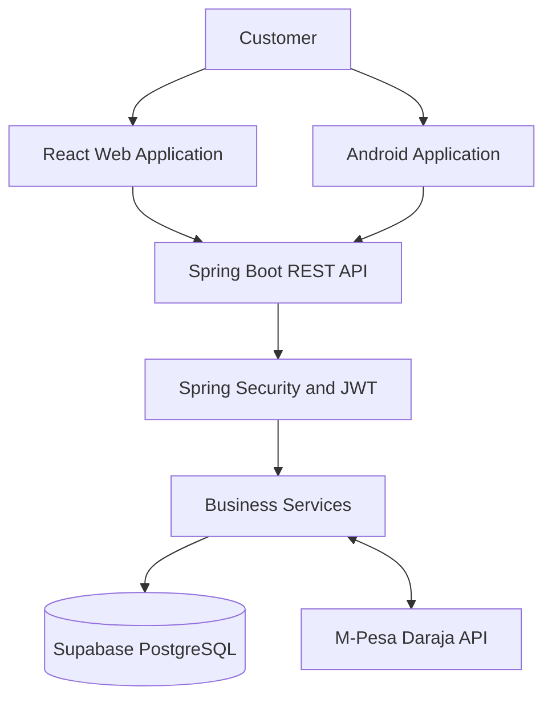

# FinPay — Digital Payments Platform

<p align="center">
  **A full-stack digital payments platform built to simplify account management, money transfers and payment experiences.**
</p>

<p align="center">
  <a href="https://finpay-web-cyan.vercel.app">Live Application</a> ·
  <a href="https://finpay-api-wszn.onrender.com">Backend API</a> ·
  <a href="https://github.com/cephcroidson/-FinPay">GitHub Repository</a>
</p>

<p align="center">
  
  
  
  
  
  
</p>

---

## Overview

FinPay is a full-stack fintech project designed around digital account management, secure authentication, financial transactions and payment integration.

The platform explores the development of modern payment systems within the Kenyan financial technology ecosystem, with M-Pesa integration as a key payment channel.

The project brings together software engineering, business analysis, UI/UX design, cybersecurity, quality assurance and deployment.

## Key Features

- User registration, login and authenticated access.
- Account management and dashboard.
- Deposits, withdrawals and account transfers.
- Transaction history and tracking.
- M-Pesa STK Push integration.
- Protected application routes and account-level authorisation.
- Responsive web interface.
- Kotlin-based Android application module.

## Technology Stack

| Component | Technologies |
|---|---|
| Frontend | React, TypeScript, Vite |
| Styling | Tailwind CSS |
| Backend | Java 25, Spring Boot 4 |
| Security | Spring Security, JWT, BCrypt |
| Database | PostgreSQL, Supabase |
| ORM | Spring Data JPA, Hibernate |
| Migrations | Flyway |
| Mobile | Kotlin, Android, Jetpack Compose |
| Payments | M-Pesa Daraja API |
| Infrastructure | Docker, Docker Compose |
| Deployment | Vercel, Render, Supabase |
| Version Control | Git, GitHub |

## System Architecture

FinPay follows a client-server architecture. Web and mobile clients communicate with the Spring Boot API, which handles business logic, security, database operations and payment integrations.



## Live System

| Service | Platform | Address |
|---|---|---|
| Web application | Vercel | [FinPay Web](https://finpay-web-cyan.vercel.app) |
| Backend API | Render | [FinPay API](https://finpay-api-wszn.onrender.com) |
| Database | Supabase | PostgreSQL |

## Repository Structure

```text
FinPay/
├── backend/          # Spring Boot REST API
├── frontend/         # React web application
├── mobile/           # Kotlin Android application
├── database/         # Database migrations and backups
├── integrations/     # External payment integrations
├── infrastructure/   # Docker and deployment resources
├── scripts/          # Development scripts
├── docs/             # Project documentation
└── README.md
```

## Local Development

**Prerequisites:** Java 25, Node.js, npm, Docker and Git.

```bash
# Clone the repository
git clone https://github.com/cephcroidson/-FinPay.git
cd FinPay

# Start the local database
docker compose up -d postgres

# Start the backend in one terminal
cd backend/finpay-api
./mvnw spring-boot:run

# Start the frontend in another terminal
cd ~/FinPay/frontend
npm install
npm run dev
```

Configure the required database, JWT and payment-provider environment variables before starting the backend. Configure `VITE_API_BASE_URL` for the frontend. Never commit credentials or secrets.

## Project Status

FinPay has a deployed web application, backend API and managed PostgreSQL database, with an Android development module and supporting engineering work.

The project continues to evolve through implementation, testing, documentation and technical improvements. Individual capabilities should be evaluated against their implementation and test evidence.

## Disclaimer

FinPay is a software engineering and demonstration project. It is not a licensed bank or independently authorised financial institution. Real-world financial services require appropriate regulatory approval, provider authorisation, security assessment and operational validation.

---

<p align="center">
  **FinPay — Connecting accounts, payments and technology.**
</p>
